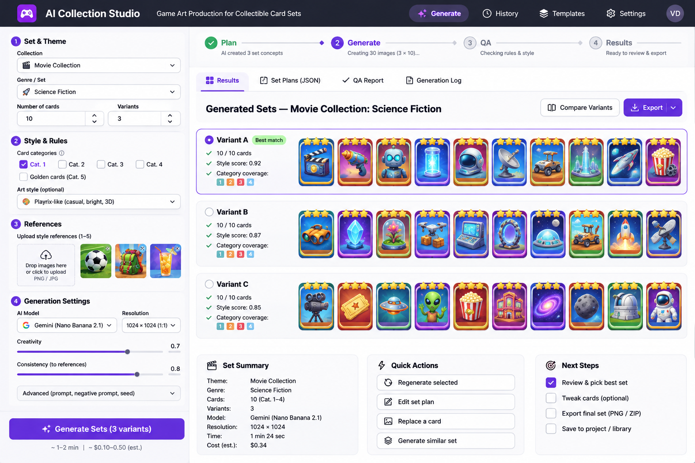
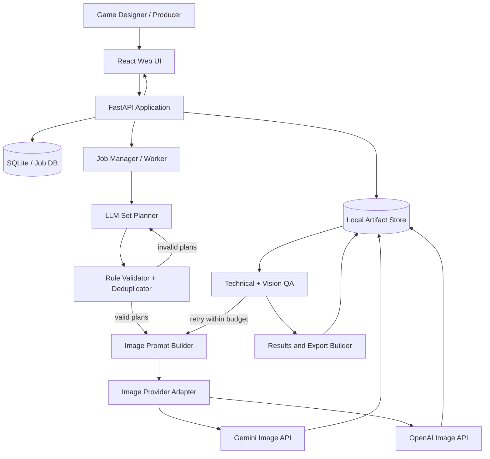

# Playrix AI Producer — Collection Studio
## Source of Truth / Product Requirements + UX + Technical Design + Execution Plan

**Версія:** 1.0 (первинна повна специфікація)  
**Дата:** 4 листопада 2026 року  
**Статус:** `PROPOSED / NOT IMPLEMENTED`  
**Власник концепції:** кандидат на роль AI Producer  
**Мова робочого документа:** українська; назви кнопок, об'єктів та API — англійською  
**Мета:** єдиний документ для розробки, делегування AI coding agent, перевірки scope та підготовки презентації результатів тестового завдання.

> **Головне правило:** цей документ навмисно розрізняє **[P] вимогу Playrix**, **[U] побажання користувача / автора концепції**, **[D] запропоноване дизайн-рішення**, **[A] припущення, що потребує перевірки**, **[F] можливе майбутнє розширення**. Не можна подавати [D], [A] чи [F] як вимоги роботодавця.

> **Обмеження достовірності:** технічна система ще не розроблена й не протестована; скетч UI — візуальна концепція, а не робочий застосунок. Наведені метрики, вартості, оцінки якості, тривалості та ілюстрації в скетчі — приклади, а не фактичні результати тесту.

---

# 0. Executive summary / рішення в одному абзаці

**Collection Studio** — локальний або вебдоступний інструмент, у якому геймдизайнер/продюсер задає тематику, жанр, необов'язкові побажання і стильові референси, вибирає модель та налаштування й натискає **Generate Sets**. Система спочатку формує **3–5 різних тематично цілісних планів набору**, перевіряє правила категорій і дублікати, потім генерує **по 10 artwork-зображень для кожного плану**, оцінює структурні й візуальні критерії, повторно створює проблемні зображення в межах бюджету та показує всі варіанти для порівняння. Користувач може оглянути набори, замінити окрему картинку, вибрати найкращий варіант і експортувати PNG/ZIP + метадані. **Основним артефактом є artwork окремих карток; автоматичне складання ігрових рамок не є вимогою тесту.**

## 0.1 Пріоритети

1. **P0 — product/art match:** відповідність референсному стилю, принципам композиції та логіці сетів.
2. **P0 — автономність:** інша людина може пройти від input до output без участі автора.
3. **P0 — output:** 3–5 повних варіантів набору на один запит; три нові тематичні набори для демонстрації.
4. **P0 — прозорість:** фіксація планів, промптів, моделей, спроб, критеріїв оцінки й рішень.
5. **P1 — зручний Web UI:** зрозумілі поля, референси, стан генерації, gallery, regeneration, export.
6. **P2 — універсальний генератор усіх типів ігрового арту:** не входить у перший MVP.

## 0.2 MVP у числах

- [P] Один набір (`set`) містить **10 карток**.
- [P] Одна колекція загалом містить **16 наборів**; **16-й — спеціальний золотий**.
- [P] Генератор повертає **3–5 варіантів одного замовленого набору**.
- [P] Демонстраційна тема — **«Кіно-колекція»**.
- [P] Треба створити **3 різні набори** на тему різних кіножанрів, **без золотих карток**.
- [D] Для демонстрації: 3 жанри × 3 альтернативи на жанр × 10 карток = **90 первинних зображень** (плюс можливі регенерації); фінально в Miro обрати 3 × 10 = **30** карток.
- [A] Точне обов'язкове співвідношення категорій 1–4 в наборі не задане текстом: його треба встановити аналізом фреймів і погодити як конфігурацію; **не вигадувати квоти**.

---

# 1. Джерела, походження вимог, статус

| Джерело | Що містить | Статус |
|---|---|---|
| Офіційна вакансія: https://playrix.com/job/open/game-design/ai-producer | Роль AI Producer | URL наданий користувачем; прямий текст сторінки не відобразився у вебперегляді |
| Дзеркало вакансії: https://www.gamejobsuk.com/playrix/ai-producer-5409 | Задачі та вимоги ролі | Перевірено вебпошуком 04.11.2026; незалежне від офіційного сайту дзеркало |
| Дзеркало: https://gamejobs.co/AI-Producer-at-Playrix | Задачі та вимоги ролі | Додаткове підтвердження |
| 6 скриншотів Miro/документів, наданих користувачем у цьому чаті | Власне тестове ТЗ, опис колекції, правила категорій, референси, шаблон для демонстрації | Первинне джерело вимог тесту |
| Побажання користувача в цьому чаті | HTML/Web UI, upload refs, dropdown моделей, роздільність, Generate, gallery, output | Первинне джерело концепції продукту |
| Згенерований раніше UI-скетч | Дизайн лівої панелі налаштувань, правої галереї та status bar | Ілюстрація, не технічний контракт |
| Gemini Docs: https://ai.google.dev/gemini-api/docs/image-generation та https://ai.google.dev/gemini-api/docs/pricing | Доступні image API та тарифікація | Перевірено 04.11.2026; перевіряти повторно перед реалізацією |
| OpenAI: https://developers.openai.com/api/docs/guides/image-generation | Image API, модельні режими, editing і output settings | Перевірено 04.11.2026; перевіряти перед реалізацією |

**Порядок пріоритету при конфлікті:** оригінальне тестове Playrix → зауваження замовника → факт із референсів → цей документ → код/макет. Якщо код не відповідає ТЗ, виправляємо код або обґрунтовано коригуємо вимогу; не переписуємо заднім числом оригінальне завдання.

## 1.1 Вакансія — AI Producer (стислий зміст, не дослівна копія)

**Компанія:** Playrix. **Роль:** AI Producer. **Формат:** remote або офіс, згідно з описом вакансії.

**Завдання ролі:**

- Шукати можливості впровадження AI на різних етапах виробництва й розвитку ігор.
- Запускати AI-ініціативи: постановка проблеми → гіпотеза → архітектура → експеримент → інтеграція у робочі процеси.
- Вибирати моделі та інструменти під конкретні задачі, будувати/покращувати AI pipelines.
- Оцінювати якість результату відповідно до стилю й продуктових вимог.
- Працювати з продюсерами, художниками, інженерами та доменними спеціалістами.
- Вимірювати вплив на швидкість, якість, витрати, продуктові метрики.
- Досліджувати нові AI-можливості та доводити корисні до практичного використання.

**Вимоги до кандидата:** досвід game development та повного циклу виробництва контенту; практичне самостійне впровадження AI; побудова pipeline і вибір моделей; вміння оцінювати game art. **Nice-to-have:** casual mobile games, зокрема Match-3. Це **бажано**, а не формально обов'язково.

**Висновок для тестового:** оцінюється не тільки програмування чи «красиві картинки», а **production-minded автоматизація**, вимірювана якість та придатність рішення для іншого користувача.

---

# 2. Оригінальне тестове завдання — зміст, зафіксований зі скриншотів

> Це структурований конспект російськомовного ТЗ з наданих зображень, а не побуквена транскрипція. Де важлива точність, вказано формулювання з оригіналу.

## 2.1 Мета тесту [P]

1. Перевірити вміння швидко та якісно виконати «продуктовий заказ» за допомогою AI.
2. Перевірити усвідомлену побудову AI pipeline під конкретну задачу й доведення результату до рівня, близького до production.

## 2.2 Deliverables від Playrix [P]

- Проаналізувати **ідейні й художні принципи** формування наборів: добір об'єктів, внутрішня логіка, композиція, стиль, повторюваність.
- На основі описів та графічних референсів зробити інструмент/пайплайн **автоматичного виробництва зображень для колекційних карток**.
- Інструмент має приймати **тему набору** і **«вільні побажання» продюсера**.
- На виході — **3–5 варіантів замовленого набору**, тобто груп зображень/карток, а не лише 3–5 варіантів однієї картинки.
- Створити за допомогою інструмента **три різні набори** на тему **«Кіно-колекція»**, що відображають різні жанри фільмів, **без золотих карток**.
- Зробити порівняння власних результатів із референсними наборами — **продуктове** та **візуальне**, із посиланням на принципи власного аналізу.
- Розмістити **весь процес і результати на наданій Miro-дошці**.
- Надати **GitHub-посилання на код / створені skills / pipeline**.

### Важливе обмеження, яке впливає на scope

Оригінальний текст: **«именно картинки объектов как во фрейме “Примеры карточек”, верстать окна не требуется, просим “подставить” карточки в готовые наборы вручную»**.

**Інтерпретація:**

- **In scope:** генерувати самі ілюстрації для карток, придатні до вставлення в існуючі шаблони.
- **Out of mandatory scope:** будувати нові великі collection windows, перемальовувати UI гри, автоматично верстати цілі ігрові екрани.
- **Optional:** зробити технічний preview «як виглядатиме арт у рамці» або contact sheet, але не витрачати на це основну частину роботи.
- **Для фінальної Miro-подачі:** вставити вибрані PNG у готові рамки/вікна руками, як просить завдання.

## 2.3 Критерії оцінювання Playrix [P]

1. Технічна якість + продуктово-артова якість.
2. Уміння витягнути з референсів **смислотворчі принципи** й перенести їх до AI-системи.
3. Наскільки результат вписується в наданий художній стиль.
4. Наскільки добре кандидат бачить і пояснює ідейні та візуальні нюанси референсів.
5. Архітектура й **автономність**: чи зможе геймдизайнер користуватися інструментом без автора.

**Контрольне питання для артчастини:** чи можна показати новий набір поруч із референсними так, щоб гравець не відчув різниці в художній та ідейній системі? Це якісна ціль, **не гарантія** і не автоматично обчислюваний факт.

## 2.4 Принципи виконання тесту [P]

- Максимальна автономність пайплайна; мінімальне ручне втручання.
- Дослідити доступні публічні моделі/інструменти; перша спроба не обов'язково найкраща.
- Показати шлях: інструменти, промпти, ітерації, причини вибору рішення.
- Самостійно шукати підходи; роботодавець не надає власних моделей або LoRA.

---

# 3. Як влаштовані колекції та набір карток [P]

## 3.1 Ієрархія контенту

```text
Collection («Кіно», «Літо», «Подорожі»...)
└── 16 thematic sets / наборів
    ├── Set 1: theme A — 10 cards
    ├── Set 2: theme B — 10 cards
    ├── ...
    ├── Set 15: theme O — 10 cards
    └── Set 16: special golden culmination — 10 golden cards
```

Кожен набір має виразну вузьку тему і не дублює інші набори тієї самої колекції. У межах набору кожна картка представляє **інший об'єкт**, пов'язаний із темою.

Приклади тем у наданих референсах: `Gardens`, `Sports`, `Finals`, `Amusement`, `Coolness`, `Countrystead`, `Seafaring`, `Boyscoute`, `Vacation`, `Beach`, `Music Fest`, `Diving`, `Road Trip`, `Poolside`, `Tour`, `Summer Party`. Вони ілюструють **принцип широка тема → різні підтематики → унікальні предмети**, а не список, який слід відтворити для кіно.

**Увага:** одна і та сама побутова річ іноді може бути тематично придатна для кількох сетів. Це не означає, що її слід повторювати в одній колекції. Планувальник повинен перевіряти **семантичне перетинання** між запропонованими сетами.

## 3.2 Категорії арту — точна логіка з референсів

| Категорія | Роль об'єкта | Тло / поверхня | Типова композиція | Важливе обмеження |
|---|---|---|---|---|
| **1** | Простий об'єкт без дрібної деталізації | Об'єкт **висить у повітрі**; однотонний / градієнтний / простий візерунковий фон | Один головний предмет, дуже читабельний силует | Не додавати кімнату чи реалістичну землю |
| **2** | Простий об'єкт без дрібної деталізації | Об'єкт стоїть на поверхні; задня вертикальна площина або простий фон | Предмет + опора; стриманий контекст | Не переходити у складну сцену |
| **3** | Об'єкт на реалістичній поверхні | Об'ємний/просторовий фон, виразний передній план | Предмет вписаний у більш предметне середовище | Об'єкт усе ще головний |
| **4** | Центральний об'єкт у повноцінному середовищі | Впізнавана оточуюча обстановка | Сценка зі зрозумілою локальною історією | Об'єкт не губиться в декораціях |
| **5** | Золота картка з одним/двома персонажами у гумористичній емоційній ситуації | Простір рівня кат. 4 | Персонажі — композиційний центр | **Не генерувати в трьох тестових Movie-сетах** |

**Нюанс:** «реалістична поверхня/оточення» означає об'ємний і правдоподібний контекст **усередині стилізованого casual game art**, а не перехід до фотографічного реалізму.

### Чого не можна припускати без аналізу скриншотів

- Не встановлювати квоту на категорії (наприклад, «2,2,3,3») як вимогу Playrix, поки це не перевірено на оригінальних фреймах.
- Кількість зірок, оформлення рамок і рідкість картки не тотожні автоматично категорії артової композиції. У ТЗ прямо сказано, що **рідкість сама по собі не впливає на зображення предмета**.
- Golden Cards мають окрему логіку; в демонстрації вони заборонені, навіть якщо загальна система згодом їх підтримуватиме.

## 3.3 Семантичні принципи, які треба показати в аналізі

1. **Thematic coherence:** усі 10 елементів утворюють одну зрозумілу підтему.
2. **Visual progression:** від простого об'єкта до складнішої предметної ситуації залежно від категорії.
3. **Unique silhouettes:** об'єкти не повторюються й не виглядають як незначні варіації одного предмета.
4. **Instant recognition:** назву картки можна вгадати за маленьким прев'ю.
5. **Casual readability:** виразна форма, чистий колір, невеликий візуальний шум.
6. **Cohesive art direction:** узгоджені рендер, об'ємність, світло, контраст, матеріали, рівень стилізації.
7. **Emotional appeal:** добір об'єктів створює цікавість/асоціації, а не механічний перелік речей.
8. **Collection-wide non-overlap:** новий сет додає нову грань великої теми, а не дублює інші сети.

Ці принципи мають бути оформлені як **Art & Product Rubric**, а не залишатися лише текстовими висновками в Miro.

---

# 4. Початковий запит автора концепції [U]

Автор тестового запропонував:

- Зробити **HTML/Web-сторінку** з дружнім користувацьким інтерфейсом.
- Дозволити користувачу **завантажувати іконки/картинки як референси**.
- Мати **prompt / free wishes** і налаштування в UI.
- Мати **dropdown із типом asset**: іконки предметів, артефакти, об'єкти, інші іконки, заставки тощо.
- Мати **dropdown AI-моделі** (Gemini або OpenAI).
- Мати **dropdown resolution**, кількість варіантів, інші параметри.
- Мати зрозумілу кнопку **Generate**.
- Викликати **під капотом API або workflow**, які автоматично створюють зображення.
- Показувати **output у вікні галереї** й давати можливість експортувати результати.
- Спроєктувати рішення так, щоб згодом його можна було **масштабувати**.

**Уточнений product statement:** користувач не повинен розуміти промпт-інжиніринг або Python. Він має замовляти **набір ігрових карток як продуктову одиницю**, а не запускати непов'язані генерації окремих картинок.

## 4.1 Рамки MVP [D]

**Включити:** `Collectible Card Set` як головний/єдиний активний asset type.  
**Не реалізовувати в першому релізі:** Splash Screen Generator, Character Sheet Generator, UI Background Generator, Animation Generator.  
**Архітектурно закласти:** плагінний механізм `AssetType`, щоб інші продукти можна було додати пізніше без переписування всього UI.

---

# 5. Користувачі, ролі, jobs-to-be-done

## 5.1 Primary persona: Game Designer / Content Producer

**Задача:** «Я хочу отримати 3–5 цілісних ігрових наборів для теми X, з дотриманням style guide, щоб вибрати найкращий і вставити арт у гру».

Не повинен:
- писати API-запити;
- знати JSON;
- самостійно придумувати кожен об'єкт;
- зберігати промпти в десяти різних сервісах;
- запускати Python-скрипти вручну;
- перегенеровувати всі 10 зображень через одну невдалу картку.

## 5.2 Secondary persona: Art Lead / AI Producer

Може переглядати повний план, коригувати композицію, перемикати модель, оцінювати style adherence, вручну відхиляти/приймати artwork, аналізувати вартість/час/якість.

## 5.3 Ключові Jobs-to-be-Done

- `JTBD-01`: швидко створити новий логічно цілісний набір.
- `JTBD-02`: отримати варіанти з різними ідеями, а не випадкові дублі.
- `JTBD-03`: зберегти стиль референсів.
- `JTBD-04`: замінити лише невдале зображення, не втрачаючи прогрес.
- `JTBD-05`: експортувати готові файли для Miro / графічного production.
- `JTBD-06`: відтворити й пояснити, звідки взявся кожен результат.

---

# 6. UX / докладний опис UI-скетчу

**Скетч:** `Playrix_Collection_Studio_UI_Sketch.png` (у комплекті з цим MD).  
**Призначення:** орієнтир композиції сторінки та користувацького досвіду, **не дизайн-файл, не готовий frontend**.



## 6.1 Загальна структура сторінки

```text
┌────────────────────────────────────────────────────────────────────────────┐
│  Logo   AI Collection Studio   [Generate]  [History] [Templates] [Settings]│
├────────────────────────────┬───────────────────────────────────────────────┤
│ LEFT: REQUEST / SETTINGS   │ TOP: [Plan] → [Generate] → [QA] → [Results]    │
│                            ├───────────────────────────────────────────────┤
│ 1. Set & Theme             │ TABS: Results | Set Plans | QA | Log          │
│   Collection [dropdown]    │                                               │
│   Genre / Set [dropdown]   │ Generated Sets — Movie Collection            │
│   Number of cards [10]     │                                               │
│   Variants [3–5]           │ Variant A: [10 artwork thumbnails]           │
│                            │ Variant B: [10 artwork thumbnails]           │
│ 2. Style & Rules           │ Variant C: [10 artwork thumbnails]           │
│   Category selection       │                                               │
│   Golden cards [off]       │ [Compare Variants] [Export]                   │
│   Art style [preset]       │                                               │
│                            │ Bottom: [Set Summary] [Quick Actions]        │
│ 3. References              │         [Next Steps]                          │
│   Upload PNG/JPG           │                                               │
│   Reference previews       │                                               │
│                            │                                               │
│ 4. Generation Settings     │                                               │
│   Model [dropdown]         │                                               │
│   Resolution [dropdown]    │                                               │
│   Quality / Cost cap       │                                               │
│   Advanced [expand]        │                                               │
│                            │                                               │
│ [ GENERATE SETS ]          │                                               │
└────────────────────────────┴───────────────────────────────────────────────┘
```

## 6.2 Header / top navigation

- **AI Collection Studio** — назва продукту й перехід до стартової сторінки.
- **Generate** — почати нове замовлення / перейти до лівої панелі; не має бути окремим способом запуску з іншою логікою.
- **History** — історія всіх запусків (`jobs`) з датою, моделлю, темою, результатом.
- **Templates** — пресети правил і жанрів (можна відкласти до P1).
- **Settings** — конфігурація API-ключів *на сервері*, default модель, budget cap, шляхи зберігання.
- **User indicator** — у локальному MVP це може бути просто `Local User`; логін необов'язковий.

## 6.3 Ліва панель: `1. Set & Theme`

| Поле | Тип | Default | Валідація / поведінка |
|---|---|---|---|
| `Collection` | Dropdown або text with presets | `Movie Collection` | Обов'язкове; назва колекції |
| `Genre / Set` | Dropdown + `Custom` | `Science Fiction` | Обов'язкове; може бути довільним текстом |
| `Number of cards` | Number | **10** | Для Playrix preset **зафіксувати 10**; зміну показувати тільки у generic future mode |
| `Variants` | Number / segmented 3,4,5 | **3** | Обов'язково 3–5 **повних наборів** |
| `Producer wishes` | Textarea | Порожньо | Вільні побажання, напр. «retro-futuristic, lighthearted, no violence» |

**Рекомендація:** «Collection» задає широку тему, «Genre / Set» — підтему. Заміна genre не повинна затирати вже завантажені референси без підтвердження.

## 6.4 Ліва панель: `2. Style & Rules`

- `Category profile` — preset `Playrix Reference Rules v1`.
- `Categories 1–4` — **всі увімкнені за замовчуванням** у Movie test mode.
- `Golden cards (Cat. 5)` — **вимкнено й заблоковано** в demo workflow.
- `Category quotas` — вкладка Advanced; лише після аналізу й ручного затвердження фактичних квот із референсу.
- `Art style` — збережений `Style Bible / Style Profile` (напр. `Reference Match v1`), не «довільний Playrix-like» як єдине правило.
- `Additional constraints` — напр. `no text in artwork`, `avoid cropped subjects`, `no duplicates`.

**Коригування скетчу:** на створеній ілюстрації в рядку категорій візуально активна лише Cat. 1. Для реального продукту це невірний default; **всі Cat. 1–4 мають брати участь** у створенні повного тестового набору відповідно до визначеного profile.

## 6.5 Ліва панель: `3. References`

- Drag-and-drop поле `Upload style references`.
- Кнопка `Browse files`.
- Preview кожного завантаженого PNG/JPEG/WebP з ім'ям, типом і кнопкою видалення.
- Опційний тип референсу: `Style`, `Category 1`, `Category 2`, `Category 3`, `Category 4`, `Composition`, `Negative example`.
- На backend: MIME validation, межа розміру, обмеження кількості (залежить від API), створення thumbnail.
- `Use project references` — вибрати раніше додані референси без повторного upload.
- `Reference manifest` — файл із власним ID, хешем, типом і джерелом кожного референсу.

**Важливо:** заборонено автоматично завантажувати на сторонній сервіс референси, на використання яких немає дозволу. Для тестового треба перевірити правила використання виданих роботодавцем матеріалів і умови відповідного AI API.

## 6.6 Ліва панель: `4. Generation Settings`

| Поле | UX | Що відбувається насправді |
|---|---|---|
| `Image Model` | Dropdown | Вибір з реально підтримуваних provider/model adapters |
| `Resolution` | Dropdown | Список допустимих розмірів **для обраної моделі**, а не довільні значення |
| `Quality` | Dropdown | Показати лише якщо provider підтримує цю опцію |
| `Creativity` | Advanced slider або `Conservative / Balanced / Exploratory` | Універсального «creativity API parameter» у image API може **не бути**; це наш preset формулювання промптів / генерації планів |
| `Reference adherence` | Advanced preset | Не видавати за гарантований API strength; реалізовувати через промпти, ref selection, editing та QA |
| `Max retries / card` | Number | Встановлює budget і stop condition |
| `Max job cost` | Currency | Soft/hard budget cap для API usage |
| `Seed` | Advanced optional | Показувати **лише якщо підтримується обраною моделлю** |
| `Parallel jobs` | Advanced | Backend concurrency, без перевищення provider limits |

**За замовчуванням Advanced згорнуто.** Геймдизайнер не повинен змінювати технічні параметри для типового запиту.

## 6.7 Кнопка `Generate Sets`

**До запуску:** активна, якщо обов'язкові поля заповнені, модель налаштована, reference policy прийнято. Показати preflight: `Theme`, `Genre`, `3 variants`, `30 initial images`, approximate cost/limit.

**Після натискання:**

1. Кнопка блокує випадковий повторний submit (idempotency key).
2. Створюється `generation job`.
3. У центральній частині — status `Planning → Generating → QA → Results`.
4. Лічильник `Generated 12/30`, `Passed QA 9/12`, `Retrying 2`, `Estimated/Actual cost` (лише якщо є точні дані).
5. Є `Cancel` і `Resume` (принаймні після оновлення сторінки); `Cancel` не гарантує відкликання вже відправлених API calls.

## 6.8 Права зона: Results / Gallery

- Заголовок `Generated Sets — Movie Collection: Science Fiction`.
- Секції `Variant A`, `Variant B`, `Variant C` (за потреби D/E).
- Кожен варіант показує **10 thumbnail artwork** у порядку карток, не 10 випадкових файлів.
- Кожна картка має назву об'єкта, категорію, status (Passed / Flagged / Failed), кнопку `View`.
- `Variant summary`: coverage, кількість pass/fail, об'єктивні перевірки, **суб'єктивна AI-оцінка з поясненням**, не магічний «95% perfect».
- `Compare Variants` — side-by-side 3–5 сетів з однаковим масштабом прев'ю.
- `Export` — ZIP повного вибраного набору + JSON metadata; кнопка окремих PNG.
- `Select as final` — зберігає вибір, не видаляє інші варіанти.

**Важливо:** зображення рамок, зірок і UI, намальовані в скетчі, **не повинні трактуватися як output за вимогою Playrix**. Для технічного MVP у gallery показувати artwork; overlay у рамці — необов'язковий режим перегляду, який не входить в output.

## 6.9 Tabs

- **Results:** галерея artwork, статуси, результати.
- **Set Plans:** список 3–5 планів, кожен по 10 іменованих карток із категоріями, описом і логікою.
- **QA Report:** чіткі rules, автооцінки, відхилені картки й причини.
- **Generation Log:** model ID, prompt version, input reference IDs, timestamps, retries, API errors, обчислені витрати.

## 6.10 Quick Actions

- `Regenerate selected` — повторити лише виділені картки, використовуючи ті самі constraints.
- `Edit set plan` — змінити назву/об'єкт/категорію до регенерації; після цього план одержує нову версію.
- `Replace a card` — завантажити готову власну ілюстрацію замість generated.
- `Generate similar set` — нове замовлення, що успадковує style profile, але не самі об'єкти.
- `Export approved set` — отримати готові artwork.

## 6.11 Важливі стани інтерфейсу

- `Empty` — користувач бачить приклад і підказку.
- `Validating` — перевірка даних.
- `Ready to generate` — показано бюджет і кількість файлів.
- `Queued` — стоїть у черзі.
- `Planning` — AI створює set plans.
- `Plan validation failed` — пропонуються автоматичне перепланування або ручне редагування.
- `Generating images` — прогрес по картках.
- `QA / retrying` — пояснити які саме картинки не пройшли.
- `Partial success` — зберегти все успішне, не губити роботу.
- `Complete` — результати + експорт.
- `Cancelled` / `Failed` — з історією та можливістю відновлення.

## 6.12 Accessibility / layout behavior

- Desktop-first, мінімальний підтримуваний робочий viewport: орієнтовно 1280px.
- Ліва колонка fixed/collapsible, права fluid. На вузькому екрані — вертикальний stack.
- Keyboard navigation, зрозумілі labels, progress/status не тільки кольором.
- Текстові помилки: `What happened → what can be done`.
- Для кожної іконки — відкриття на повний розмір (lightbox).
- Не приховувати витрати чи відхилені результати в debug-only режимі.

## 6.13 Що на скетчі лише демонстраційне

1. `Style score 0.92`, `0.87`, `0.85` — **випадкові макетні числа**, не вимірювання.
2. `Time: 1m 24s`, `Cost: $0.34`, `~1–2 min` — **не є прогнозом продуктивності**.
3. Наявні в ілюстрації назви моделей, роздільності, панелі й зірки — концепт; реальний UI треба прив'язати до API capabilities і вимог тесту.
4. Preview-картки візуально можуть мати різні рамки/зірки; основна система має працювати з artwork незалежно від рамок.
5. Скетч **не доводить**, що такий результат можна автоматично згенерувати із потрібним рівнем art direction.

---

# 7. End-to-end user journey — очима звичайного користувача

## Scenario A: «Хочу три варіанти Sci-Fi-набору»

1. Відкриваю `http://localhost:3000` (або deployment URL).
2. Бачу `AI Collection Studio`; зліва — параметри, справа — порожню галерею / історію.
3. Вибираю `Collection = Movie Collection`.
4. Вибираю `Genre = Science Fiction`.
5. Бачу, що `Cards = 10`, `Golden cards = Off`.
6. Встановлюю `Variants = 3`.
7. У `Producer wishes` пишу, наприклад: `Lighthearted retro science fiction, recognizable movie tropes, no logos, no weapons as central theme`.
8. Завантажую 3–5 style references з наданих матеріалів; можу позначити кожному category-specific призначення.
9. Вибираю AI-модель і допустиму resolution.
10. Натискаю `Generate Sets`.
11. На екрані з'являються етапи Planning, Image Generation, QA.
12. У `Set Plans` за потреби переглядаю, які саме 10 об'єктів система обрала для кожного з трьох сетів.
13. У `Results` бачу `Variant A/B/C`, кожен по 10 artwork, назви, категорії, позначені помилки.
14. Відкриваю невдалу картинку → `Regenerate this card`, обираю одну з нових версій.
15. У `Compare` зіставляю три набори.
16. Натискаю `Select as final` на найкращому.
17. Натискаю `Export` → ZIP із 10 artwork PNG, manifest JSON, коротким QA report.
18. Вставляю вибрані artwork **вручну** у Playrix-шаблон набору в Miro.

## Scenario B: «Потрібен ще один жанр без повторення елементів»

1. Обираю `New Set` → `Detective & Mystery`.
2. Встановлюю `Avoid previously used objects = On` і вибираю вже створені sci-fi set plans як exclusion context.
3. Залишаю той самий style profile.
4. Натискаю `Generate Sets` і отримую нову групу варіантів, не змінюючи базові промпти вручну.

## Scenario C: «Усе добре, крім 1 зображення»

1. Відкриваю картку.
2. Бачу original prompt, preview і QA issues.
3. Уточнюю `Keep object, simplify background, use composition Cat. 2`.
4. Натискаю `Regenerate this card only`.
5. Система зберігає стару та нову версії; не зачіпає інші дев'ять карток.

## UX acceptance criteria

- Новий користувач може пройти happy path без термінала/коду.
- Можна отримати 3–5 **повних** варіантів у рамках одного запуску.
- У кожному варіанті доступно рівно 10 іменованих карток.
- Зрозуміло, що вже готово, що виконується, що зламалося і що було перегенеровано.
- Можна повторити тільки один об'єкт.
- Є коректний export у PNG/ZIP і можливість переглянути план/історію.
- Після refresh браузера вже збережені результати не пропадають.

---

# 8. Цільова архітектура

## 8.1 Architecture principles

1. **Artwork-first:** генеруємо предметні зображення, а не відбудовуємо весь game UI.
2. **Plan before paint:** спочатку об'єктний план сету, потім image generation.
3. **Structured outputs:** план у типізованому JSON, а не в довільній прозі.
4. **Provider-agnostic core:** Gemini, OpenAI та інші image engines мають однаковий внутрішній інтерфейс.
5. **Deterministic validation where possible:** структурні речі перевіряє код, а не LLM.
6. **Model-based judgment where unavoidable:** художні оцінки здійснює мультимодальна модель із поясненням та можливістю ручного перегляду.
7. **Non-destructive iterations:** старі зображення/промпти ніколи не зникають після Regenerate.
8. **Budget-awareness:** контроль кількості спроб та фактичної вартості.
9. **Reproducibility by provenance:** повністю відтворити стохастичне зображення може бути неможливо; натомість ми зберігаємо всі інпути, параметри і версії.
10. **MVP first, production-ready boundaries:** у MVP просте середовище, але чіткі модулі.

## 8.2 High-level component diagram



**Ключове рішення:** планування, генерація та QA — **різні модулі**. Зміна провайдера зображень не повинна змінювати правила формування тематичного набору.

## 8.3 Конкретний рекомендований MVP stack [D]

| Шар | Технологія | Чому саме так | Майбутня альтернатива |
|---|---|---|---|
| UI | React + TypeScript + Vite | Простий локальний SPA, швидкий прототип | Next.js при SSR/аккаунтах |
| UI components | Tailwind + простий component kit | Швидке оформлення скетчу | Власна дизайн-система |
| Backend API | Python + FastAPI | Простий API, структурні моделі, зручна інтеграція з image libraries | Django/FastAPI production |
| Validation/data contracts | Pydantic | Перевірка JSON, schema, типів, business rules | — |
| Persistence | SQLite | Легкий single-user MVP | PostgreSQL |
| File storage | `data/` volumes | Проста локальна структура, backup | S3-compatible object storage |
| Image handling | Pillow | Resize/convert/thumbnail/contact sheets, metadata | Sharp або image workers |
| Planning LLM | Configurable Gemini/OpenAI text model | Легко повертати structured plan | інша LLM через adapter |
| Image generation | Gemini Nano Banana 2.1, alternative OpenAI | Reference-aware image generation | FLUX/ComfyUI/local |
| Vision QA | Відокремлений multimodal evaluator | Фінальна перевірка не тільки файлів, а й композиції | Human review + custom rubric |
| Worker | Окремий Python worker process + SQLite job state | Не блокує HTTP; достатньо для однієї машини | Redis Queue/Celery/RQ |
| Packaging | Docker Compose | Один запуск UI+API+worker; легко віддати GitHub | Cloud deployment |
| Testing | pytest + Playwright або UI tests | Перевірка API, бізнес-правил, happy path | CI pipeline |
| Documentation | Markdown, OpenAPI, Miro | Зрозумілий handoff | — |

**Чому не голий HTML:** статичний HTML може відобразити UI, але не повинен зберігати API-ключі й виконувати довгі генерації прямо з браузера. React + окремий backend — керована реалізація цієї ж ідеї, а не відхід від неї.

**Чому не n8n у core:** n8n можна використати як зовнішній trigger/logging/notification orchestrator, але складні цикли карток, версіювання, QA та image operations простіше тестувати в Python. Якщо MVP вже працює через n8n, він може бути альтернативним адаптером, але це **не must-have**.

## 8.4 Logical modules / responsibility matrix

### `web-ui`

Рендерить форми, завантажує refs, показує статус і результати; **не спілкується з модельними провайдерами напряму**, не зберігає ключі.

### `api`

Перевіряє запити, працює з референсами/робочими проєктами, створює jobs, повертає результати, готує downloads.

### `job-manager`

Черга, обмеження паралельності, статус, resume, retry, cancel, budget.

### `reference-manager`

Зберігає оригінальні ref файли, thumbnails, типи refs, SHA-256 hashes, правомірність/контекст використання, роздільність.

### `style-analyzer`

Створює **Style Bible** на основі reference set; пропонує текстові rules зі ступенем впевненості й прикладами. **Не вважати всі висновки моделі фактами:** людський перегляд на старті.

### `set-planner`

Створює 3–5 незалежних семантичних **планів**, по 10 різних карток.

### `rules-validator`

Перевіряє 10 карток, допустимі категорії, no golden, required fields, відсутність точних дублікатів, задані category quotas (якщо вони затверджені).

### `semantic-reviewer`

Перевіряє тематичну логіку, доречність кіножанру, приблизну семантичну неповторюваність; human review якщо неоднозначно.

### `prompt-compiler`

Перетворює структурований план і Style Bible на короткий, послідовний prompt для конкретної image-моделі.

### `image-generator` + `providers/*`

Знає як відправити refs, налаштування й промпт до конкретного API, як розібрати response, нормалізувати помилки й зберегти original response metadata.

### `image-postprocessor`

Перевіряє/нормалізує формат, створює preview, при потребі обрізає/зменшує зображення **без втрати важливого об'єкта**; зберігає оригінал.

### `art-qa`

Комбінує технічні правила, vision оцінку та (за потреби) ручний approval.

### `exporter`

Створює ZIP з artwork, manifest, JSON plans, QA report, generation log, thumbnails/contact sheets.

### `observability`

Реєструє job stage, timestamps, retries, provider, model ID, usage, costs, failures та ручні інтервенції.

## 8.5 Separation of concerns

**Що має бути жорстко в коді:** 10 карток; валідні категорії; Golden Off для Movie demo; унікальні card IDs; коректний формат зображення; файл існує й читається; export structure.

**Що має оцінювати LLM/vision:** чи є предмет логічним для жанру; чи не повторює інший предмет за змістом; чи відповідає картинка категорії; наскільки узгоджений стиль.

**Що має залишитися за людиною (принаймні у тестовій демонстрації):** остаточне прийняття набору, тонка артова оцінка поруч із референсами, добір трьох фінальних наборів для Miro.

---

# 9. End-to-end generation pipeline

## Stage 0 — Reference study / style onboarding

**Input:** видані Miro reference frames і описи.  
**Process:** візуально розібрати до 20–30 прикладів з категорій 1–4; порівняти силуети, material/lighting, фони, відстань до камери, прості/складні композиції, семантику.  
**Output:** `style_profile.json`, `reference_analysis.md`, приклади positive/negative.

**Обов'язково для Miro:** показати не лише назви категорій, а кілька зіставлень «правило → референс → наслідок для генерації».

## Stage 1 — Request validation

Перевірити: тема, жанр, variants 3–5, cards 10, refs придатні, API key існує, доступна модель/розмір, estimated max budget. Заблокувати запит із золотими картками для Movie demo.

## Stage 2 — Set concept planning

LLM отримує контекст колекції, вузький жанр, producer wishes, category profile і список уже використаних об'єктів. Створює **3–5 концептуально різних set variants**, кожен по 10 карток.

**Не можна:** створювати `Variant B` як ті самі 10 предметів із трохи зміненими кольорами. Це слабкий змістовий варіант.  
**Можна:** різні мікротеми в межах одного жанру, напр. у Sci-Fi: `Retro Space Expedition`, `Alien City`, `Future Laboratory`, якщо всі коректно представляють жанр.

## Stage 3 — Plan validation + revision

- Exactly 10 cards / variant.
- Names unique within variant.
- Allowed categories 1–4.
- No gold cards.
- Повний, осмислений тематичний зв'язок.
- Категорійні описи не суперечать один одному.
- Усі required properties є.
- Відсутні очевидні дублікати із попередніх наборів тієї самої колекції.
- Якщо plan invalid, зробити не більше `MAX_PLAN_RETRIES`, після чого показати проблему в UI.

## Stage 4 — Prompt compilation

Для кожної картки сформувати:

- `style prompt` — спільний для всього набору;
- `category prompt` — специфічна композиція 1/2/3/4;
- `object prompt` — конкретний предмет, призначення, форма;
- `background prompt` — фон/середовище категорії;
- `constraints` — без написів, без текстових UI-рамок, один центральний об'єкт тощо;
- `reference selection` — які референси релевантні саме цій категорії;
- `negative guidance` — чого уникати; враховувати, що не всі API мають окреме negative-prompt поле.

**Рекомендований базовий режим:** одна картка = один API image request. Генерація великої сітки 10 іконок одним зображенням ускладнює однакові пропорції, подальше редагування та управління якістю.

## Stage 5 — Image generation

- Розмістити requests у worker queue.
- На кожну card spec — одна первинна image generation.
- Зберегти binary output у незмінюваний file path.
- Записати provider, model ID, settings, prompt hash, reference hashes, usage/latency.
- Якщо provider відмовив — retry з exponential backoff лише для transient errors (429/5xx/network), не «сліпо» для неправильного prompt/model.
- Застосувати concurrency limit, погоджений із provider quota.

## Stage 6 — Technical QA

Перевірки без AI:

- файл відкривається;
- PNG/JPEG/WebP supported, вивід PNG;
- фактичні dimensions відповідають допустимим;
- image не порожній / не повністю прозорий / не corrupted;
- важливий об'єкт не обрізаний за наявності відповідного vision signal (самою Pillow цього не гарантувати);
- uniqueness file hashes;
- coverage потрібної кількості карток;
- правильне зіставлення image → card ID.

## Stage 7 — Art / Product QA

Vision evaluator бачить **зображення + card spec + category rubric + reference(s)**. Має повернути JSON з окремими критеріями, поясненням, evidence, suggested fix, confidence.

Особливо перевіряємо:

- відповідність тематичного предмета;
- композиція Cat. 1–4;
- стиль, матеріали, світло;
- чіткий силует і читабельність у thumbnail;
- чи не з'явилися зайві предмети / текст / випадкові логотипи;
- чи не перекривається об'єкт;
- чи збігається арт між картками набору.

**Увага:** vision model — не абсолютний суддя художнього стилю. Точки й пороги мають бути відкалібровані на ручній експертній оцінці; без калібрування показувати `Advisory AI score`, не `Pass guaranteed`.

## Stage 8 — Targeted retries

- **Необхідна реакція:** якщо одна з десяти карток не проходить QA, повторюємо **лише цю** картку.
- Використовуємо failed criteria, а не переписуємо весь prompt навмання.
- Обмеження: напр. `max 2 retries per card` — **запропонована стартова конфігурація, не вимога Playrix**.
- Якщо всі спроби вичерпані — маркуємо `NEEDS_REVIEW`, не маскуємо проблему.
- Результат retry має новий asset version; попередній зберігається.

## Stage 9 — Set-level QA

Після перевірки окремих зображень оцінюється **весь набір поруч**:

- однаковий art direction;
- відсутність візуальних дублювань;
- послідовність композицій за категоріями;
- широкий, але логічно пов'язаний вибір об'єктів;
- наскільки набір вписується в наданий референсний приклад.

Тут недостатньо 10 окремих `PASS`: індивідуально хороші іконки можуть погано виглядати разом.

## Stage 10 — User review + export

Користувач бачить 3–5 наборів, обирає, редагує/перегенеровує, затверджує фінальний; ZIP містить лише актуальні approved artwork plus full traceability.

## Stage 11 — Miro placement and comparison

Вставляємо фінальні 3×10 PNG у готові шаблони Playrix на Miro, показуємо порівняння з референсами й докладаємо raw images та звіт про pipeline.

---

# 10. Дані та формати

## 10.1 Core entities

```text
Project
  id, name, collection_theme, created_at, style_profile_id

ReferenceAsset
  id, project_id, file_path, sha256, kind, category_hint, source_label

StyleProfile
  id, version, visual_rules, forbidden_patterns, approved_refs

GenerationJob
  id, project_id, theme, subtheme, wishes, requested_variants,
  model_config, status, created_at, updated_at, total_cost

SetVariant
  id, job_id, index, variant_name, concept, status, version

CardSpec
  id, set_variant_id, position, name, category, object_description,
  composition, background, prompt, validation_status

ArtworkVersion
  id, card_spec_id, version, provider, model, prompt_hash,
  path_original, path_preview, generation_status, usage, latency_ms

QualityCheck
  id, artwork_version_id, evaluator, rubric_version,
  checks, score, confidence, issues, verdict

UserDecision
  id, user_id, entity_id, action, reason, timestamp

ExportBundle
  id, project_id, selected_variant_id, zip_path, created_at
```

## 10.2 Example JSON plan (одна картка, уривок)

```json
{
  "schema_version": "1.0",
  "project": "Movie Collection",
  "set_theme": "Science Fiction",
  "variant_id": "sci-fi-A",
  "variant_concept": "Retro Space Expedition",
  "cards": [
    {
      "id": "sci-fi-A-01",
      "position": 1,
      "name": "Space Helmet",
      "category": 1,
      "object_description": "Rounded retro astronaut helmet",
      "composition": "Single centered object floating in air",
      "background": "Simple blue radial gradient",
      "focal_object": "Space helmet",
      "no_gold": true,
      "reason_for_inclusion": "Recognizable tool of space exploration"
    }
  ]
}
```

**Це уривок для пояснення структури:** production schema вимагає **рівно 10 елементів** у `cards` для повного набору. Не можна приймати наведений приклад з 1 карткою як валідний план.

## 10.3 API contracts — proposed, not provider endpoints

| Method | Route | Purpose |
|---|---|---|
| `GET` | `/api/health` | Health check |
| `GET` | `/api/models` | Доступні моделі + capabilities |
| `GET` | `/api/style-profiles` | Список style presets |
| `POST` | `/api/projects` | Створення проєкту |
| `POST` | `/api/projects/{id}/references` | Upload ref / тип референсу |
| `GET` | `/api/projects/{id}/references` | Список refs |
| `POST` | `/api/jobs` | Створити generation job |
| `GET` | `/api/jobs/{job_id}` | Поточний status/progress |
| `GET` | `/api/jobs/{job_id}/events` | Polling або SSE events |
| `GET` | `/api/jobs/{job_id}/variants` | Варіанти наборів |
| `GET` | `/api/variants/{variant_id}` | Plan, cards, QA summary |
| `POST` | `/api/cards/{card_id}/regenerate` | Регенерація однієї картки |
| `PATCH` | `/api/cards/{card_id}` | Редагування card spec з versioning |
| `POST` | `/api/variants/{id}/approve` | Фінальний вибір варіанта |
| `POST` | `/api/exports` | Збірка ZIP |
| `GET` | `/api/exports/{id}/download` | Download |
| `POST` | `/api/jobs/{id}/cancel` | Best-effort cancel |

### Example `POST /api/jobs`

```json
{
  "project_id": "movie-collection-001",
  "set_theme": "Science Fiction",
  "producer_wishes": "Fun retro sci-fi, no famous movie logos, no gold",
  "number_of_cards": 10,
  "number_of_variants": 3,
  "allowed_categories": [1, 2, 3, 4],
  "category_policy": "reference_profile_v1",
  "style_profile_id": "reference-match-v1",
  "reference_ids": ["ref-001", "ref-002", "ref-003"],
  "image_model": "gemini-nano-banana-2.1",
  "resolution": "1024x1024",
  "max_regenerations_per_card": 2,
  "max_budget_usd": 15.0
}
```

**Важливе:** `category_policy` не має самостійно вигадувати розподіл; конкретні quotas живуть у StyleProfile та проходять перевірку на основі референсів.

### Example async response

```json
{
  "job_id": "job-20261104-001",
  "status": "queued",
  "status_url": "/api/jobs/job-20261104-001",
  "expected_primary_images": 30,
  "message": "Job accepted. Results will appear progressively."
}
```

Це **внутрішня контрактна схема**, не реальний API Playrix, Gemini чи OpenAI.

## 10.4 Job state machine

```text
CREATED -> VALIDATING -> PLANNING -> PLAN_QA -> GENERATING
      -> IMAGE_QA -> SET_QA -> READY_FOR_REVIEW -> APPROVED -> EXPORTED
                    \-> RETRYING -> IMAGE_QA
All active states -> FAILED / CANCEL_REQUESTED
READY_FOR_REVIEW -> PARTIAL_SUCCESS (якщо проблеми лишилися)
```

- Статус зберігається в БД, не тільки в пам'яті процесу.
- `job_id` і `artwork_version_id` незмінні.
- Перезапуск server/worker не має автоматично видаляти готові outputs.
- Якщо після crash є `GENERATING`, worker визначає які картки вже completed і продовжує з інших, уникаючи повторних витрат наскільки можливо.

## 10.5 Як організувати файли

```text
data/
  projects/
    movie-collection-001/
      references/
        ref-001-original.png
        ref-001-thumbnail.png
      style/
        style-profile-v1.json
      jobs/
        job-001/
          request.json
          plans/
            variant-A.json
            variant-B.json
            variant-C.json
          artworks/
            variant-A/
              card-01-v1-original.png
              card-01-v1-preview.png
              card-01-v2-original.png
              ...
          qa/
            report.json
          logs/
            events.jsonl
          exports/
            variant-A-approved.zip
```

## 10.6 Export contract

```text
Movie_SciFi_VariantA_Approved.zip
  README.txt
  manifest.json
  set-plan.json
  QA-report.json
  contact-sheet.png
  artwork/
    01_space-helmet_cat1.png
    02_retro-control-panel_cat2.png
    ...
    10_future-city-portal_cat4.png
```

Фінальний export має містити **actual image pixels**, не посилання на API чи промпти замість картинок. `manifest` вказує provider, model version, prompt version, input refs, category та QA verdict для кожного PNG.

---

# 11. Prompt engineering і style system

## 11.1 Style Bible (головний consistency artifact)

Формат у `style_profile.json`:

```json
{
  "id": "reference-match-v1",
  "status": "draft_needs_reference_validation",
  "style_description": "Polished, readable, colorful casual-game object illustrations",
  "visual_rules": {
    "silhouette": "Clear silhouette at thumbnail size",
    "materials": "Soft polished materials, stylized volume",
    "lighting": "Controlled soft lighting; avoid harsh photo-realism",
    "color": "Bright, well-separated colors consistent with references",
    "camera": "Keep perspective and object scale consistent with category examples",
    "object_centrality": "Primary object remains visually dominant",
    "text": "No embedded labels, watermarks or UI typography"
  },
  "category_rules": {
    "1": "simple floating object, abstract background",
    "2": "simple object on a surface, simple background",
    "3": "object on realistic-feeling surface, spatial background",
    "4": "central object in a recognizable environment"
  },
  "validation_required": [
    "color palette from source references",
    "category distribution per 10 cards",
    "camera and material conventions"
  ]
}
```

Це **starting scaffold**, не твердження, що система вже на 100% відтворює фактичний арт Playrix. Art Bible треба уточнювати на основі наданих прикладів, з візуальною аргументацією.

## 11.2 Set planning prompt — логіка, не готова магічна формула

```text
SYSTEM: You are a game-content set planner.
Create 3 to 5 DISTINCT coherent collectible card sets for the given genre.
Each variant must include EXACTLY 10 UNIQUE object concepts.
Follow the supplied collection logic and category definitions.
Never create golden cards for this task.
Avoid exact or semantic duplicates within a variant and against excluded sets.
Return strictly schema-valid JSON; no markdown or prose outside JSON.
For each card provide category, object, composition, background and inclusion rationale.
Do not invent famous franchise logos or copyrighted characters.
```

Вхід у planner: collection theme, set theme, wishes, normalized rules, approved used-object list, category quotas тільки якщо обґрунтовані.

## 11.3 Image prompt skeleton

```text
Task: Generate ONE standalone square collectible-card ARTWORK (not a card frame).
Object: {{object_description}}.
Set theme: {{set_theme}}.
Category: {{category}}.
Composition rule: {{category_composition_rule}}.
Background rule: {{category_background_rule}}.
Style: {{approved_style_bible}}.
Visual target: the uploaded style references, without copying exact existing art.
Object must be readable at small size. Keep it central and unobstructed.
No text, no labels, no stars, no border, no collection window, no watermark.
One coherent illustration, visually compatible with the other cards in the set.
```

**Потрібно тестувати:** генерація з 1–3 релевантними category-specific refs проти генерації з усім пулом references, а також text-only prompt проти reference-edit workflows.

## 11.4 Quality-repair prompt

```text
Regenerate the SAME concept with these corrections:
- Failed criterion: {{criterion}}
- Observed problem: {{description}}
- Required change: {{fix}}
Keep: {{object_name}}, {{set_art_direction}}, {{approved_style_reference}}
Do not add: frame, labels, stars, extra foreground items.
```

**Не слід** надсилати в image API унікальні API-поля, які даний provider не підтримує. `PromptCompiler` робить provider-specific mapping.

## 11.5 Семантична різноманітність

Запропоновані перевірки:

1. Нормалізація назв (`Space Helmet` ≠ `Astronaut Helmet` може бути майже дублікатом).
2. Semantic review через LLM/embeddings для близьких об'єктів.
3. Перевірка різних **function types**: інструменти, транспорт, локації, props, предмети сцени тощо.
4. Зіставлення з об'єктами інших наборів тієї самої колекції.
5. Human override з поясненням, якщо збереження схожих об'єктів обґрунтоване.

Не можна механічно вимагати по одному об'єкту з кожної довільної групи — логіка жанру важливіша за штучну таксономію.

---

# 12. Image model selection / provider strategy

## 12.1 Принцип вибору

**Модель не обираємо лише за назвою, популярністю чи ціною.** Оцінюємо на **ідентичних card specs і однаковому reference pack**. Знімаємо результати на категоріях 1–4. Рішення приймаємо за відповідністю референсам, контрольованістю композиції, стабільністю по сету та реальною вартістю прийнятої картки.

## 12.2 Candidate image models на 04.11.2026

| Provider | Модель / model ID | План використання |
|---|---|---|
| Google Gemini | Nano Banana 2.1 / `gemini-nano-banana-2.1` | **Default candidate**: швидка серійна генерація |
| Google Gemini | Nano Banana Pro / `gemini-3-pro-image` | Challenger: складні категорії, reference adherence |
| OpenAI | GPT Image 2.5 Flare / `gpt-image-2.5-flare` | Challenger: speed, edits |
| OpenAI | GPT Image 2.5 Sunburst / `gpt-image-2.5-sunburst` | Challenger: quality, edits |

**Provider URLs:**
- Gemini image docs: https://ai.google.dev/gemini-api/docs/image-generation
- Gemini pricing: https://ai.google.dev/gemini-api/docs/pricing
- OpenAI image generation: https://developers.openai.com/api/docs/guides/image-generation

Ці назви/model IDs перевірені за документацією на дату документа. **Не гарантуємо доступ до всіх моделей у конкретному API-проєкті**: потрібні ключ, billing, регіональна доступність, квоти, іноді verification. Реалізація перевіряє доступність при запуску.

## 12.3 Provider capabilities — не приписувати те, чого немає

`ImageProviderAdapter` повертає:

```json
{
  "provider": "gemini",
  "model": "gemini-nano-banana-2.1",
  "supports_reference_images": true,
  "supported_sizes": ["1024x1024", "2048x2048", "4096x4096"],
  "supports_quality_levels": false,
  "supports_seed": false,
  "supports_image_editing": true
}
```

**Зразок вище — внутрішня UX capability map, не дослівна схема Google API**. Під час інтеграції поля треба привести до реальних provider capabilities, включно з можливими aspect ratios і vendor-specific aliases. Якщо провайдер не підтримує slider/seed/negative_prompt, UI **не повинен удавати**, що змінює generation engine.

## 12.4 Model evaluation plan

**Pilot:**

1. Вибрати 4 референсні category cases (по одному на категорію 1–4).
2. Для кожного case обрати один і той самий object spec та style refs.
3. Згенерувати **по кілька outputs** двома-трьома моделями (або двома підходами до refs).
4. Оцінити blind або хоча б за однаковим rubric.
5. Повторити для складнішої категорії 4.
6. Зафіксувати: effective pass rate, реальні витрати, processing time, кількість retries, найтиповіші помилки.
7. Вибрати default, fallback та strategy для категорій.

**Висновок pilot має бути даними, а не заздалегідь заданою перевагою Gemini/OpenAI.**

## 12.5 Вартість і бюджет: формула замість фальшивої точності

```text
planned_initial_images = number_of_sets * variants_per_set * 10
actual_image_calls = planned_initial_images + retries
image_cost = sum(provider_reported_usage_or_billing_for_each_call)
planning_cost = sum(planner_tokens * planner_rates)
qa_cost = sum(vision_eval_tokens * qa_rates)
total_cost = image_cost + planning_cost + qa_cost + optional_storage/infra
cost_per_accepted_card = total_cost / accepted_cards
cost_per_accepted_set = total_cost / accepted_sets
```

**Лише приклад, не цінова пропозиція:** на дату перевірки в Gemini pricing для Nano Banana 2.1 зазначено еквівалент близько **$0.0336 за одне вихідне 1K-зображення** в Standard mode **без усіх додаткових input/QA витрат**. Мінімальні 90 outputs ≈ **$3.02 лише за вихідні зображення**. Додаткові спроби та інші виклики збільшать цю суму. Реальні рахунки можуть бути іншими; вартість потрібно логувати.

**Для MVP default:** configurable `max_budget_usd`, `max_retries_per_card`, `max_parallel_requests`, `hard_stop_before_next_call` у випадку перевищення budget estimate. Якщо вендор не повертає фактичні token/cost дані — показувати **Estimate** з позначенням, а не `Actual cost`.

---

# 13. QA rubric / формалізована перевірка

## 13.1 Спочатку hard rules

| Rule ID | Перевірка | Автоматична? | Якщо fail |
|---|---|---|---|
| HR-01 | Рівно 10 card specs/variant | Так | Replan |
| HR-02 | Картки мають унікальні IDs та names | Так | Replan |
| HR-03 | Для demo тільки Cat. 1–4 | Так | Reject plan |
| HR-04 | Golden off | Так | Reject plan |
| HR-05 | Кожен artwork файл читається | Так | Regenerate asset |
| HR-06 | Export містить потрібні файли | Так | Rebuild export |
| HR-07 | Кожна картка має category-specific rules | Так | Replan / fix spec |
| HR-08 | Category quotas дотримані | Так, **якщо quotas підтверджено** | Replan |
| HR-09 | Немає exact duplicate artwork file hashes | Так | Review / regenerate |
| HR-10 | API calls не виходять за budget/rate caps | Так | Stop/queue |

## 13.2 Soft art/product scoring

Шкала за кожним критерієм: `0..4` з описаними anchors:

- **0** — явне порушення правила.
- **1** — слабка відповідність, значні дефекти.
- **2** — часткова відповідність, потрібна правка.
- **3** — добра відповідність, дрібні відхилення.
- **4** — відмінна відповідність критерію за порівнянням із референсами.

| Criterion | Weight (запропонований) | Спосіб оцінки |
|---|---:|---|
| Art style match | 30% | Reference-based vision + human |
| Category composition match | 25% | Category rubric + vision |
| Theme/product relevance | 20% | LLM + human |
| Thumbnail readability | 15% | Small preview + vision/human |
| Cross-set visual consistency | 10% | Whole-set comparison |

**Ці ваги — наша пропозиція, не Playrix scorecard.** До калібрування їх можна використовувати для внутрішнього prioritization, але не стверджувати, що score 92/100 означає production-ready artwork.

### Proposed gates

- Hard-rule failure → **не можна** експортувати як approved без явного override.
- Art criterion 0 або 1 → `FAIL / RETRY`.
- Інші soft issues → `FLAGGED / HUMAN_REVIEW`.
- `PASS` означає «пройшло наші критерії», а не «Playrix гарантовано прийме».

## 13.3 QA report для однієї картинки

```json
{
  "card_id": "sci-fi-A-01",
  "artwork_version": 2,
  "category": 1,
  "technical_valid": true,
  "art_checks": {
    "style_match": { "rating": 3, "reason": "Volume and palette are close to refs" },
    "category_match": { "rating": 4, "reason": "Single floating subject" },
    "theme_relevance": { "rating": 4, "reason": "Recognizable sci-fi prop" },
    "thumbnail_readability": { "rating": 3, "reason": "Readable at small size" }
  },
  "verdict": "PASS_WITH_NOTES",
  "issues": ["Slightly oversaturated highlights"],
  "human_reviewed": false
}
```

**Уточнення:** вище показано **демонстраційний формат звіту**, а не оцінку будь-якої реально згенерованої іконки.

## 13.4 Set-level checks

- Три об'єкти занадто схожі? Якщо так — змінити plan, а не просто перегенерувати з тим самим subject.
- Одна картка різко відрізняється за світлом/матеріалами? Targeted regenerate.
- Category 1 випадково виглядає як Category 4? Перевірити prompt та image.
- Усі елементи жанрові, але сам набір не розповідає єдиної історії? Перепланування concept.
- У варіантах A/B/C фактично однакові 10 об'єктів? Регенерувати плани, не лише картинки.

## 13.5 Human-in-the-loop

- У базовому happy path людина **не потрібна до результатів**.
- Після автоматичного output людина виконує фінальний acceptance review (порівняння поряд із референсом).
- Помилку можна `accept with reason` або `regenerate`; усі overrides логуються.
- Автономність треба **вимірювати** за кількістю втручань, а не оголошувати абсолютною.

---

# 14. Experiment design — як довести, що рішення працює

## 14.1 Порядок перевірок: не починати з повноцінного UI

**Experiment 1 — Prompt/reference feasibility:** 4–8 artwork у всіх категоріях.  
**Experiment 2 — Set planning:** 3–5 різних концептів по 10 структурно валідних карток.  
**Experiment 3 — Style consistency:** один повний сет із 10 artwork.  
**Experiment 4 — Automated QA & targeted retries:** перевірити 2–3 спеціально проблемних outputs.  
**Experiment 5 — End-to-end Web UI:** один користувач проходить complete flow без коду.  
**Experiment 6 — Three genres:** фінальний тест на 3 жанрах і 3–5 варіантах кожного.

Чому так: найбільший ризик — **чи здатні публічні image-моделі дотриматися стилю й категорій**. Немає сенсу будувати складний frontend до першої успішної 10-card серії.

## 14.2 A/B порівняння підходів

| Тест | A | B | Вимірюваний результат |
|---|---|---|---|
| Reference usage | 1 common style reference | 2–4 category-specific refs | Style match, category adherence |
| Planning | One plan then random variations | 3–5 explicitly different concepts | Semantic novelty |
| Generation | All images independently | Shared style manifest + prior approved examples | Cohesion |
| QA | Single pass | Vision QA + targeted retries | Accepted rate/cost |
| Models | Nano Banana 2.1 | Gemini Pro / GPT Image | Quality per accepted image |
| Resolution | 1K | 2K | Visual improvement vs cost |

Результати фіксувати в таблиці `experiments.csv` та в Miro: **гіпотеза → inputs → outputs → спостереження → рішення**.

## 14.3 Метрики

```text
first_pass_acceptance_rate = first_attempt_accepted / initial_outputs
final_acceptance_rate = accepted_cards / expected_cards
average_generation_attempts = total_image_calls / accepted_cards
human_interventions = count(manual_edits + manual_regenerations + overrides)
manual_intervention_rate = human_interventions / accepted_cards
cost_per_accepted_card = total_api_cost / accepted_cards
time_per_accepted_set = accepted_set_duration_seconds / count(accepted_sets)
planning_validity_rate = valid_plans / proposed_plans
```

Збирати фактичний `model ID`, `retry reason`, `QA verdict`, `usage`, `latency`, `review decision`. Чітко відрізняти measured values від estimate та гіпотез.

## 14.4 Baseline для висновків

Тестове не дає кількісного порогу прийняття. Тому не можна чесно заявляти «заощадження 80% часу» без виміряного ручного baseline. Якщо порівняння з ручною роботою недоступне — показати фактичний час/вартість автоматизованого процесу і написати, що **manual baseline не вимірювався**.

---

# 15. Три демонабори для Movie Collection — початкова концепція [D]

**Вимога:** три різні кіножанри, без золота, 10 artwork/сет. Нижче — **робочі кандидати для планувальника**, не затверджений art plan і не готовий результат. Після аналізу ref frames і тесту моделі назви та категорії можна змінювати.

## 15.1 Set A — Science Fiction / Retro Space Discovery

**Фантазія:** доброзичливий, яскравий retro-futuristic кіножанр, що асоціюється з космічними експедиціями. Не використовувати чужі франшизні логотипи/персонажів.

| № | Об'єкт — кандидат | Категорія (попередньо) | Чому він тут |
|---:|---|---:|---|
| 1 | Holographic Communicator | 1 | Миттєво впізнаваний sci-fi gadget |
| 2 | Space Helmet | 1 | Силует космічної тематики |
| 3 | Anti-Gravity Boots | 2 | Об'єкт на опорі, простий фон |
| 4 | Robot Assistant | 2 | Character-like device; не золота картка, не ігровий герой |
| 5 | Stellar Navigation Console | 2 | Control prop без розгорнутої сцени |
| 6 | Asteroid Sample Container | 3 | Лабораторний контекст і реалістична поверхня |
| 7 | Lunar Rover | 3 | Розпізнаваний предмет на поверхні |
| 8 | Orbital Telescope | 4 | Об'єкт у space-observatory environment |
| 9 | Interstellar Transit Gate | 4 | Центральний портал у цікавій локації |
| 10 | Landing Shuttle | 4 | Центральний транспорт на посадковому майданчику |

**Ризик:** sci-fi іконки легко стають надто технічними, «реалістичними» або темними; слід контролювати simplification, кольори й silhouette.

## 15.2 Set B — Detective & Mystery / Classic Whodunit

**Фантазія:** пригодницький детектив у доступній casual стилізації, без графічного насильства.

| № | Об'єкт — кандидат | Категорія (попередньо) | Чому він тут |
|---:|---|---:|---|
| 1 | Magnifying Glass | 1 | Класичний символ розслідування |
| 2 | Coded Note | 1 | Пізнавана загадка |
| 3 | Detective Hat | 2 | Кіношний реквізит на поверхні |
| 4 | Evidence Case | 2 | Збір доказів |
| 5 | Pocket Recorder | 2 | Ключовий предмет детективної історії |
| 6 | Typewriter with Clue | 3 | Впізнавана композиція на столі |
| 7 | Locked Antique Safe | 3 | Секрет, інтрига |
| 8 | Investigation Board | 4 | Центр кімнати розслідувань |
| 9 | Midnight Telephone Booth | 4 | Виразний предмет у міському середовищі |
| 10 | Mysterious Manor Door | 4 | Атмосферний центральний об'єкт у оточенні |

**Ризик:** категорія 4 може перетворитися на landscape із надлишком деталей; тримати конкретний focal object.

## 15.3 Set C — Fantasy Adventure / Magical Quest

**Фантазія:** легка магічна пригода, яскраві предмети з чарівного світу. Не прив'язуватися до конкретних захищених фентезійних франшиз.

| № | Об'єкт — кандидат | Категорія (попередньо) | Чому він тут |
|---:|---|---:|---|
| 1 | Crystal Wand | 1 | Простий магічний силует |
| 2 | Enchanted Compass | 1 | Пригодницький предмет |
| 3 | Potion Bottle | 2 | Зрозуміла casual-іконка на опорі |
| 4 | Spellbook on Stand | 2 | Символ магічного навчання |
| 5 | Mystic Lantern | 2 | Артефакт із простим тлом |
| 6 | Treasure Chest | 3 | Об'єкт на фізичній поверхні |
| 7 | Dragon Egg | 3 | Магічний object prop у контексті |
| 8 | Ancient Stone Altar | 4 | Центральний об'єкт у середовищі |
| 9 | Castle Gate | 4 | Впізнавана fantasy-локація з focal object |
| 10 | Enchanted Bridge | 4 | Фінальна композиція у fantasy environment |

**Ризик:** вихід може стати надто «дитячим», painterly або зовсім іншим за матеріалами; art refs важливіші за generic fantasy-естетику.

## 15.4 Як із цих трьох зробити 3–5 варіантів на кожен

Варіанти мають відрізнятися **ідеєю сету**, а не тільки довільною кольоровою варіацією. Приклади:

- Science Fiction: `Retro Space Discovery` / `Alien City Life` / `Future Laboratory`.
- Detective: `Classic Whodunit` / `Secret Agent Gadgets` / `Museum Heist Mystery`.
- Fantasy: `Magical Quest` / `Wizard Workshop` / `Enchanted Forest Adventure`.

**Це 9 запропонованих напрямків, а не фінальні 90 card specs.** Набори формує planner із обов'язковою перевіркою на дублікати й категорійні правила. Для тесту слід показати, що система може видати 3–5 повних output groups на один запит, і обрати один найкращий із кожного жанру для Miro.

---

# 16. Scope / MoSCoW

## 16.1 MUST HAVE — без цього тестове не виконується

- [ ] Сформульований і показаний аналіз референсів — ідейна та візуальна частини.
- [ ] Style Bible / composition rule profile.
- [ ] Генерація **3–5 повних варіантів набору** на input theme + wishes.
- [ ] Рівно 10 зображень у кожному варіанті.
- [ ] Всі чотири category rules застосовано згідно затвердженого ref profile.
- [ ] Жодних золотих карток у трьох тестових наборах.
- [ ] API/пайплайн із реальними calls, не просто статичний mockup.
- [ ] Можливість незалежного запуску іншою людиною — UI або чіткий automated script workflow; обраний підхід: Web UI.
- [ ] Референси застосовуються у planning/style workflow, а не просто відображаються на екрані.
- [ ] Збереження output і можливість повторної генерації failed individual card.
- [ ] Фактичні outputs для трьох різних жанрів.
- [ ] Порівняльна оцінка з референсами, включно з недоліками.
- [ ] Весь процес на Miro + GitHub code link.

## 16.2 SHOULD HAVE

- [ ] Перегляд 3–5 variants side-by-side.
- [ ] Роздільні tabs Plans / Results / QA / Logs.
- [ ] JSON/ZIP export + contact sheet.
- [ ] Cost/time/attempt counters.
- [ ] Збереження jobs після browser refresh.
- [ ] Alternative model adapter.
- [ ] Блокування повторного запуску одного й того ж job випадковими кліками.

## 16.3 COULD HAVE

- [ ] Upload user-generated replacement art.
- [ ] Templates/History UI.
- [ ] Category-specific reference tagging.
- [ ] Optional frame-overlay preview.
- [ ] n8n notification/log sync.
- [ ] Offline local LLM для частини text-only planning.

## 16.4 WON'T HAVE IN MVP

- [ ] Full game UI/window compositor (Playrix прямо не вимагає).
- [ ] Генерація готових анімованих assets.
- [ ] Splash screen, VFX, character animation, 3D meshes.
- [ ] Навчання власної LoRA/моделі з Playrix refs.
- [ ] Автоматичне публікування зображень у живу гру.
- [ ] Enterprise accounts, RBAC, multi-tenant billing.

---

# 17. Backlog, спринти/фази та definition of done

Це **порядок робіт, не обіцянка календарних строків**. Перехід до наступної фази здійснюється за результатом перевірки, а не після фіксованої кількості годин.

## Phase 0 — Reference discovery + rubric

**Tasks:**
- [ ] Зібрати всі source refs у локальну папку з метаданими (не пушити чужі матеріали публічно без дозволу).
- [ ] Позначити по кілька позитивних/пограничних прикладів кожної категорії.
- [ ] Зафіксувати композиційні й стилістичні правила.
- [ ] Перевірити фактичну category distribution/rarity mapping на повному фреймі.
- [ ] Створити `style-profile-v1.json`, `reference-analysis.md`.

**DoD:** незалежний художник може прочитати rubric і зрозуміти, чим Cat. 2 відрізняється від Cat. 3.

## Phase 1 — Provider proof-of-concept

**Tasks:**
- [ ] Перевірити API key/billing/quota і доступність моделей.
- [ ] Зробити adapter для Gemini і 1–2 текстових reference prompts.
- [ ] Згенерувати 4–8 пробних картинок Cat. 1–4.
- [ ] Порівняти за rubric; задокументувати failed cases.
- [ ] За потреби порівняти challenger model.

**DoD:** є хоча б один реально переконливий приклад для кожної категорії й зрозумілий план покращення слабких категорій; якщо немає — об'єктивно зафіксовано blocker.

## Phase 2 — Structured planner

**Tasks:**
- [ ] Pydantic schema для `SetVariant`, `CardSpec`.
- [ ] Генератор 3–5 різних планів по 10 карток.
- [ ] Category rules, unique IDs/objects, no golden.
- [ ] Retry malformed JSON + semantic review.
- [ ] Unit tests на invalid plans.

**DoD:** набір валідний без ручного редагування для 3 жанрів; invalid prompt не дає invalid output без помітного попередження.

## Phase 3 — Image worker + storage

**Tasks:**
- [ ] Job states і збереження в SQLite.
- [ ] Async/background execution поза HTTP request.
- [ ] Input refs, image generation, file saving, basic thumbnails.
- [ ] Per-card status, retry network failures, budget cap.
- [ ] Логи з prompt/model/cost provenance.

**DoD:** після restart browser/worker збережений job і готові картинки доступні.

## Phase 4 — Automated QA + corrections

**Tasks:**
- [ ] Technical QA.
- [ ] Vision evaluation with schema.
- [ ] `Regenerate failed card` з обмеженням спроб.
- [ ] Whole-set audit + reasons.
- [ ] Протестувати 2–3 edge cases, показати невдалі спроби.

**DoD:** одне невдале зображення можна замінити без повторного generation інших 9.

## Phase 5 — Web UI matching sketch

**Tasks:**
- [ ] Left form (theme/genre/variants/wishes/style refs/models/resolution).
- [ ] Upload refs та preview.
- [ ] Generate + progress bar.
- [ ] Right gallery with 3–5 variants and 10 card previews.
- [ ] QA/log/plans tabs.
- [ ] Actions approve / regenerate / export.
- [ ] Friendly error states.

**DoD:** стороння людина успішно запускає один повний job з браузера без доступу до термінала.

## Phase 6 — Three-genre production pass

**Tasks:**
- [ ] Генерація 3–5 альтернатив Sci-Fi.
- [ ] Генерація 3–5 альтернатив Detective.
- [ ] Генерація 3–5 альтернатив Fantasy.
- [ ] Відібрати найкращий full set у кожному жанрі.
- [ ] Фінальна ручна перевірка й обґрунтування відхилень.
- [ ] Вставити 3 × 10 final artwork у надані Miro frames.
- [ ] Зберегти всі prompts, iterations і часткові fail cases.

**DoD:** три фінальні набори × десять артів, порівняння поруч із референсами, немає золота; інструмент видавав 3–5 реальних альтернатив, а не лише один набір.

## Phase 7 — Packaging / submission

**Tasks:**
- [ ] GitHub README (setup, env, run, usage, troubleshooting, architecture).
- [ ] `.env.example` без реальних секретів.
- [ ] Docker Compose setup.
- [ ] Miro story + results + experiments + candid limitations.
- [ ] Прогнати smoke tests з чистого checkout.
- [ ] Перевірити всі links, secrets, ліцензії, asset rights.

**DoD:** reviewer може зрозуміти й запустити систему за README та оцінити результати на Miro.

---

# 18. Proposed GitHub repository structure

```text
playrix-collection-studio/
├── README.md
├── docs/
│   ├── SOURCE_OF_TRUTH.md
│   ├── ARCHITECTURE.md
│   ├── REFERENCE_ANALYSIS.md
│   ├── ART_RUBRIC.md
│   ├── EXPERIMENT_LOG.md
│   ├── RUNBOOK.md
│   └── USER_GUIDE.md
├── assets/
│   └── ui-sketch.png                    # Власний mockup, не приватні source refs
├── frontend/
│   ├── package.json
│   ├── src/
│   │   ├── app/
│   │   ├── components/
│   │   │   ├── RequestForm.tsx
│   │   │   ├── ReferenceUploader.tsx
│   │   │   ├── ModelSettings.tsx
│   │   │   ├── GenerationProgress.tsx
│   │   │   ├── VariantGallery.tsx
│   │   │   ├── CardPreview.tsx
│   │   │   └── QAReport.tsx
│   │   ├── hooks/
│   │   ├── api/
│   │   └── types/
│   └── tests/
├── backend/
│   ├── pyproject.toml
│   ├── app/
│   │   ├── main.py
│   │   ├── api/
│   │   ├── models/
│   │   ├── services/
│   │   │   ├── reference_manager.py
│   │   │   ├── style_analyzer.py
│   │   │   ├── set_planner.py
│   │   │   ├── plan_validator.py
│   │   │   ├── prompt_compiler.py
│   │   │   ├── art_qa.py
│   │   │   ├── retry_policy.py
│   │   │   └── exporter.py
│   │   ├── providers/
│   │   │   ├── base.py
│   │   │   ├── gemini_image.py
│   │   │   ├── openai_image.py
│   │   │   └── model_registry.py
│   │   ├── worker/
│   │   │   ├── runner.py
│   │   │   └── states.py
│   │   └── config/
│   │       ├── category_rules.yaml
│   │       └── prompt_templates/
│   └── tests/
│       ├── test_plan_validation.py
│       ├── test_category_rules.py
│       ├── test_provider_mock.py
│       ├── test_job_resume.py
│       └── test_export.py
├── demo/
│   ├── example-input.json
│   ├── anonymized-sample-output/
│   └── sample-qa-report.json
├── scripts/
│   ├── check_env.py
│   ├── run_smoke_test.py
│   └── export_miro_contact_sheet.py
├── docker-compose.yml
├── .env.example
├── .gitignore
└── LICENSE                        # Обрати тільки після перевірки прав
```

**Приватні референси / вхідні зображення роботодавця:** не додавати автоматично в публічний GitHub. Якщо їх можна законно поширювати, дозволити окрему папку `references/`; якщо ні — запропонувати reviewer інструкцію з локального upload наданих матеріалів.

## 18.1 Setup / запуск після реалізації

Пропонована user story (команди є **плановими**, поки repository не створено):

```bash
# After cloning the future repository:
cp .env.example .env
# Put provider API keys only in .env (not in frontend files)
docker compose up --build
```

Далі: відкрити `http://localhost:3000`, заповнити форму, завантажити референси, натиснути Generate. Backend/worker працює всередині Docker Compose і віддає результати через UI.

## 18.2 Environment variables (proposed)

```dotenv
# Do not commit real secrets.
GEMINI_API_KEY=
OPENAI_API_KEY=
DEFAULT_IMAGE_PROVIDER=gemini
DEFAULT_IMAGE_MODEL=gemini-nano-banana-2.1
MAX_JOB_COST_USD=15
MAX_PARALLEL_IMAGE_REQUESTS=2
MAX_CARD_RETRIES=2
DATABASE_URL=sqlite:////data/collection_studio.sqlite3
ARTIFACT_ROOT=/data/artifacts
```

У `.env.example` ключі порожні. Реальні `.env`, користувацькі завантаження, локальні БД та секрети — у `.gitignore`.

---

# 19. Security, rights, reliability

## 19.1 Secrets

- API keys тільки в backend environment або server-side secrets store.
- Не вставляти ключ у React `.env` змінні, що збираються в browser bundle.
- Не відправляти secrets у Miro / screenshots / public logs.
- Не логувати повні request headers.

## 19.2 Reference/IP handling

- Завантажені референси можуть бути робочими матеріалами роботодавця.
- До відправлення на external AI API перевірити, чи дозволено використання матеріалів із відповідним провайдером; якщо статус невідомий — позначити як ризик і не викладати публічно.
- У prompts надавати референси для **стильового орієнтиру**, не просити копіювати один-в-один існуючі ігрові assets.
- Для кінотематики не генерувати логотипи, постери, впізнаваних персонажів або конкретні franchise artwork, якщо немає ліцензії.
- У README прямо вказати, що надані Playrix references не входять до відкритого репозиторію без дозволу.

## 19.3 Upload safety

- Перевірка MIME + file signature.
- Обмеження розміру та кількості референсів.
- Sanitized filenames/UUID storage.
- Заборонити path traversal.
- Ліміти preview image processing.
- Не повертати користувачу довільні filesystem paths.

## 19.4 API/worker reliability

- Provider timeout, rate limiting, exponential backoff.
- Circuit breaker або fallback provider після повторних 5xx, якщо має сенс.
- Передбачений partial success і можливість відновлення job.
- Ідемпотентні job creation + per-card generation steps, де це можливо.
- Immutable artifact versions.
- Немає silent failures: пояснення в UI та events log.

## 19.5 Бюджетні та operational safeguards

- Preflight cost estimate з позначкою `estimate`.
- Hard cap на кількість provider calls.
- На 429 не створювати неконтрольовану кількість паралельних retries.
- Якщо все заблоковано, зупинити job і показати причину — не приховувати в нескінченному spinner.

---

# 20. Non-functional requirements / scale

| Вимога | MVP target | Future production |
|---|---|---|
| Users | 1–кілька локальних користувачів | Multi-user RBAC |
| Concurrency | 1 активний job, bounded image calls | Queue workers + quotas per team |
| Persistence | SQLite + local volumes | PostgreSQL + S3 |
| Resumability | Resume incomplete stages після restart | Durable queue + idempotent tasks |
| Latency | Відображати фактичний progress; **без гарантій часу** | SLO за даними вимірювань |
| Image resolution | 1K baseline; 2K/4K за підтримки моделі | Provider-specific multi-resolution |
| Availability | Local Docker environment | Hosted with monitoring/backup |
| Cost control | Per job budget + retry cap | Team budgets + billing analytics |
| Observability | JSONL logs + job/QA/usage DB | Tracing, metrics, dashboards |
| Model upgrade | Configurable adapter & capability registry | Model routing/A/B cohorts |

## 20.1 Реальна scalability логіка

- **Масштаб UI:** Web frontend майже не є вузьким місцем.
- **Масштаб worker:** збільшення кількості незалежних generation worker instances.
- **Масштаб database:** міграція SQLite → PostgreSQL перед багатокористувацьким навантаженням.
- **Масштаб файлів:** local volumes → object storage з immutable object IDs.
- **Масштаб бюджету:** жорсткі caps та дешевші моделі для чернеток; premium models для складних/фінальних карток.
- **Основна межа:** зовнішні model rate limits, latency, quality consistency, не сам HTML/UI.

**Ризик при переході до scale:** багатокористувацькі одночасні jobs потребують керованої черги, concurrency controls, per-user quota, асинхронних подій, dedup, ownership. Але **не слід будувати Kubernetes заради тестового**.

---

# 21. Risk register / ризики та mitigation

| ID | Ризик | Вплив | Імовірність | Дія |
|---|---|---|---|---|
| R-01 | Не вдається дотриматися референсного art style | Критичний | Висока | Pilot 4 категорій до UI, refs, model comparison, iterative QA |
| R-02 | Card category composition drift | Високий | Висока | Category-specific prompts, refs і rubric |
| R-03 | Семантичні дублікати об'єктів | Високий | Середня | Plan validation + semantic review + cross-set exclusions |
| R-04 | 3–5 variants занадто подібні | Високий | Середня | Вимагати distinct concepts і оцінювати novelty |
| R-05 | Модель додає UI, зірки, назви | Середній | Висока | Artwork-only prompts, негативні приклади, targeted retries |
| R-06 | Важкий фон поглинає об'єкт | Високий | Висока | Category rules + thumbnail readability check |
| R-07 | QA оцінює «все чудово» без підстав | Високий | Висока | Calibration, explicit evidence, human acceptance |
| R-08 | Ціна/кількість API retries росте | Середній | Середня | Budget cap, max retries, cost per accepted image |
| R-09 | API/модель змінилася або не доступна | Середній | Середня | Model registry, provider adapter, runtime capability check |
| R-10 | Тест не демонструє автономність | Критичний | Середня | Незалежний end-to-end user test |
| R-11 | Репозиторій містить ключі/приватні refs | Критичний | Середня | Secrets scanning, gitignore, rights review |
| R-12 | UI занадто складний для геймдизайнера | Середній | Середня | Basic mode defaults, Advanced collapsed |
| R-13 | Втрата карток при refresh/crash | Високий | Середня | DB-backed state + durable files |
| R-14 | Замість арту розробляється game window compositor | Середній | Висока | Scope guard: art only, manual insertion в Miro |
| R-15 | Три Movie-сети не різняться жанром | Високий | Середня | Sci-fi / Mystery / Fantasy + set-level check |
| R-16 | Некоректно заявлені time/cost/quality метрики | Високий | Висока | Metric provenance, no mock values in submission |

---

# 22. Miro board — повна структура submission

**Playrix просить показати весь хід роботи та результати на наданій Miro-дошці.** Рекомендована послідовність фреймів:

## Frame 01 — Problem and Goal

- 1–2 абзаци, що саме автоматизуємо.
- Вхід: theme + wishes + style refs.
- Вихід: 3–5 complete set variants × 10 artwork.
- Scope: images only; manual insertion у game set windows.

## Frame 02 — Reference Analysis: Product Principles

- Приклади broad collection → narrower set → 10 unique object ideas.
- Принципи coherence, no duplicates, recognizability, variety, game-friendly style.
- Таблиця «reference observation → generation rule → verification method».

## Frame 03 — Reference Analysis: Art Principles

- Відкриті category samples 1–4, підписи.
- Відмінності floating/standing/realistic surface/environment.
- Зовнішній вигляд: silhouette, lighting, material, saturation, perspective.
- Показати category 5 як окрему систему, але пояснити, що demo її виключає.

## Frame 04 — Hypothesis and Solution Architecture

- Web UI screenshot.
- Diagram: UI → Planner → Validator → Image Model → QA → Results.
- Коротко пояснити навіщо step planning перед generation.

## Frame 05 — Model Comparison

- Однакові specs і refs для моделей.
- 4 категорії, per-model examples.
- Конкретні помилки (зайвий об'єкт, неправильний background, стиль не той).
- Рішення про default model і чому.

## Frame 06 — Iteration Log / Lessons Learned

- Початкові outputs, критика, зміна prompt/refs/model.
- Before/after приклади не менше ніж з різних категорій.
- Навмисно не приховувати невдалі спроби.

## Frame 07 — Pipeline Demo

- UI: форма запиту, sample refs, model/resolution.
- Відображення planning, progress, generated results.
- Screenshot однієї card regeneration.
- GitHub README/demo link.

## Frames 08–10 — Final Sets

- `Science Fiction` — 10 карток у готовому шаблоні.
- `Detective & Mystery` — 10 карток.
- `Fantasy Adventure` — 10 карток.
- За необхідності показати окремо 3–5 згенерованих альтернатив на один жанр, аби перевіряльник побачив виконання цієї вимоги.

## Frame 11 — Comparison with Reference

Поруч: Playrix reference group і власна група. Таблиця:

| Принцип | Reference observation | Наш результат | Збіг? | Що покращити |
|---|---|---|---|---|
| Semantic coherence | ... | ... | ... | ... |
| Category composition | ... | ... | ... | ... |
| Lighting/materials | ... | ... | ... | ... |
| Readability | ... | ... | ... | ... |
| Unity of style | ... | ... | ... | ... |

**Важливо:** залишити поле для чесної критики результату. Не підміняти оцінку словами «perfect match» без доказу.

## Frame 12 — Results, Metrics, Limitations

- Plans created / valid.
- Images generated, attempts/retries.
- Auto QA passed/failed; human overrides.
- Actual total cost (якщо відомий) / estimate з позначенням.
- Actual duration.
- Які проблеми лишилися й як продукт масштабувався б.
- GitHub link, використані моделі, версія source of truth.

---

# 23. README для майбутнього репозиторію — що обов'язково має бути

1. **Purpose:** що робить Collection Studio і для кого.
2. **Requirements:** Python/Node/Docker, API key/billing.
3. **Installation:** clone, `.env`, `docker compose up`.
4. **Quick Start:** тематична задача, refs, model, Generate, QA, Export.
5. **MVP features & limitations:** images only, 10 cards, 3–5 variants, manual Miro placement.
6. **Architecture:** коротка схема і детальні docs.
7. **Provider support:** adapter list + current model IDs (runtime validated).
8. **Prompt/versioning:** де налаштовуються категорії і Style Bible.
9. **Testing:** як запустити unit/e2e/smoke tests; приклад mock mode без витрат API.
10. **Troubleshooting:** API invalid key, rate-limit, missing refs, partial jobs.
11. **Privacy/IP:** як поводитися з роботодавчими референсами.
12. **Known issues / Roadmap:** чесний список обмежень.
13. **Submission / Miro link:** якщо дозволяється публікувати URL.

---

# 24. Test strategy / критерії приймання системи

## 24.1 Unit tests

- Plan із 9 або 11 карток не проходить.
- Plan із повтором ID не проходить.
- Golden Cat. 5 у Movie demo не проходить.
- Unsupported resolution не надсилається до provider.
- Max retries виконується.
- Export manifest відповідає фактично збереженим PNG.

## 24.2 Integration tests (на mock provider)

- Submit valid `POST /api/jobs` → job created.
- Three variants × 10 cards → worker створює 30 mock artwork files.
- Один provider failure → retry card, усі інші completed.
- Refresh/UI poll → готові результати не зникають.
- Download ZIP → усі 10 selected artworks + manifest.
- Cancel request → припинення нових task dispatch, без пошкодження готових файлів.

## 24.3 Live smoke test

- API key та model access validated.
- One Cat. 1 and one Cat. 4 generation with refs.
- Елементи мають правильний формат, назви, versioned paths.
- Logging фактичної кількості запитів, часу, помилок.

## 24.4 User acceptance test

**Tester:** інша людина, якій доступний URL/локальна інструкція, але яка не знає код.

Сценарій: створити новий set за довільним жанром, завантажити refs, отримати 3 варіанти по 10, змінити одну картку, експортувати фінальний ZIP.

**Pass:** tester не потребує консультації розробника для нормального сценарію. **Fail:** якщо для basic task потрібні редагування коду, ручні API-виклики чи переписування промптів у сторонньому інтерфейсі.

## 24.5 Art acceptance

Це окремий gate, а не частина unit tests. Фінальне рішення приймається порівнянням із Playrix refs. Навіть працюючий технічний інструмент не задовольняє тестове, якщо art не відповідає.

---

# 25. Open questions / ті рішення, яких не варто вигадувати

Це **не питання, які блокують початок прототипу**; вони мають бути розв'язані evidence-based під час аналізу/експериментів.

| ID | Питання | Власний default до перевірки |
|---|---|---|
| OQ-01 | Який точний розподіл Cat. 1–4 по 10 картках у наданих прикладах? | Увімкнути 1–4 без вигаданої фіксованої квоти |
| OQ-02 | Чи всі референси можна передавати зовнішнім AI API? | Не публікувати й перевірити правила до cloud upload |
| OQ-03 | Чи хоче Playrix саме 3–5 готових наборів на кожну тему, чи частково допустимі плани? | Дотримуватися суворої інтерпретації: **3–5 готових artwork groups** |
| OQ-04 | Чи потрібен повний automation of Miro insertion? | Ні, вручну, як у ТЗ |
| OQ-05 | Чи коректні category composition rules з текстового конспекту щодо всіх прикладів? | Перевірка на зображеннях перед фіксацією StyleProfile |
| OQ-06 | Чи доцільний 1K output? | Почати з 1024×1024, оцінити quality need |
| OQ-07 | Який provider найкраще відтворює стиль? | A/B pilot; не вирішувати апріорі |
| OQ-08 | Чи має сенс автоматично вставляти арт у прев'ю рамки? | P2; для Miro користувач вставляє вручну |
| OQ-09 | Який поріг AI art score відповідає людській оцінці? | Немає порогу до калібрування |
| OQ-10 | Чи потрібно багатокористувацьке/хмарне розгортання? | Ні для MVP; локальний Docker |
| OQ-11 | Чи слід показувати сценарії 2K/4K у базовій формі? | Тільки якщо модель дозволяє і збільшення якості доведено |
| OQ-12 | Як саме дизайнеру зручніше порівнювати 5 варіантів? | Side-by-side + zoom для кожної картки |

---

# 26. Decisions log (ADR-style)

| Decision | Вибір | Чому | Переглядати, коли... |
|---|---|---|---|
| ADR-001 | Web UI замість чистого CLI | Автономність геймдизайнера | Якщо занадто довго до art proof |
| ADR-002 | Планувати 10 об'єктів до image generation | Семантичний контроль | Завжди core |
| ADR-003 | Одна картка / один primary image request | Редагування, QA, versioning | Якщо batch дає вимірювану перевагу |
| ADR-004 | Artwork-only output | Пряма вимога тестового | Тільки якщо зміниться ТЗ |
| ADR-005 | Gemini 2.1 як стартовий candidate | Ціна/швидкість/reference workflow | За результатами A/B |
| ADR-006 | External providers behind adapters | Легко міняти моделі | Залишити |
| ADR-007 | SQLite + local files для MVP | Простота й достатня надійність | Перед multi-user/cloud |
| ADR-008 | Vision QA як advisory, hard rules у коді | Не вигадувати точність AI judge | Після calibration |
| ADR-009 | Зберігати всі ітерації й rejected outputs | Прозорість тестового | Залишити |
| ADR-010 | No LoRA training у MVP | Обсяг і правила тестового | Якщо окремо доведена потреба/права |

---

# 27. Handoff instructions для AI coding agent

**Як використати цей документ у новому середовищі (Claude Code, Codex, Cursor, GitHub Copilot тощо):**

1. Покласти файл до `docs/SOURCE_OF_TRUTH.md`.
2. Покласти UI-скетч до `assets/ui-sketch.png` або змінити шлях у документації.
3. Спочатку створити **architecture skeleton** і `README`, не генерувати сотні картинок.
4. Зафіксувати API contracts і Pydantic schemas.
5. Написати mock provider, щоб UI й pipeline тестувалися без грошей.
6. Реалізувати reference uploads, planning, validations, states, export.
7. Підключити **одного** реального image provider.
8. Зробити малий art pilot і лише після цього розширити UI до всього скетчу.
9. Додати model adapter №2, QA, retries, reports.
10. Провести acceptance tests на трьох жанрах і підготувати Miro.

### Prompt для coding agent (можна копіювати)

```text
You are building "AI Collection Studio" for a Playrix AI Producer take-home test.
Treat docs/SOURCE_OF_TRUTH.md as the requirements source of truth.
Preserve exact distinction between Playrix requirements [P], user requirements [U],
proposed decisions [D], assumptions [A], and future ideas [F].

MVP: React/TypeScript/Vite frontend, FastAPI/Pydantic backend, SQLite state,
local versioned image storage, a worker, structured set planner, provider adapter,
artwork-only image generation, technical QA, optional vision QA, targeted retries,
3-5 complete set variants x exactly 10 artwork each, preview gallery, ZIP export.

Never implement a full game-window compositor as a mandatory deliverable.
Never hardcode mock quality/cost/time metrics as real measured values.
Never expose API keys in frontend.
Never treat images with card borders/stars/text as required raw outputs.

Start by proposing a small implementation plan and writing tests for plan validation.
Build an end-to-end mock-mode flow before real image API calls.
The top risk is visual fidelity to the provided art references; prioritize a
4-category feasibility pilot before polishing optional UI features.
Do not fabricate Playrix style references or empirical results.
After each milestone, update docs/DECISIONS.md and docs/EXPERIMENT_LOG.md.
```

## 27.1 Rules for implementation agent

- Не змінювати `cards_per_set=10` і `variants=3–5` без явної зміни вимоги.
- Не робити category 5 у Movie demo.
- Не використовувати sample fake images як доказ роботи реального API.
- Не ставити «production-ready» в README без демонстрації фактичної відповідності refs.
- Не міняти стек заради новизни, якщо немає чіткої переваги.
- Не запускати необмежену платну генерацію без ліміту.
- Перед комітом перевіряти `git status`, `.gitignore`, наявність секретів/вхідних refs.
- Додавати tests на кожну ключову business rule.
- В README позначати, що реалізовано, а що proposed.

---

# 28. Рекомендований порядок наступних практичних рішень

**Крок 1.** Затвердити scope: «Artwork-only Collection Set Generator; 10 cards; 3–5 variants; 3 genres; no golden».  
**Крок 2.** Створити reference analysis / Style Bible; вручну перевірити composition categories на скриншотах.  
**Крок 3.** Запустити 4-category API pilot без frontend, порівняти Gemini/OpenAI за якістю.  
**Крок 4.** Перевірити 10-card full set consistency. Якщо неякісно — виправити generation strategy.  
**Крок 5.** Реалізувати planner + validator + job worker + QA.  
**Крок 6.** Упакувати у Web UI за скетчем і додати exports.  
**Крок 7.** Зробити три кіножанри, зібрати Miro, надати GitHub.

**Головний trade-off:** красивий UI добре демонструє product thinking, але не компенсує погану художню якість. Тому пріоритет №1 — **отримати переконливий арт у 4 категоріях**, а пріоритет №2 — зробити його генерацію автономною через зрозумілу вебсторінку.

---

# 29. Checklist перед здачею Playrix

### Product/Art

- [ ] Принципи формування колекцій описані на основі референсів.
- [ ] Обґрунтовані category rules, показані приклади.
- [ ] У фінальному результаті 3 набори різних кіножанрів.
- [ ] Рівно 10 artwork у кожному наборі.
- [ ] Немає golden cards.
- [ ] Кожен набір має логіку, читабельність, унікальні об'єкти.
- [ ] Порівняння з референсами чесне та конкретне.

### Pipeline

- [ ] Вхід: theme + producer wishes.
- [ ] Вихід: 3–5 альтернативних повних наборів на запит.
- [ ] Є реальна автоматизація через image API.
- [ ] Підтримуються style refs.
- [ ] Можна регенерувати тільки одну картку.
- [ ] Є хоча б базовий QA та visible errors.
- [ ] Можна працювати без автора інструмента.

### Delivery

- [ ] Повний хід роботи, експерименти й ітерації — Miro.
- [ ] Фінальні PNG вручну підставлені у готові Miro frames.
- [ ] GitHub містить робочий код, README, setup, залежності.
- [ ] Посилання працюють.
- [ ] Немає випадково опублікованих API keys або приватних refs.
- [ ] Реальні метрики не переплутані з numbers зі скетчу.

---

# 30. Glossary

- **Collection** — широка тематична група з 16 наборів.
- **Set / набір** — вузька тематична група з 10 карток.
- **Card spec** — структурований опис одного задуму для artwork.
- **Artwork** — саме предметне зображення для картки (основний output тесту).
- **Card frame / game window** — UI-шаблон гри; Playrix не вимагає його генерувати.
- **Set variant** — одна з 3–5 альтернативних **груп 10 artwork**.
- **Style Bible / Art Profile** — явні правила художнього стилю, затверджені за референсами.
- **Planner** — LLM, що спершу генерує ідеї, назви й composition specs.
- **Prompt Compiler** — перетворює specs у model-specific промпти.
- **Image Provider Adapter** — нормалізує роботу різних image API.
- **QA** — технічні й візуальні перевірки відповідності.
- **Targeted regeneration** — перероблення одного проблемного зображення, а не всього набору.
- **Provenance** — журнал: який prompt/model/reference/версія згенерували файл.
- **MVP** — мінімальний цілісний продукт, який реально виконує завдання.

---

# 31. Джерела для майбутньої перевірки та оновлень

1. Playrix AI Producer — https://playrix.com/job/open/game-design/ai-producer
2. Агрегований опис ролі — https://www.gamejobsuk.com/playrix/ai-producer-5409
3. Додатковий опис ролі — https://gamejobs.co/AI-Producer-at-Playrix
4. Gemini Image Generation — https://ai.google.dev/gemini-api/docs/image-generation
5. Gemini API Pricing — https://ai.google.dev/gemini-api/docs/pricing
6. OpenAI Image Generation — https://developers.openai.com/api/docs/guides/image-generation
7. Оригінальні матеріали тестового — **6 скриншотів, наданих користувачем у чаті 04.11.2026**; як основне джерело слід зберегти їх окремо, без публікації без дозволу.
8. Generated UI sketch — `Playrix_Collection_Studio_UI_Sketch.png`, створений раніше в цій розмові.

**Актуальність API:** назви моделей, квоти, тарифікація, модельні можливості, умови використання референсів змінюються. Перед coding/API call перевіряти офіційні model docs і доступ у власному акаунті.

---

# 32. Change log

| Version | Date | Change |
|---|---|---|
| 1.0 | 2026-11-04 | Перша повна Source of Truth: вакансія, тестове, правила колекцій, UX скетчу, архітектура, моделі, API/contracts, QA, backlog, ризики, Miro, acceptance criteria |

## Final status

**Документ готовий як детальна специфікація для обговорення й старту розробки.**  
**Система ще не створена; outputs, які показані в скетчі, не є фактичним виконаним тестом.**  
**Перший технічний gate:** image generation proof-of-concept на category rules 1–4 із реальними refs.
