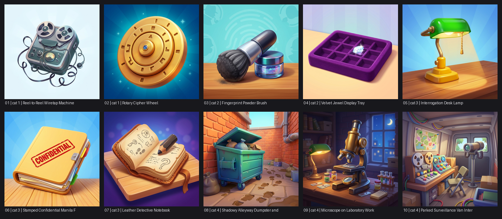

# Movie collection: final sets

Real images produced by the app (Gemini Nano Banana 2.1, 512x512). Nothing here was generated by this script.

## Detective: 10 cards

| # | Category | Subject |
|---|---|---|
| 1 | 1 | [Reel-to-Reel Wiretap Machine](detective/01_cat1_reel-to-reel-wiretap-machine.png) |
| 2 | 1 | [Rotary Cipher Wheel](detective/02_cat1_rotary-cipher-wheel.png) |
| 3 | 2 | [Fingerprint Powder Brush](detective/03_cat2_fingerprint-powder-brush.png) |
| 4 | 2 | [Velvet Jewel Display Tray](detective/04_cat2_velvet-jewel-display-tray.png) |
| 5 | 3 | [Interrogation Desk Lamp](detective/05_cat3_interrogation-desk-lamp.png) |
| 6 | 3 | [Stamped Confidential Manila Folder](detective/06_cat3_stamped-confidential-manila-folder.png) |
| 7 | 3 | [Leather Detective Notebook](detective/07_cat3_leather-detective-notebook.png) |
| 8 | 4 | [Shadowy Alleyway Dumpster and Footprints](detective/08_cat4_shadowy-alleyway-dumpster-and-footprints.png) |
| 9 | 4 | [Microscope on Laboratory Workbench](detective/09_cat4_microscope-on-laboratory-workbench.png) |
| 10 | 4 | [Parked Surveillance Van Interior](detective/10_cat4_parked-surveillance-van-interior.png) |

## Comedy: PENDING

_The approved 10 cards were curated with the in-browser My Selection, which the app does not persist. Add "cards": [10 card ids] and re-run scripts/package_deliverables.py._

## Adventure: PENDING

_Candidate: job-20261110-134631-4709 (10 cards; three category-3 cards were later re-rolled in job-20261110-140905-9327). Confirm, then set "job" or "cards"._
