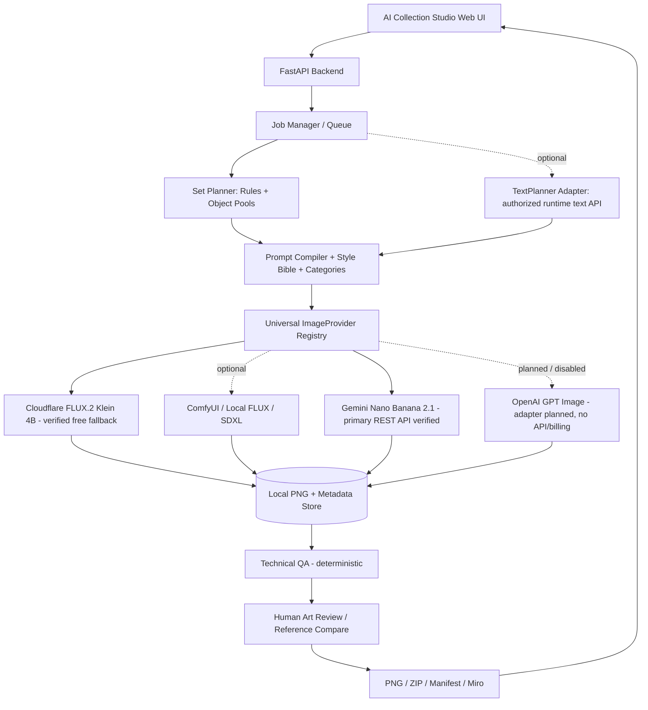

# Playrix AI Producer — Collection Studio
## Source of Truth / Product Requirements + UX + Technical Design + Execution Plan

**Version:** 1.10 (UI/functionality stabilization: free-text Collection/Set with AI planning, 1–10 cards, golden cards, Output Resolution, exact PNG sizes; 1.9: API Connections: secure credential storage; free Cloudflare models FLUX.2 Klein 4B + FLUX.1 Schnell; UI aligned with the mockup; v1.8.1 status refresh; v1.7 + model roadmap: runtime-grouped Model Selector, future cloud/local model backlog, capability metadata; Card Category Distribution: `Auto (Balanced)` / `Custom`, Σ=10, Cat.5 locked at 0; Gemini Nano Banana 2.1 REST image + image-reference smoke tests verified; Gemini-first integration; OpenAI GPT Image planned/disabled)  
**Date:** 9 November 2026 (v1.10 update: stabilization; v1.9: API Connections, Cloudflare free-tier models, UI alignment; v1.8.1: status refresh; v1.8: model roadmap; v1.7: Card Category Distribution; v1.6: Gemini REST API and reference input verified)  
**Status:** **WORKING LOCAL MVP: Phases 0–7 implemented** (actual state — README, "Implementation status"); this document remains the source of requirements. **Gemini Nano Banana 2.1 verified live** (text-to-image, reference-to-image, a 4-card pilot in the app); **Cloudflare FLUX.2 Klein 4B**: adapter implemented and mock-tested, live verification awaits `CLOUDFLARE_ACCOUNT_ID`; **OpenAI GPT Image: planned, disabled, no network code**; Seedream 4.5 and local models — backlog (§12.7). **Artistic quality is not tuned** (known Cat. 3/4 issues — `docs/KNOWN_ISSUES.md`).  
**Concept owner:** candidate for the AI Producer role  
**Working document language:** English (translated from the original Ukrainian); button, object and API names — in English  
**Goal:** a single document for development, delegation to an AI coding agent, scope verification, and preparing the presentation of the test assignment results.

> **Key rule:** this document deliberately distinguishes **[P] a Playrix requirement**, **[U] a wish of the user / concept author**, **[D] a proposed design decision**, **[A] an assumption that needs verification**, **[F] a possible future extension**. [D], [A] or [F] must not be presented as employer requirements.

> **Reliability caveat (updated in v1.8.1):** the application is implemented and tested (171 automated backend tests, offline smoke test, clean-checkout verification), but **live generation was performed only as single Gemini smoke tests, a reference test, and a 4-card pilot (≈ $0.40 by local estimate)**. A full live 10-card set, three genres × 3–5 variants, and **artistic fidelity to the references have not been verified**. Automated QA is structural (it does not detect text in the image or style). The Cloudflare adapter has been verified on mock only. Do not invent QA scores, API credits, the number of generated cards, or final readiness; cost is a local estimate, not an invoice.

---

## CURRENT DECISION v1.6 — TAKES PRECEDENCE OVER THE HISTORICAL SECTIONS BELOW (07.11.2026)

This is the **single current status** of provider connections. Later v1.6 decisions take precedence over outdated examples where Cloudflare is named as primary, Gemini is marked `Samples only`, or the runtime budget strictly required `$0`.

| Provider | Model | User-confirmed fact | Role in the app after implementation | Active in our own Web UI now? |
|---|---|---|---|---|
| **Google Gemini** | **`gemini-nano-banana-2.1`** | **API key + billing configured; text REST `generateContent` returned a PNG; REST with `inlineData` Playrix PNG returned a PNG.** €5 has been added to the account. | **Default / primary image generation provider** | **No — the app is not built yet; API smoke test passed in PowerShell** |
| Google Gemini | `gemini-3.1-flash-image` (Nano Banana 2), `gemini-3.1-flash-lite-image` (2 Lite), `gemini-3-pro-image` (Pro) | Official documentation exists; **these models have not been tested in the user's account** | Model selection under a single Gemini adapter once access is available | No — `Available after live model check` |
| **Cloudflare Workers AI** | `@cf/black-forest-labs/flux-2-klein-4b` | Text REST and REST with a reference PNG were verified earlier | **Free baseline / fallback**; no automatic paid upgrade | **No — the app is not built yet; external API smoke test passed** |
| **OpenAI GPT Image** | `gpt-image-2.5-flare`, `gpt-image-2.5-sunburst` (and others after verification) | Official Image API/Edits API are documented; **personal API key, billing and live calls are NOT configured / NOT tested** | **Planned provider, visible in UI, disabled until separately configured and approved** | **No, `Not configured`** |

**Owner's decision [U]:** **we connect Gemini first**; **OpenAI GPT Image is provisioned everywhere** (UI, provider registry, adapters interface, settings/env template, jobs, image refs, cost counters, provenance, README, QA/tests), but **we make no OpenAI API requests and do not activate its billing** without a separate decision. We keep Cloudflare as a backup alternative.

**Verified evidence in Windows PowerShell [U]:**
- Text-to-image with `gemini-nano-banana-2.1` → `SUCCESS! Image saved: C:\Users\vd\gemini_test.png`.
- Reference-to-image with `playrix_single_reference_calculator.png` → `SUCCESS! Image saved to: C:\Users\vd\Documents\GitHub\icon-gen-tool\Specification\gemini_ref_test.png`.
- For the reference, `contents[].parts[].inlineData = {mimeType: 'image/png', data: '<base64>'}` was used. **Success = the file was created; this does not mean a verified Playrix style.**
- The initial `400 Bad Request` in the first text smoke test was caused by an invalid request `generationConfig.responseFormat.image`; the corrected request **without that block** succeeded. The first reference `400 Unable to process input image` was caused by a **nonexistent local path and empty Base64**; the corrected path produced a successful PNG. Do not record these 400s as Gemini defects.

**Before large jobs:** review the `gemini_ref_test.png` image in Art Review; compare Cat. 1–4, run a 10-card mini pilot, confirm real quotas and the availability of the required model IDs. Track the remaining €5 in Google AI Studio. **The app-level budget guard is best-effort, not a guarantee of a hard limit from Google**, because usage/billing may be updated with a delay. Refuse to start a job if its volume does not fit within a conservative limit.

**Official documentation:** https://ai.google.dev/gemini-api/docs/image-generation ; https://ai.google.dev/gemini-api/docs/pricing ; https://developers.openai.com/api/docs/guides/image-generation ; https://developers.cloudflare.com/workers-ai/platform/pricing/ .

---

## UPDATE v1.12 — Single AI planner, session-only prompts, prompt snapshot, transparency (09.11.2026)

Supplements v1.11. **Where there is a discrepancy, this block prevails** (in particular item 2 of v1.11 about curated pools and `planner = "auto"`).

1. **One planning mechanism [D].** `Collection + Set + Free Wishes → AI Semantic Set Planner → Card Specifications → Prompt Builder → Image Generation`. Curated pools and the rules planner have been **removed from production** (`object_pools.yaml`, `plan_set`, `curated_genre_for`, the `planner` field): Movies / Science Fiction, Detective, Fantasy and any other Collection/Set pair go through the **same** AI planner. The names of the three Movie genres remain only as form hints and for the Movie Collection export workflow (`MOVIE_DELIVERABLE_GENRES`), without pools. Deterministic plans exist **only as test fixtures** (`backend/tests/conftest.py`, `deterministic_plan`) and in the offline smoke script.
2. **No silent fallback.** If the text planner is unavailable (no Gemini key, paid calls disabled, an error/invalid response), job creation ends with a clear error (`gemini_key_missing` / `paid_disabled` / `ai_plan_failed` / `ai_plan_invalid`) **before** any image generation; no curated subjects. The Mock **image** provider remains (free testing of the UI/pipeline; images are marked Mock), but card planning always requires the AI text planner. Job creation (= the Generate action) itself permits the cheap planning call; a free preview without `allow_ai_plan` remains `ai_plan_required`; image cost confirmation is unchanged (the planning cost ≈ $0.002 is included in "Confirm & spend"). Plan Only works as before.
3. **Session-only prompt overrides.** Editable: System Style, Category 1–5 rules, Closing Constraints (repair — permanent only). Flow: View → Edit → **Apply to Session** → **Reset to Default** / **Reset All Session Overrides**. Stored in the tab's `sessionStorage` (`ics.promptOverrides.v1`): survives refresh; a new tab/session gets the defaults. The permanent Prompt Library **is not changed** and no new versions are created; Permanent versioning remains a separate mode ("Permanent versions"), their difference is emphasized in the UI; a "Session Override Active" indicator in the Prompt Library and next to Generate.
4. **Immutable prompt snapshot per job.** When a job is created, the server resolves the full bundle once (all 8 templates: permanent active version + session override), writes the exact texts and their origin into `request.prompt_bundle` (DB), binds it to all variants; every card and **regeneration** of that job uses only its snapshot. Editing the library or the session while a job is running does not change an already created job; after the browser is closed the snapshot stays on the server. Old jobs without a snapshot continue to load (planning prompts — from the current library; already saved image prompts do not change).
5. **Protection of mandatory rules.** While a session override is active, the server appends a MANDATORY block to every prompt (artwork only, no text/labels/frame/border/stars/badges; for golden — at most 2 characters). Contradictory text produces a warning (`POST /api/prompts/session-check`, in provenance and preview). The structure of Standard Set, Grand Set, `characters` ≤ 2, and Movie export are verified **on the server**, not in the prompt text.
6. **Shared Set context in the prompt.** Layer B of each card gets the Collection, Set, **variant title**, **variant concept** and a condensed **rationale** (the `rationale` field from the AI plan, ≤ 140 characters; a template rationale is skipped) with the note "shared art direction only; never replaces this subject or the rules". The subject and the category rules remain primary.
7. **Reference selection [D].** Only applicable ones: `category_N` → only cards of category N; `character` (new type) → only golden (Cat. 5); `style`/`composition`/`negative` → the whole set (`negative` is labeled NEGATIVE: "never reproduce"). The "send everything" fallback has been **removed**: if nothing is applicable — the image is generated without references + text rules (`reference_selection = none_applicable`). Priority under the provider limit: category > character > style > composition > negative. Handling of Gemini (inlineData), FLUX.2 Klein 4B (up to 4 images, downscaling <512 px) and FLUX.1 Schnell (text-only) is unchanged.
8. **Prompt transparency.** (a) "View Prompt" in the card detail: the exact immutable prompt stored with the image (model, references, template versions, SESSION markers, set context, Copy), without calling the provider; (b) "Preview Prompts" (optional): for a job — the stored prompts of generated images + compiled ones for planned images (`GET /api/jobs/{id}/prompts`); for a plan without a job — `POST /api/jobs/preview-prompts`. The same `_card_request` + `compile_card_prompt` as in real generation (not a frontend approximation). There is no Approve step.
9. **Image provenance** now contains: `prompt.effective`, `bundle` (source `library`/`session_override`, permanent version, base_version), `session_overrides`, `effective_texts` (system style, category rule, closing), `mandatory_block_appended`, `planning_context` (collection, set, variant title/concept, rationale), references (id, role), `template_versions`; the export manifest (variant and Selection) contains bundle/session_overrides.
10. **Unchanged:** Standard Set (categories/distribution), Grand Set, ≤ 2 characters, the distinction art category ≠ rarity, Movie Collection deliverable restrictions, cost confirmations and limits, Prompt System v0.2 **not imported** (a separate benchmark).
11. **Planner text model (fix after the first live Plan Only: HTTP 404 for `gemini-2.5-flash`).** The single model for Plan Only and for automatic planning at Generate — **`gemini-3.5-flash-lite`** (`GEMINI_TEXT_MODEL`, stable; Google's documentation states structured outputs; `ListModels` for the project key shows it with `generateContent`). Request: `generateContent`, `responseMimeType: application/json` + `responseSchema`, `systemInstruction`, `seed`; **`temperature` removed** (deprecated/ignored on Gemini 3.x, may be rejected). The planning call price is computed from the model's actual pricing: **$0.30 / 1M input, $2.50 / 1M output (including thinking)**: `cost = base_usd + per_card_usd × variants × cards` (≈ $0.0041 for 1×10, ≈ $0.015 for 5×10); the same constants are returned by `GET /api/models → planner`, the UI has no numbers of its own. Google note: requests to `gemini-2.5-flash` will be redirected to `gemini-3.5-flash-lite` from 01.12.2026. A live call was **not** made in this change.
12. **Planner quality (instruction tuning, no architecture changes):** the same `TextPlanner` text instruction for Plan Only and Generate now requires: (a) a clear focal point for Cat.1-4 cards (a recognizable collectible object, readable as a thumbnail, no crowds/empty locations); for Grand Set / golden cards this rule does NOT apply (1 character or an interaction of 2 characters, maximum 2, emotions and irony preserved); (b) Cat.4 = ONE hero object in a rich environment (the name points to the object, not the place); the definitions of Cat.1-3 are unchanged; (c) respect for the defining content of the Set (the core must have the defining property, accompanying gear is allowed, no rigid keywords and no exceptions for specific Sets; the model checks itself in the same call, no additional paid calls); (d) diversity as a preference, not a quota (identity, function, silhouette, role, previous batches). Exact/synonymous duplicates are still rejected by `semantic_planning`. Tests: `tests/test_planner_quality.py`. The real quality of LLM plans has not yet been measured.
13. **Prompt System v0.5 (default production prompts):** seven templates (`system_style`, `category_1..5`, `image_closing`) from `AI_Collection_Studio_Prompt_System_v0.5_reviewed.md` are stored verbatim in `backend/app/config/prompt_system_v05.yaml` and written once into the Prompt Library as NEW permanent versions (v2, author "Prompt System v0.5"), active for all new generations; v1 remains for rollback (Restore). A template the Producer has already edited is not overwritten; after a rollback to v1, v0.5 is not re-applied. `repair` is unchanged. Template limit: 5000 characters (permanent versions, session overrides, snapshot). Historical generations and their snapshots do not change. Tests: `tests/test_prompt_v05.py`. The real effect on the art has not yet been measured.
14. **Prompt System v0.6 (default production prompts, replaces v0.5):** seven templates from `AI_Collection_Studio_Prompt_System_v0.6_candidate.md` verbatim in `backend/app/config/prompt_system_v06.yaml`; `PromptLibrary.apply_releases()` saves them once as new permanent versions (v3, author "Prompt System v0.6") and activates them; v1 and v2 (v0.5) remain for rollback. A template is updated only while the active version is an untouched previous release, so Producer edits and deliberate rollbacks are not overwritten. One and the same compiler for Gemini and Cloudflare Klein; the 5000-character limit is kept. Tests: `tests/test_prompt_releases.py`. The effect on the art has not yet been measured.
15. **Prompt System v0.7 → v0.8:** v0.7 (four templates, v4) and v0.8 (six templates: `system_style`, `category_1`–`category_4`, `image_closing`; `prompt_system_v08.yaml`, verbatim) are installed by the same `apply_releases()` mechanism; `category_5` and `repair` are unchanged. The Cat.3/Cat.4 labels in `category_rules.yaml` are fixed (no "realistic"). Snapshots: `docs/prompt-archive/` (v0.7 effective, v0.8 resolved). The effect on the art has not been measured.
16. **Limitations:** the quality of real LLM plans and the effect of session prompts on the art have not yet been measured (only mocked/Mock-image checks); inter-batch history is taken from all saved jobs of the topic; the star exists only in set mode.

---

## UPDATE v1.11 — Semantic Set Planner, Session Favorites, Plan Only (09.11.2026)

Supplements (does not cancel) v1.10. Where stated otherwise than in item 1 of the v1.10 block ("a custom topic requires an explicit Plan with AI"), **this block prevails**.

1. **Collection → Set → Cards [P]/[D].** Collection is a broad topic (Winter, Technology), Set is a specific sub-topic (Forest, Two-Wheeled Vehicles); a full collection = 16 sets, the final one being the Grand Set. Each card must meaningfully belong to **the Set itself**, not merely to the Collection.
2. **Semantic Set Planner (AI by default) — the curated/`planner` part is replaced by v1.12 (single AI planner).** For any Collection/Set pair the plan is made by the AI TextPlanner (one structured text call, no auto-retry). Prompt: the Set is a semantic boundary; the AI itself determines what the Set is (an activity, a place, an event, a category of objects), what distinct aspects it has, and selects recognizable, diverse subjects. **There are no hard quotas.** Curated pools remain only for the Movie Collection presets (Sci-Fi / Detective / Fantasy) with `planner = "auto"`; `planner = "ai"` forces AI even for them; a custom topic is never silently replaced by a curated one. Art categories (Cat.1–4, Auto/Custom, Gold) and Grand Set are unchanged.
3. **Plan validation before image generation.** In addition to the existing rules: (a) near-duplicate subjects (identical words after normalization / nearly identical entry; "Bicycle" ≠ "Bicycle Helmet") → `ai_plan_invalid`; (b) exclusions from Free Wishes ("no buildings", "without weapons") → a card with the corresponding word (and unambiguous synonyms: house/cabin/hut/…) rejects the plan; (c) golden: `characters` = 1 or 2 (v1.10). Free Wishes cannot override the constraints of the Set / categories / safety / Grand Set.
4. **Inter-batch history.** Before planning, a compact list is collected ("name — hint ≤ 48 characters", deduplicated, newest first, **≤ 48 subjects**) from previous jobs of **the same Collection + Set + Set type** (other topics are not mixed). It goes into the prompt: "prefer new subjects". This is a **strong preference, not a ban** (some Sets have little diversity). The plan cache accounts for the history.
5. **Simplified workflow.** Generate itself invokes AI planning (≈ $0.002 text) and then the existing prompt builder; there is no mandatory Approve plan / Replace / prompt editing. The planning price is shown on the button and **is included in the "Confirm & spend" confirmation** (also when images are free, e.g. Mock): planning does not bypass cost confirmation. The free preview does **not** call the AI plan; there is an optional "Preview plan (optional)" button.
6. **Plan Only / Test planner.** `POST /api/plan/test` + the "🧪 Test planner (no images)" button: the same Collection / Set / Free Wishes / number of cards / Set type, the real planner, **without an image provider and without a job**. Response: cards (name, description, category, `characters`), `text_model`, `cached`, `text_cost_estimate_usd`, the number of history subjects, `image_provider_called: false`; a real text call is recorded in the regular ledger/budget. The planner is provider-agnostic: `TextPlanner(backend=…)` is the only provider-specific place (Gemini text by default); the Cloudflare text LLM is **not integrated**, model comparison is the next step.
7. **My Selection (session favorites).** ☆/★ on every generated image of the set (variant grid and card detail; in the detail — specifically the displayed version). An entry = a specific image (`artifact_id`) + `job_id`, `card_id`, `variant_id`, version, category, provider/model, batch number. Stored in the tab's `sessionStorage` (`ics.favorites.v1`), survives refresh and new batches, empty in a new session; key = Collection + Set + Set type (the selection is restored on returning to the Set). Files and job history are neither copied nor deleted; there is no limit on the count. A new generation never replaces a marked image.
8. **Export Selected.** `POST /api/exports/selection` → ZIP: `artwork/` (delivered PNGs of exact size), `originals/` (provider originals where stored), `manifest.json` (job / batch / variant / card / model / prompt for each image), `selection-report.json`, `contact-sheet.png`, `README.txt`. Multiple jobs are fine. **Warnings, not blocking:** not 10 cards, missing Cat.1–4, golden in Standard, Mock, non-golden in Grand; for 10 cards Cat.1–4 are checked separately from the total count (`standard_ten_card_set`, match with 2/2/3/3). Not included in the Movie Collection bundle.
9. **Batch #N.** The batch number = the order of the job among all jobs of the same Collection + Set + Set type; shown as the chip "Batch #N — M images" and in My Selection.
10. **Not verified / limitations:** the quality of real LLM plans (mocked tests only; paid calls were not run); the star exists only in set mode (single-card images do not have it); the near-duplicate check is lexical (does not catch synonyms in different words); the image model resets to Gemini after a page refresh (existing behavior); history is taken from all saved jobs of the topic, not only from the current session (limited to 48 subjects).

---

## UPDATE v1.10 — UI and functionality stabilization (09.11.2026)

Clarifications that **supplement** (do not cancel) §3.4, §6.3–6.7, §6.15 and §19.1.1; everything not mentioned here remains valid as before. Where §3.4 / §6.4 / §8.4 say "Cat.5 = 0, locked" or "always 10 cards", for the **general application** this block applies; for the **final Movie Collection deliverables** the restrictions remain (see below).

1. **Collection and Set — free text [U].** Both fields are interpreted by the AI Planner (Collection = a broad topic, Set = a narrower refinement; the API field `genre` = Set). Hints (Sci-Fi, Detective, Fantasy, Comedy…) are only clickable chips; they **never restrict** input. The curated rules planner applies **only** when the Collection looks like cinema (movie/film/cinema/кіно/фільм) **and** the Set matches Sci-Fi/Detective/Fantasy. Everything else is a **custom topic**: an explicit "Plan with AI" is required (one Gemini text call, ≈ $0.002, one-time, cached by exact inputs). There is no silent substitution with an unrelated genre. The plan (objects per card) is shown **before** image generation; the planning and image costs are shown separately.
2. **Number of cards 1–10 (default 10 = the "gold standard").** `Number of cards = 1` enables single-card mode. The "How much to generate" block (pilot/full) has been removed from the UI (scope is always `full`; for old jobs it stays in the DB). Advanced settings have been removed.
3. **Golden cards (Cat.5), slider 0–N [U].** Playrix rule: the collection's key characters in an ironic emotional situation, **no more than 2 characters per card**; an image without text. Σ(Cat.1–4) + golden = Number of cards **always**. User values are **never changed silently** (a Σ mismatch blocks Generate; there is an "Auto-fit" button). Golden cards are **excluded from the final Movie Collection deliverables**: the final bundle / collection progress count only jobs with 10 cards and 0 golden (`final_eligible`); other jobs are exported as a regular variant ZIP.
4. **Compliance flag.** "Playrix-compliant" = ≥4 standard cards and each Cat.1–4 ≥1. Other configurations are **allowed** (no new restrictions for general collections) but are labeled "Custom / non-compliant" with the reason.
5. **Output Resolution — a single setting (24…1024 px, default 1024).** The choice of model/internal generation size is not shown to the user. **The final PNG (UI, download, export) has exactly the requested dimensions** (LANCZOS in the backend; a centered crop to square if needed); the provider original is stored alongside (`<id>.original.png`); Technical QA `TQ-10` checks size conformance; the manifest contains `output_pixel_size`. A separate Aspect choice has been removed from the main UI (always 1:1).
6. **API Connections — fixes [U].** Editing **per field**: a field with no value is always editable; a saved one is shown as Saved with a source tag (Windows Credential Manager / .env) and an Edit/Replace button. You can enter only the Cloudflare Account ID without replacing the token from `.env`. **Priority: value in Credential Manager > `.env` > nothing.** "Remove from this PC" is a **local** removal, **not revocation of the key at the provider**; if the same value remains in `.env`, the UI states directly that the provider stays connected. Real revocation is in the provider's dashboard.
7. **UI.** Variant labels = 1…5 (the backend IDs A…E remain internal). When the form differs from the displayed job, the right panel is marked "Previous result / Previous run". Model Selector: a fixed-position list without overlapping the CTA; statuses Active / Connected · awaiting live verification / Not connected / Planned · local; the priority order is unchanged (Gemini Nano Banana 2.1 → Cloudflare FLUX.2 Klein 4B → Z-Image-Turbo planned; FLUX.1 Schnell — optional). Tooltips explain Cat.1–4 and Gold.
8. **Unchanged:** budget limits ($0.75 per run / $5.00 total; the total limit was raised from $4.00 to $5.00 by the Producer's decision), no auto-retry, no paid calls without confirmation, OpenAI disabled, Cloudflare not live until a real request.
9. **Grand Set (All Golden) — `Implemented (locally, mocked-tested; live AI planning not verified)`.** The requirement is described in **§3.5**, ADR-018 and backlog §17. Standard Set is unchanged. Grand Set **never** goes into the Movie Collection bundle (even when the mode is explicitly selected) and has its own regular generation / review / standalone export.
10. **Agreed execution order after documentation [U]:** (1) test and refine the real outputs of Gemini Nano Banana 2.1; (2) connect and live-verify Cloudflare FLUX.2 Klein 4B; (3) improve generation quality with these two models; (4) only then decide on additional models. Paid generation and new model integrations — only with separate approval.

---

## UPDATE v1.9 — API Connections, Cloudflare free-tier models, UI alignment (09.11.2026)

Added **Settings → API Connections** (§6.2, §19.1.1): the user enters, replaces and deletes the Google Gemini (API key) and Cloudflare Workers AI (Account ID + API token) credentials themselves; they are stored **only on the Python backend side in Windows Credential Manager (DPAPI)**, `.env` remains a development fallback; secrets are **never** returned by the API, written to browser storage, SQLite, logs or Git; the connection check **does not generate images**; endpoints are protected (loopback Host/Origin + per-session token). A **first-run setup guide** was added. Two **free-tier Cloudflare models** appeared in the registry: **FLUX.2 Klein 4B** (text-to-image + up to 4 references) and **FLUX.1 Schnell** (text-to-image only, references unavailable) (§12.7.1). A free quota ≠ unlimited free usage: **no automatic switch to a paid plan and no silent fallback to another provider**. The UI is aligned with the approved mockup (§6.15). Phases, existing functionality and the Gemini integration are **unchanged**; Cloudflare models **are not considered live until a real request has passed** (a separate approval of the smoke test is needed).

## UPDATE v1.8 — Model roadmap and Model Selector (08.11.2026)

Added a **future integration backlog** for alternative image models (details — **§12.7**): the Model Selector is grouped by runtime — **Cloud API** (Gemini Nano Banana 2.1 = Active; Cloudflare FLUX.2 Klein 4B; ByteDance Seedream 4.5 = Planned; OpenAI GPT Image = Not configured, disabled) and **Local (planned)** (FLUX.2 Klein 4B, Z-Image-Turbo, Z-Image Base, ERNIE-Image-Turbo, ERNIE-Image Base, Qwen-Image-Edit-2511, Qwen-Image-2512); **Mock** remains for development/testing. All models work through the **existing provider abstraction**; planned models are **visible but disabled** until the adapter and runtime configuration are ready; an unavailable model is **never shown as working**. Model weights and local runtimes are **not downloaded or installed now**. This is a **backlog, not MVP scope**: phases 0–7, functionality and the Gemini integration are **unchanged**; evaluation of local models and quality comparison — after the MVP works.

## UPDATE v1.7 — Card Category Distribution (07.11.2026)

Added the **Card Category Distribution** requirement (details — **§3.4**): every standard set = **10 cards** with all categories **1–4**; modes `Auto (Balanced)` (default **[2,2,3,3]** — *our project assumption [D], not a fixed Playrix ratio*) and `Custom`; validation Σ=10 and each category ≥1; **Cat.5 = 0 (locked)** in the Movie demo; the distribution is applied at Set Planning before generation and is the same for all 3–5 alternatives. Everything else from v1.6 (providers, budget, UI, scope) is **unchanged**. Where earlier sections say "do not invent quotas" or "quotas, if approved", §3.4 applies: Playrix does not fix the exact count, so the distribution is configurable [D].

---

## Major update v1.5 — image provider choice after API comparison (07.11.2026)

**Historical v1.5 conclusion, confirmed by the v1.6 access:** since we have **already activated a small paid Gemini API budget**, for this test and for **not very complex casual-style icons / card art objects** I recommend **starting with Gemini as the first premium image adapter**, namely:

- **`gemini-nano-banana-2.1`** — if we want the best balance of quality, editing, reference-following and chances of a style match;
- **`gemini-3.1-flash-lite-image` (Nano Banana 2 Lite)** — if the main priority is the **lowest price** and high throughput;
- **OpenAI GPT Image** should be kept as a **second optional adapter / backup**, not as the first integration;
- **Cloudflare FLUX.2 Klein 4B** remains the **first actually verified live adapter**, but is now more of a **zero-cost baseline / fallback** than the best candidate for final art quality.

**Why:** the official Gemini docs explicitly position `Gemini 3.1 Flash Image (Nano Banana 2)` as the **go-to image generation model** with the best balance of quality/price/latency, with support for **multi-turn image editing**, **up to 14 reference images** in the Gemini 3 image model family, and high-fidelity object/character reference workflows. For a Playrix-style workflow this is very useful: we have references, iterations, and a need to keep the set consistent.

**Historical planning recommendation v1.5 (the successful Gemini REST test in v1.6 changes its status):**

1. **Do not integrate two paid image providers at once.**
2. First build a **provider-agnostic core** + **one premium adapter**.
3. If we allow a small spend — **connect Gemini first**.
4. Add OpenAI **only as a second step**, if after the pilot there is a real need for even better editing/repair workflow or separate output modes (for example, transparent PNG / SVG / GIF).
5. Keep Cloudflare as a **cheap baseline / fallback / smoke-test provider**.

**Budget conclusion [D]:** for fast prototyping, **one provider first** looks the most rational. If a paid route is needed, it should be **Gemini first**; if we stay in a strict `0 extra spend`, we keep working through Cloudflare Free, but honestly accept the risk of lower visual quality.

## Historical architectural decision v1.4 — status updated in v1.6 (07.11.2026)

**User-confirmed:** the Cloudflare REST API with the model `@cf/black-forest-labs/flux-2-klein-4b` returned a PNG after a **real** call from Windows PowerShell. A separate call with a supplied image via `input_image_0` also returned a PNG. **Quality is weak**; "reference request accepted" does not equal "reference style accurately matched". The FLUX.2 Klein 9B Playground is only a visual experiment; the live REST API for 9B has **not been verified** in this project.

**Model-agnostic runtime [U]/[D]:** the tool does not depend on FLUX, Cloudflare, Gemini, OpenAI or any specific vendor. `ImageProvider` is a universal contract with model capabilities (`capabilities`, supported reference inputs, dimensions, status) and provider-specific adapters. **The first chronologically verified external REST endpoint** — **Cloudflare Workers AI / FLUX.2 Klein 4B**. **The first paid API with a genuinely successful text/reference smoke test and the main adapter to implement** — the **Google Gemini image family** (primarily `gemini-nano-banana-2.1`, alternatively `gemini-3.1-flash-lite-image`). OpenAI GPT Image — the second optional premium adapter. In the future: other FLUX.2 versions, local ComfyUI/SDXL, Gemini Image API, GPT Image, etc., given real permitted access.

**Claude Code is a DEVELOPMENT tool, not a runtime planner.** Claude writes code, prompt templates, rules, scripts, tests and UI. A Claude Pro subscription **does not provide a runtime Claude API** for the application. **Qwen/Ollama are not required**. For the limited Movie demo, the first `set-planner` may use pre-composed genre object pools + deterministic rules + variability; this is **not equivalent to a full understanding of an arbitrary creative brief**. If truly dynamic planning of any topic/wishes is needed, provide an **optional TextPlanner provider** (a permitted Cloudflare text API / another compatible LLM API) and honestly label `template_mode` vs `ai_planning_live`.

**Cloudflare + budget (historical v1.5 wording; v1.6 takes precedence) [U]/[D]:** our own Cloudflare API is not a "local model". On the laptop, the Web UI + FastAPI run, and inference is executed in the Cloudflare cloud. In v1.5 we fix **two permitted budget modes**: (a) `Zero-cost mode` — only Cloudflare Free / another free, actually available provider, no extra payments; (b) `Minimal paid mode` — **one** paid image provider for the pilot, Gemini recommended. In either mode, a usage/quota preflight, rate limits and a hard stop on exceeding the limits are required before a batch. Do not claim that the free tier is enough for 90 images until this has been verified.

**QA:** deterministic technical QA + human art review, without fake style scores and without mandatory Vision QA. The final 3 Movie sets must be created **through the real pipeline**, not substituted from manual generation in Gemini/GPT, which may be used only as a separate study.

**Design:** keep the **first detailed light UI mockup with a dark header, a rich gallery and a dense left panel**. The later simplified mockup is not a new design source.

---

## Historical clarification v1.3 — Quality Assurance (07.11.2026; in force in v1.4)

**This current decision takes precedence over all previous QA descriptions below.**

- **Automated Technical QA — MVP / mandatory:** deterministic Python checks: PNG count, files can be opened, format, resolution, unique IDs/names, valid categories, no golden cards for the Movie demo, metadata completeness. These can be automated reliably.
- **Visual / Artistic QA — Human-in-the-loop / mandatory:** the producer or artist views the artwork and references through Split Slider, Side by Side and Grid View; independently chooses Approve / Reject / Regenerate. Artistic fidelity does not reduce to an automatic numeric indicator.
- **Vision LLM QA — an optional experimental extension, NOT a must-have MVP:** the model may report suspected problems, but does not approve final quality, does not trigger unlimited regenerations, and does not provide unjustified `style scores`.
- **UI update:** the earlier `Style Score 0.92 / 0.87 / 0.85`, `Best Match` or `QA passed` in the reference sketch are demo markers, not measurements. Show actual statuses `Generated 10/10`, `Technical QA: passed`, `Art Review: pending/approved/rejected`.
- **Provider statuses (v1.6 override):** Gemini `gemini-nano-banana-2.1` = `api_smoke_tested_text_and_reference` (future primary in app); other Gemini image model IDs = `documented_unverified`; OpenAI GPT Image = `planned_not_configured` and `Generate disabled`; Cloudflare FLUX.2 Klein 4B = `api_smoke_tested_text_and_reference` (fallback). Manually imported images remain `manual_import`.
- **Runtime budget (v1.6 override):** one permitted paid Gemini account with a prepaid €5; Cloudflare Free fallback; OpenAI paid API is NOT to be activated. Hard stop by the local budget estimate, no auto top-up and no endless retries. Check artistic quality separately.

---

# 0. Executive summary / the decision in one paragraph

**Collection Studio** is a local Web UI for a producer/game designer. The user sets a **collection theme**, **one set genre** (or three genres for the batch Movie demo), **optional "free wishes"**, adds references and selects an available model. The **System Prompt / Style Bible** with mandatory composition and category rules is defined in advance; UI parameters and wishes do not replace these rules. The Planner forms **3–5 alternative plans for each ordered genre**, and the connected image provider attempts to create **10 separate artwork PNGs** for each variant. Prompts, provenance, iterations and results are saved. The frontend shows a gallery, imported research examples, Reference Compare (Slider / Side by Side / Grid) and Export. **The artwork itself, not the game frames/windows, is the deliverable.**

**Budget principle v1.6 [U]/[D]:** by default we keep **minimal costs**, but we no longer **require** artificially that the only scenario be `0 USD` at any price in quality. Two modes are allowed: **Zero-cost baseline** (Cloudflare Free) and **Minimal paid quality-first pilot** (one premium provider, Gemini recommended). **The first historically verified external REST provider:** Cloudflare Workers AI → FLUX.2 Klein 4B; **the first confirmed paid image API:** Gemini Nano Banana 2.1 via PowerShell (text + reference). OpenAI GPT Image — **planned in UI and architecture but disabled until separate API/billing activation**. Qwen/Ollama/ComfyUI are **not mandatory**. Planning in the PoC: an implemented Python planner with verifiable rules; optionally a runtime TextPlanner API for arbitrary topics and wishes. The application runs locally on a laptop, and inference is performed through an external API provider. A static HTML without a backend does not generate images. Live testing of Playrix on a public URL is not a direct requirement of the assignment.

## 0.1 Priorities

1. **P0 — product/art match:** conformity to the reference style, composition principles and set logic.
2. **P0 — autonomy:** another person can go from input to output without the author's involvement.
3. **P0 — output:** 3–5 full set variants per request; three new themed sets for demonstration.
4. **P0 — transparency:** recording plans, prompts, models, attempts, evaluation criteria and decisions.
5. **P1 — convenient Web UI:** separate `Collection`, `Genre(s)`, `Variants`, `Free Wishes`, `System Rules`, `Prompt Library`, `Planning Model`, `Image Model` with a visible connection status, references, gallery, **Reference Compare (Split / Side by Side / Grid)**, import samples and export.
6. **P2 — universal generator of all types of game art:** not part of the first MVP.

## 0.2 MVP in numbers

- [P] One set (`set`) contains **10 cards**.
- [P] One collection contains **16 sets** in total; **the 16th is a special golden one**.
- [P] The generator returns **3–5 variants of one ordered set**.
- [P] The demonstration theme is **"Movie collection"**.
- [P] **3 different sets** must be created on the theme of different movie genres, **without golden cards**.
- [D] For a full live pilot: 3 genres × 3 alternatives per genre × 10 cards = **90 primary images** (plus retries). If resources are limited — **incremental jobs**, not a dishonest claim of 90 images done; for the final we select 3 × 10 = **30** cards. Anything imported manually must be marked separately.
- [P]/[A] Every standard set contains all categories 1–4, but **the exact number of cards per category is not fixed in the source materials**. [D] The distribution is set by `Card Category Distribution` (§3.4): `Auto (Balanced)` default [2,2,3,3] — **our assumption, not a Playrix requirement** — or `Custom`; Σ=10, each Cat.1–4 ≥1, Cat.5=0.

---

## 0.3 Agreed product-technical decisions v1.6 [U]/[D]

| Question | Current decision | Limitation / explanation |
|---|---|---|
| Is a public SaaS needed? | **No.** Web UI + Python FastAPI run locally | Access to the Cloudflare AI API over the internet; there is no requirement to publish our backend |
| Requirement for a real tool | **Yes.** Make the three final Movie sets through our own pipeline | A Mock UI + manual images do NOT satisfy automatic production |
| Live generation | **Gemini Nano Banana 2.1 primary; Cloudflare FLUX.2 Klein 4B fallback** | Both passed separate external REST text/ref smoke tests; **neither is integrated into our own app yet**; art review pending |
| Other image models | **Pluggable adapters, model-independent core** | Gemini multi-model dropdown after a model-by-model live check; **OpenAI GPT Image visible/planned but disabled**; (v1.8) future cloud/local backlog — Seedream 4.5, FLUX.2 Klein 4B / Z-Image / ERNIE-Image / Qwen-Image (local) — visible but disabled, **not MVP scope** (§12.7) |
| Planning (without Qwen) | **Python rules + object pools / templated planning for the Movie demo** | This is bounded planning; do not claim full semantic adaptation to any arbitrary `Free Wishes` |
| Arbitrary semantic planning | Optional **TextPlanner provider via API** | Claude Code Pro is not a runtime API; a Cloudflare text model can be added after verifying the specific endpoint and quota |
| Backend | **FastAPI + job manager + Prompt Compiler + ImageProvider registry** | Category logic, tracing, storage, technical QA, export |
| Machine split | **Laptop: UI + FastAPI; Cloudflare: inference** | Desktop/Ollama/ComfyUI are needed only if we add an optional local provider |
| Budget | **€5 prepaid Gemini; Cloudflare Free fallback; OpenAI paid DISABLED** | Conservative per-job budget guard, quotas and retries; do not enable OpenAI billing |
| QA | Deterministic technical checks + manual artistic approval | Vision LLM is not a must-have, no invented style scores |
| Final image | **Artwork only**, without game frames; Miro insertion manually | Direct Playrix requirement |
| Gold cards | Optional in the generic architecture; Movie demo **OFF** | No Category 5 in the final three sets; Cat.5 = 0 locked (§3.4) |
| Card Category Distribution (v1.7) | `Auto (Balanced)` default [2,2,3,3] or `Custom`; Σ=10, each Cat.1–4 ≥1 | [2,2,3,3] is our assumption [D], not a Playrix requirement; applied at Set Planning; the same for all 3–5 alternatives (§3.4) |
| Design | **FIRST detailed UI mockup** + new `Free Wishes` fields, provider status and compare | The later simplified UI does not replace the first reference |
| API credentials (v1.9) | Entered in **Settings → API Connections**; stored in **Windows Credential Manager** via the Python backend; `.env` — dev fallback | Never in localStorage / SQLite / logs / Git / API responses; connection check without paid generation; endpoints only for the local application (§19.1.1) |
| Free models (v1.9) | Cloudflare **FLUX.2 Klein 4B** (first priority) and **FLUX.1 Schnell** | The free-tier quota (10,000 Neurons/day) is limited; no auto-upgrade, no silent fallback; not live until a real successful request (§12.7.1) |
| Scope | A working PoC with 1 live image adapter, not a SaaS | Mark `implemented / mock / future` |

### 0.3.1 Two levels of trials that must not be substituted for each other

- **Research showcase:** images created manually in available ChatGPT/Gemini and/or local image engines. The model, prompt, version and method of acquisition are visible (`manual_import` / `live_generation`). This is a study of tools, **not proof of a live API**.
- **End-to-end automation showcase:** one actually connected planner + image provider that go from `theme + wishes` to `3–5 × 10` without manually launching each icon. Quality is honestly checked against the references; unmet criteria are recorded as limitations.
- **Reviewer handoff:** instructions on how to run locally given models/hardware; a video/screencast + Miro + GitHub. The provided assignment contains no requirement that "the recruiter must have generation running at a public URL".

## 0.4 Three levels of instructions: why `Free Wishes` does NOT duplicate prompts

| Level | Source | Who controls it | What it contains |
|---|---|---|---|
| **A — System Prompt / Style Bible** | Approved style profile + category composition rules | AI Producer / administrator | Constant style rules, category 1–4 rules, illustration focus, negative conditions, fixed JSON/PNG format; in the demo Cat.5 is forbidden |
| **B — Generation Settings** | Structural UI fields | Game Designer / Producer | Collection, genre(s), 10 cards, 3–5 variants per genre, golden toggle (disabled in the demo), resolution, provider |
| **C — Producer's Free Wishes** | **Optional free-form field** | Game Designer / Producer | Mood, object types, era, priorities, constraints (`no weapons`, `cozy feel`) |

**Priority rule:** A (mandatory rules) > B (validation settings) > C (creative wishes). C cannot make the model violate the categories, the number of illustrations or introduce golden cards in the Movie demo. The UI shows a clear conflict message.

**A fourth technical stage, but not a new field for the producer:** the `Prompt Compiler` combines A+B+C+the specific `CardSpec` into an **effective image prompt** for the selected image provider. The **Prompt Library** stores versioned system/style and category templates, allows viewing, comparing and changing them in Advanced/Producer mode; in Basic Mode they are read-only.

**Order example:** `Collection=Movie Collection; Genres=[Science Fiction, Detective, Fantasy]; Cards=10; Variants=3; Gold=Off; Wishes='Retro-futuristic, lighthearted; avoid weapons and horror'`. A separate generation job for each genre with **3 variants of 10**. In the final Miro presentation show **one** selected set per genre; keep all variants/iterations as research evidence.


# 1. Sources, origin of requirements, status

| Source | What it contains | Status |
|---|---|---|
| Official job posting: https://playrix.com/job/open/game-design/ai-producer | The AI Producer role | URL provided by the user; the page text itself did not render in web view |
| Job posting mirror: https://www.gamejobsuk.com/playrix/ai-producer-5409 | Role tasks and requirements | Verified by web search on 04.11.2026; a mirror independent of the official site |
| Mirror: https://gamejobs.co/AI-Producer-at-Playrix | Role tasks and requirements | Additional confirmation |
| 6 screenshots of Miro/documents provided by the user in this chat | The test assignment itself, the collection description, category rules, references, the demonstration template | Primary source of test requirements |
| User wishes in this chat | HTML/Web UI, upload refs, model dropdown, resolution, Generate, gallery, output; **Compare: Split slider, Side by Side, Grid** (06.11); **three prompt levels, Producer Free Wishes, Prompt Library, three genres, zero-cost/local, import samples** (07.11) | Primary source of the product concept |
| Previously generated UI sketch | The design of the left settings panel, right gallery and status bar | Illustration, not a technical contract |
| Gemini Docs: https://ai.google.dev/gemini-api/docs/image-generation and https://ai.google.dev/gemini-api/docs/pricing | Available image APIs and pricing | Verified 04.11.2026; re-verify before implementation |
| OpenAI: https://developers.openai.com/api/docs/guides/image-generation | Image API, model modes, editing and output settings | Verified 04.11.2026; verify before implementation |

**Priority order in case of conflict:** the original Playrix test → customer remarks → fact from the references → this document → code/mockup. If the code does not match the assignment, we fix the code or adjust the requirement with justification; we do not rewrite the original assignment retroactively.

## 1.1 Job posting — AI Producer (brief content, not a verbatim copy)

**Company:** Playrix. **Role:** AI Producer. **Format:** remote or office, according to the job posting.

**Role tasks:**

- Look for opportunities to introduce AI at various stages of game production and development.
- Launch AI initiatives: problem statement → hypothesis → architecture → experiment → integration into workflows.
- Select models and tools for specific tasks, build/improve AI pipelines.
- Evaluate the quality of results against style and product requirements.
- Work with producers, artists, engineers and domain specialists.
- Measure the impact on speed, quality, cost, product metrics.
- Research new AI capabilities and bring the useful ones to practical use.

**Candidate requirements:** game development experience and full content production cycle; practical independent adoption of AI; building pipelines and choosing models; the ability to evaluate game art. **Nice-to-have:** casual mobile games, in particular Match-3. This is **desirable**, not formally mandatory.

**Conclusion for the test:** what is evaluated is not only programming or "pretty pictures", but **production-minded automation**, measurable quality and the solution's suitability for another user.

---

# 2. Original test assignment — content captured from screenshots

> This is a structured summary of the Russian-language assignment from the provided images, not a verbatim transcription. Where accuracy matters, the original wording is indicated.

## 2.1 Test goal [P]

1. Verify the ability to quickly and properly fulfill a "product order" with the help of AI.
2. Verify the deliberate construction of an AI pipeline for a specific task and bringing the result to a near-production level.

## 2.2 Deliverables from Playrix [P]

- Analyze the **ideological and artistic principles** of forming sets: object selection, internal logic, composition, style, repetition.
- Based on descriptions and graphic references, build a tool/pipeline for **automatic production of images for collectible cards**.
- The tool must accept a **set theme** and the producer's **"free wishes"**.
- The output is **3–5 variants of the ordered set**, i.e. groups of images/cards, not just 3–5 variants of a single picture.
- Use the tool to create **three different sets** on the theme of **"Movie collection"** reflecting different movie genres, **without golden cards**.
- Compare your own results with the reference sets — **product** and **visual** comparison, with reference to the principles of your own analysis.
- Place the **entire process and results on the provided Miro board**.
- Provide a **GitHub link to the code / created skills / pipeline**.

### An important constraint that affects scope

Original text: **"именно картинки объектов как во фрейме “Примеры карточек”, верстать окна не требуется, просим “подставить” карточки в готовые наборы вручную"**.

**Interpretation:**

- **In scope:** generate the card illustrations themselves, suitable for insertion into existing templates.
- **Out of mandatory scope:** building new large collection windows, redrawing the game UI, automatically laying out entire game screens.
- **Optional:** make a technical preview "how the art will look in a frame" or a contact sheet, but do not spend the main part of the work on it.
- **For the final Miro presentation:** insert the selected PNGs into ready-made frames/windows by hand, as the assignment asks.

## 2.3 Playrix evaluation criteria [P]

1. Technical quality + product-and-art quality.
2. The ability to extract **meaning-forming principles** from the references and transfer them into the AI system.
3. How well the result fits the provided art style.
4. How well the candidate sees and explains the ideological and visual nuances of the references.
5. Architecture and **autonomy**: whether a game designer can use the tool without the author.

**Control question for the art part:** can a new set be shown next to the reference ones so that the player does not feel a difference in the artistic and ideological system? This is a qualitative goal, **not a guarantee** and not an automatically computable fact.

## 2.4 Test execution principles [P]

- Maximum pipeline autonomy; minimal manual intervention.
- Research the available public models/tools; the first attempt is not necessarily the best.
- Show the path: tools, prompts, iterations, reasons for choosing a solution.
- Look for approaches independently; the employer does not provide its own models or LoRAs.

---

# 3. How collections and the card set are structured [P]

## 3.1 Content hierarchy

```text
Collection ("Cinema", "Summer", "Travel"...)
└── 16 thematic sets / sets
    ├── Set 1: theme A — 10 cards
    ├── Set 2: theme B — 10 cards
    ├── ...
    ├── Set 15: theme O — 10 cards
    └── Set 16: special golden culmination — 10 golden cards
```

Each set has a distinct narrow theme and does not duplicate other sets of the same collection. Within a set, each card represents a **different object** related to the theme.

Examples of themes in the provided references: `Gardens`, `Sports`, `Finals`, `Amusement`, `Coolness`, `Countrystead`, `Seafaring`, `Boyscoute`, `Vacation`, `Beach`, `Music Fest`, `Diving`, `Road Trip`, `Poolside`, `Tour`, `Summer Party`. They illustrate the **principle broad theme → different sub-themes → unique objects**, not a list to be reproduced for cinema.

**Attention:** one and the same everyday item may sometimes be thematically suitable for several sets. This does not mean it should be repeated within one collection. The planner must check **semantic overlap** between the proposed sets.

## 3.2 Art categories — exact logic from the references

| Category | Object role | Background / surface | Typical composition | Important constraint |
|---|---|---|---|---|
| **1** | A simple object without fine detail | The object **hangs in the air**; a solid / gradient / simple patterned background | One main object, a very readable silhouette | Do not add a room or realistic ground |
| **2** | A simple object without fine detail | The object stands on a surface; a back vertical plane or simple background | Object + support; restrained context | Do not turn it into a complex scene |
| **3** | An object on a realistic surface | A volumetric/spatial background, an expressive foreground | The object is embedded in a more object-rich environment | The object is still the main one |
| **4** | A central object in a full environment | A recognizable surrounding setting | A scene with a clear local story | The object is not lost in the scenery |
| **5** | A golden card with one/two characters in a humorous emotional situation | A space at the level of cat. 4 | Characters are the compositional center | **Do not generate in the three test Movie sets** |

**Nuance:** "realistic surface/environment" means a volumetric and plausible context **within stylized casual game art**, not a shift to photographic realism.

### What must not be assumed without analyzing the screenshots

- Do not present the category distribution (for example, "2,2,3,3") as a Playrix requirement: the exact count is not fixed in the source materials. Use it only as a configurable [D] default `Auto (Balanced)` (§3.4); if needed, check the actual picture against the original frames.
- The number of stars, frame styling and card rarity are not automatically identical to the art composition category. The assignment explicitly states that **rarity by itself does not affect the object's image**.
- Golden Cards have separate logic; in the demonstration they are forbidden, even if the general system later supports them.

## 3.3 Semantic principles that must be shown in the analysis

1. **Thematic coherence:** all 10 elements form one clear sub-theme.
2. **Visual progression:** from a simple object to a more complex object situation depending on the category.
3. **Unique silhouettes:** objects do not repeat and do not look like minor variations of one item.
4. **Instant recognition:** the card name can be guessed from a small preview.
5. **Casual readability:** expressive shape, clean color, little visual noise.
6. **Cohesive art direction:** consistent render, volume, light, contrast, materials, level of stylization.
7. **Emotional appeal:** the selection of objects creates curiosity/associations, not a mechanical list of things.
8. **Collection-wide non-overlap:** a new set adds a new facet of the big theme rather than duplicating other sets.

These principles must be formalized as an **Art & Product Rubric**, not remain merely text conclusions in Miro.

## 3.4 Card Category Distribution (v1.7) [P]/[A]/[D]

**What is confirmed [P]:** according to the reference, every standard set (10 cards) contains **all four standard art categories 1–4**. **The exact number of cards per category is NOT fixed in the source materials** [A].

**Product decision [D]:** the distribution is a configurable request parameter, not a hard Playrix requirement. In the UI this is the **`Card Category Distribution`** control in Generation Settings (§6.6).

| Mode | Behavior |
|---|---|
| `Auto (Balanced)` (default) | A configurable default; initially **Cat.1 = 2, Cat.2 = 2, Cat.3 = 3, Cat.4 = 3** (Σ = 10). **The ratio [2,2,3,3] is our project assumption [D], not a fixed Playrix ratio.** Stored in the configuration (`category_distribution_default` in StyleProfile) and changed without code edits |
| `Custom` | The producer manually sets the number of cards for Cat.1–4 |

**Validation rules (identical in UI, API and Planner):**

1. Σ(Cat.1–4) = **10**: a standard set contains exactly 10 cards.
2. Each of Cat.1–4 has **at least 1** card.
3. The counts are whole non-negative numbers.
4. **Cat.5 (Golden Cards) = 0** and locked (read-only, disabled) for the Movie Collection demo / the current pilot; a value > 0 is rejected with a validation error, not silently corrected.
5. The distribution by category is **separate from rarity / the number of stars** (see §3.2): stars and rarity do not determine the category, and vice versa.
6. An invalid `Custom` blocks `Generate` with an explanation; `Auto` never forms an invalid distribution.

**Application in the pipeline:**

- The distribution is applied during **Set Planning (Stage 2), before image generation**: the planner assigns each of the 10 objects to a category slot according to the distribution (for example, [2,2,3,3] → 2 Cat.1 slots, 2 Cat.2 slots, 3 Cat.3 slots, 3 Cat.4 slots) and selects objects suitable for the composition of that category (a complex object is not assigned to Cat.1).
- The **Prompt Compiler** applies the category-specific visual rules from the table below for each card; the distribution does not change the category rules themselves.
- When generating **3–5 alternative sets**, all alternatives keep **the same requested distribution**: the objects and micro-themes differ, not the number of cards per category.
- The distribution is recorded in the request, plan, manifest and QA report (provenance) and verified by the `rules-validator` (HR-08).

**Category prompt logic — constraints that must be reflected in the prompts:**

| Cat | Mandatory constraints in the prompt |
|---|---|
| **1** | a simple object; **no fine details**; the object **hangs in the air**; a simple background: flat / gradient / a simple repeating pattern / rays |
| **2** | a simple object; the object **stands on a simple surface**; a simple **vertical background** behind; remains clean and minimal |
| **3** | the object on a **more realistic surface**; a more **volumetric scene**; the object is still centered and readable |
| **4** | the object **embedded in a realistic environment**; the object remains the **central focus** |
| **5** | a **narrative golden-card scene with one or two characters**; in the specification only as a concept of future support; **locked = 0 and disabled** in the current Movie Collection pilot |

"Realism" in Cat.3–4 is a volumetric, plausible context within stylized casual game art, not photorealism (see the nuance in §3.2).

---

### 3.5 Grand Set (All Golden) [P]/[D] — **Implemented (v1.10, locally)**

**Origin [P]:** in the Playrix assignment the 16th set is a special **Grand Set** consisting only of golden cards; its theme is the culmination of the collection (for example, "Summer Party"). "16th" means the **position of the final set in the collection, not the number of cards**.

**Requirements [D] (approved, not yet implemented):**
- A new **`Set Type`** control: `Standard Set` / `Grand Set (All Golden)`. Standard Set behaves **unchanged**.
- In Grand Set mode `Golden cards` is automatically = `Number of Cards`; Cat.1–4 = 0, their distribution controls are disabled. This is an **explicit exception** to the requirement to cover all four standard categories (§3.4); the compliance flag for such a set shows "Grand Set", not "non-compliant".
- The AI Planner generates **story scenes with characters** expressing the culmination of the collection's theme; each golden card is an ironic emotional situation with **no more than two characters**; scenes differ from each other but share a common artistic line (Style Bible) across the whole set.
- Golden cards **remain excluded from the current Movie Collection deliverables** (`final_eligible`, §UPDATE v1.10, item 3). Grand Set is a general feature for the final set of a collection and **is not part of** the current three-genre Movie Collection deliverables **even when Grand Set is explicitly selected**; it has its own regular generation, review and standalone export (variant ZIP).
- **Number of characters [P]:** a maximum of 2 per golden card. The AI Planner returns a `characters` field (1 or 2) for each golden card; a plan without it or with a different value is rejected (`ai_plan_invalid`) **before** image generation. The actual conformity of the image is verified only visually (Art QA).

**Implementation status:** implemented. `set_type` (`standard`|`grand`, default `standard`) in `JobCreateRequest`; the server forcibly sets gold = Number of Cards and Cat.1–4 = 0; Grand Set is always planned by the AI planner (an explicit "Plan with AI" is required); compliance shows "Grand Set"; UI: a "Set type" selector, the Gold slider and Cat.1–4 are locked. Tests: `backend/tests/test_grand_set.py` (mocked, no paid calls).

---

# 4. The concept author's initial request [U]

The test author proposed:

- Build an **HTML/Web page** with a friendly user interface.
- Allow the user to **upload icons/pictures as references**.
- Have a **prompt / free wishes** and settings in the UI.
- Have a **dropdown with the asset type**: item icons, artifacts, objects, other icons, splash screens, etc.
- Have an **AI model dropdown** (Gemini or OpenAI).
- Have a **resolution dropdown**, number of variants, other parameters.
- Have a clear **Generate** button.
- Call an **API or workflow under the hood** that automatically creates images.
- Show **output in a gallery window** and allow exporting the results.
- Design the solution so that it can later be **scaled**.

**Refined product statement:** the user should not need to understand prompt engineering or Python. They should order a **set of game cards as a product unit**, rather than launching unrelated generations of individual pictures.

## 4.1 MVP boundaries [D]

**Include:** `Collectible Card Set` as the main/only active asset type.  
**Not to be implemented in the first release:** Splash Screen Generator, Character Sheet Generator, UI Background Generator, Animation Generator.  
**Architecturally provide for:** a pluggable `AssetType` mechanism so that other products can be added later without rewriting the entire UI.

---

# 5. Users, roles, jobs-to-be-done

## 5.1 Primary persona: Game Designer / Content Producer

**Task:** "I want to get 3–5 coherent game sets for theme X, compliant with the style guide, so that I can pick the best one and put the art into the game."

Must not have to:
- write API requests;
- know JSON;
- come up with every object on their own;
- keep prompts in ten different services;
- run Python scripts manually;
- regenerate all 10 images because of one failed card.

## 5.2 Secondary persona: Art Lead / AI Producer

Can review the full plan, adjust the composition, switch the model, assess style adherence, manually reject/accept artwork, and analyze cost/time/quality.

## 5.3 Key Jobs-to-be-Done

- `JTBD-01`: quickly create a new, logically coherent set.
- `JTBD-02`: get variants with different ideas rather than random duplicates.
- `JTBD-03`: preserve the style of the references.
- `JTBD-04`: replace only the failed image without losing progress.
- `JTBD-05`: export finished files for Miro / graphic production.
- `JTBD-06`: reproduce and explain where each result came from.

---

# 6. UX / detailed description of the UI sketch

**Current design basis v1.4:** `Playrix_Collection_Studio_UI_Original_Detailed_Reference.png` — the **first, rich UI design**, not the later simplified sketch. It needs `Producer Free Wishes`, model selection/status, reference compare added, and the illustrative `Style Score` and fictitious costs fixed. `Playrix_Collection_Studio_UI_Mockup.html` is only a clickable UI-only prototype, not a live generator.  
**Purpose:** UX alignment, **not production code and not proof of live generation**.


## 6.1 Overall page structure

```text
┌────────────────────────────────────────────────────────────────────────────┐
│  Logo   AI Collection Studio   [Generate]  [History] [Templates] [Settings]│
├────────────────────────────┬───────────────────────────────────────────────┤
│ LEFT: REQUEST / SETTINGS   │ TOP: [Plan] → [Generate] → [QA] → [Results]    │
│                            ├───────────────────────────────────────────────┤
│ 1. Set & Theme             │ TABS: Results | Reference Compare | Plans    │
│   Collection [Movie]       │        | Prompt Library | History/Logs        │
│   Genre [Sci-Fi, ...]      │                                               │
│   Cards [10 locked]        │ Selected genre: Science Fiction              │
│   Variants [3–5 / genre]   │ Variant A: [10 artwork thumbnails]           │
│   Gold [OFF locked]        │ Variant B: [10 artwork thumbnails]           │
│                            │ Variant C: [10 artwork thumbnails]           │
│ 2. Producer's Free Wishes  │                                               │
│   [optional textarea]      │ [Compare refs: Split / Side / Grid]          │
│                            │ [Import examples] [Export selected]          │
│ 3. Rules & Prompt Library  │                                               │
│   [Rules preset, locked]   │                                               │
│   [View/Edit saved prompt] │                                               │
│                            │                                               │
│ 4. References              │                                               │
│   [Upload] [Preview]       │                                               │
│                            │                                               │
│ 5. Model & Output          │                                               │
│   Planner [Rules / API]   │                                               │
│   Image [Cloudflare FLUX]  │                                               │
│   Provider status          │                                               │
│   Resolution [1024]        │                                               │
│                            │                                               │
│ [ GENERATE SETS ]          │                                               │
└────────────────────────────┴───────────────────────────────────────────────┘
```

## 6.2 Header / top navigation

- **AI Collection Studio** — the product name and a link to the start page.
- **Generate** — start a new order / jump to the left panel; it must not be a separate way of launching with different logic.
- **History** — history of all runs (`jobs`) with date, model, theme, and result.
- **Templates** — presets of rules and genres (can be deferred to P1).
- **Settings** — (v1.9) **API Connections** (add / replace / delete Gemini and Cloudflare credentials, connection status, Test connection, setup guide; values are never shown after saving), default model, budget cap, storage paths (view only).
- **User indicator** — in the local MVP this can simply be `Local User`; login is optional.

## 6.3 Left panel: `1. Set & Theme`

| Field | Type | Default | Validation / behavior |
|---|---|---|---|
| `Collection` | Dropdown or text with presets | `Movie Collection` | Required; the collection name |
| `Genre / Set` | Dropdown + `Custom` (+ optional multi-select for batch) | `Science Fiction` | Required. **One genre → 3–5 variants**, in batch mode **3 genres → 3 separate jobs**; can be free text |
| `Number of cards` | Number | **10** | For the Playrix preset, **fix at 10**; show changes only in the generic future mode |
| `Variants` | Number / segmented 3,4,5 | **3** | Required: 3–5 **complete sets** |
| `Producer wishes` | **Separate Textarea, optional** | Empty | A meaningful human brief, NOT a system prompt. `No weapons`, `retro-futuristic`; the system validates conflicts with the mandatory rules |

**Recommendation:** "Collection" sets the broad theme, "Genre / Set" the sub-theme. Changing the genre must not wipe refs without confirmation. The number of variants means **alternatives PER genre**, not the number of genres. **Movie demo:** Science Fiction, Detective, Fantasy — three independent themes, 10 artworks each. All Cat.1–4 are active; Cat.5 is OFF + disabled.

### 6.3.1 `Producer's Free Wishes` and `Prompt Library` — different fields

- `Producer's Free Wishes`: a separate **optional** textarea with the placeholder "Desired atmosphere, objects, era, forbidden motifs…". There is no need to write an engineering prompt; example: `Lighthearted retro science fiction; mysterious devices; no guns or horror`.
- `System Rules / Style Bible`: choice of a ready-made preset, **read-only** in Basic Mode, includes categories 1–4, art style, no golden for Movie, negative rules.
- `Prompt Library`: a list of versioned templates (`Set planner`, `Image prompt base`, `Category 1–4`, `Repair prompt`), with the buttons `View`, `Duplicate`, `Edit`, `Save as Version`, `Restore`; editing only in Advanced and with a change log.
- `Effective Prompt Preview` (optional): shows the assembled prompt for a **specific card** after combining Style Bible + settings + wishes + CardSpec; does not change on every open without logging.
- `Conflicts`: if Free Wishes contain a wish that contradicts the rules (e.g. "make golden cards" with Gold OFF), the API must not silently change the style profile: show a warning and a safe interpretation, or return a validation error.
- The library must work in local mode **without connecting any LLM**: saving/editing/versioning prompts is regular application functionality.


## 6.4 Left panel: `2. Style & Rules`

- `Category profile` — the `Playrix Reference Rules v1` preset.
- `Categories 1–4` — **all enabled by default** in Movie test mode.
- `Golden cards (Cat. 5)` — **disabled and locked** in the Movie demo workflow, even if the universal future generator can support Cat.5.
- `Card Category Distribution` — (v1.7) located in Generation Settings (§6.6), not in Advanced; the rules and the default [2,2,3,3] are in §3.4. The previously separate Advanced tab "Category quotas" is superseded by this control.
- `Art style` — a saved `Style Bible / Style Profile` (e.g. `Reference Match v1`), not "arbitrary Playrix-like" as the only rule.
- `Additional constraints` — e.g. `no text in artwork`, `avoid cropped subjects`, `no duplicates`.

**Sketch correction:** in the created illustration, only Cat. 1 is visually active in the categories row. For the real product this is the wrong default; **all Cat. 1–4 must participate** in creating a full test set according to the defined profile.

## 6.5 Left panel: `3. References`

- A drag-and-drop field `Upload style references`.
- A `Browse files` button.
- A preview of each uploaded PNG/JPEG/WebP with name, type, and a delete button.
- Optional reference type: `Style`, `Category 1`, `Category 2`, `Category 3`, `Category 4`, `Composition`, `Negative example`.
- On the backend: MIME validation, size limit, count limit (depends on the API), thumbnail creation.
- `Use project references` — choose previously added references without re-uploading.
- `Reference manifest` — a file with the ID, hash, type, and source of each reference.

**Important:** it is forbidden to automatically upload to a third-party service references that are not cleared for such use. For the test assignment, the usage rules of the materials provided by the employer and the terms of the relevant AI API must be checked.

## 6.6 Left panel: `4. Generation Settings`

| Field | UX | What actually happens |
|---|---|---|
| `Planning Mode` | Dropdown | `Rules / Templates` by default; `AI Planning` only when a real runtime TextPlanner API is configured. Claude Code Pro is not such an API |
| `Card Category Distribution` (v1.7) | Segmented `Auto (Balanced)` / `Custom` + compact number-steppers Cat.1–4, Cat.5 = `0` (locked, disabled) and a live counter `Σ = 10` | `Auto (Balanced)`: configurable default [2,2,3,3] — our assumption [D], not a Playrix requirement. `Custom`: manual values. Validation: Σ = 10, each Cat.1–4 ≥ 1, Cat.5 = 0 for the Movie demo. It is one compact row in Generation Settings without changing the approved layout; rules and application — §3.4 |
| `Image Model` | Dropdown, **grouped by runtime** (v1.8): `Cloud API` / `Local (planned)` / `Development / testing` | **Gemini / Nano Banana 2.1** is the default after implementation; Gemini Nano Banana 2, 2 Lite, Pro with an availability check; **Cloudflare FLUX.2 Klein 4B** fallback; **ByteDance Seedream 4.5** `Planned`; **OpenAI GPT Image** is visible as `Not configured (disabled)` with `Configure later`; **local models** (FLUX.2 Klein 4B, Z-Image-Turbo/Base, ERNIE-Image-Turbo/Base, Qwen-Image-Edit-2511, Qwen-Image-2512) — `Planned`, visible but disabled; **Mock** — for development/testing. For each model the UI shows status, `disabled_reason`, and capabilities; an unavailable model never looks functional (§12.7) |
| `Provider Status` | Status label | `Live API`, `Live Local`, `Samples Only`, `Not Configured`, `Unavailable`, `Connecting`; `Generate` only for a truly connected image adapter |
| `Resolution` | Dropdown | The list of allowed sizes **for the selected model**, not arbitrary values |
| `Quality` | Dropdown | Show only if the provider supports this option |
| `Creativity` | Advanced slider or `Conservative / Balanced / Exploratory` | There may be **no** universal "creativity API parameter" in image APIs; this is our preset for prompt wording / plan generation |
| `Reference adherence` | Advanced preset | Do not present it as a guaranteed API strength; implement via prompts, ref selection, editing, and QA |
| `Max retries / card` | Number | Sets the budget and the stop condition |
| `Max job cost` | Currency | **Paid Gemini is deliberately included** after a prepaid €5. Show estimated spend, budget remaining, max allowed cost per job, and a cost guard; Cloudflare Free = 0; OpenAI = disabled. The internal guard does not guarantee instant agreement with the provider invoice |
| `Seed` | Advanced optional | Show **only if supported by the selected model** |
| `Parallel jobs` | Advanced | Backend concurrency, without exceeding provider limits |

**Advanced is collapsed by default.** A game designer must not have to change technical parameters for a typical request. `Image model` and `Planning model` are **different dropdowns**, because a text LLM does not draw icons. Models for research samples **cannot pretend to be live**. Provider inventory / model IDs must be confirmed against the documentation and the actual configuration; do not hard-code unverified availability.

## 6.7 The `Generate Sets` button

**Before launch:** active only if the required fields are filled, **the image provider has Live status**, and the planning mode is `rules_ready` or `text_api_live`; the reference policy is accepted. Show a preflight: `Theme`, `Genre`, `Variants per genre`, `10 cards each`, `Initial images=number_of_genres × variants × 10`, `Gold OFF`, and only genuinely known costs/limits. With Samples-only — `View / Import Samples`, not `Generate`.

**After clicking:**

1. The button blocks an accidental repeated submit (idempotency key).
2. A `generation job` is created.
3. The central area shows the status `Planning → Generating → QA → Results`.
4. Counters `Generated 12/30`, `Passed QA 9/12`, `Retrying 2`, `Estimated/Actual cost` (only if exact data is available).
5. There are `Cancel` and `Resume` (at least after a page refresh); `Cancel` does not guarantee recalling API calls that have already been sent.

## 6.8 Right area: Results / Gallery

- The heading `Generated Sets — Movie Collection: Science Fiction`.
- Sections `Variant A`, `Variant B`, `Variant C` (D/E if needed) **for each genre**; a separate filter `Sci-Fi / Detective / Fantasy`.
- Each variant shows **10 artwork thumbnails** in card order, not 10 random files.
- Each card has the object name, category, status (Passed / Flagged / Failed), and a `View` button.
- `Variant summary`: coverage, pass/fail count, objective checks, a **subjective AI assessment with an explanation**, not a magical "95% perfect".
- `Compare Variants` — comparison of 3–5 **generated set variants against each other** with the same preview scale. **Not to be confused with `Reference Compare`**, which compares generated artwork with the original style reference.
- `Reference Compare` — open a separate panel/modal window for comparing generated ↔ reference in three modes: **Split Slider**, **Side by Side (1×1)**, **Grid Overview (10 pairs)**; details in §6.8.1.
- `Export` — a ZIP of the full selected set + JSON metadata; a button for individual PNGs.
- `Select as final` — saves the choice, does not delete other variants.

**Important:** the images of frames, stars, and UI drawn in the previous sketch **must not be treated as output required by Playrix**. For the MVP, show artwork; a frame overlay is an optional preview. The new mockup also uses **exclusively illustrative sample images**; `Quality 0.92`, `Cost $0.34`, etc. must not be shown as real metrics without measurement.

**Gallery origin badges:** `Live API · Gemini Nano Banana 2.1` (only after implementation and an app call), `Live API · Cloudflare FLUX.2 Klein 4B` (after an app call), `Planned · OpenAI GPT Image (disabled)`, `Live Local · ComfyUI` (only if ever configured), `Imported · [provider/model]`, `Mock UI`. For imported content there is no fictitious `generated by pipeline` status, and regenerate is available only for an image provider that is actually connected.

## 6.8.1 Reference Compare — new UX module [U] + implementation details [D]

> **Origin of the requirement:** the user explicitly requested (06.11.2026) a window in which a **generated icon can be compared with the original reference** by moving a vertical slider, as well as a **Side by Side / one-by-one** mode in which **both full images are visible at the same time**. We also add **Grid Overview** as a practical extension to survey all 10 pairs at once. This is **not a separate formal Playrix requirement**, but a UX decision for analyzing artistic conformity.

### Three comparison modes

| Mode | UI elements | Behavior |
|---|---|---|
| **A. Split Slider** (default) | Two images in one comparison canvas; a vertical draggable handle at 50% | **Generated** is visible on the left, **Reference** on the right; changing the slider position changes the visible width of each image. This is one overlaid pair with matched scale and position, not a file switch. |
| **B. Side by Side (1×1)** | Two separate viewports of equal size next to each other | **Generated** on the left and **Reference** on the right — both **fully visible at the same time**; synced zoom/pan by default, a `Fit` button and, if needed, `100%`. No overlay/cropping by a slider. |
| **C. Grid Overview** | A table/gallery with **10 pairs** for the selected set: the left cell is Generated, the right is the corresponding Reference | The whole set is visible at once; you can scroll, filter by Cat. 1–4, quickly find problem cards, and jump from a specific pair into modes A/B. Each pair has a name, category, and QA status. |

### Compare panel wireframe (supplement to the main UI sketch)

```text
+-------------------------------------------------------------------------+
| Reference Compare: Variant A / Science Fiction        [X Close]         |
| [Split Slider] [Side by Side (1x1)] [Grid Overview]    [Card 04 / 10]   |
| Choose card [Space Helmet v]  Reference [Category 2 / ref-004 v]        |
+-------------------------------------------------------------------------+
|                                                                         |
| Split Slider:                                                           |
| +----------------------------------------------------+                  |
| |             GENERATED      |      REFERENCE         |                  |
| |                            |                        |                  |
| |          artwork           |       ref image        |                  |
| |                            |                        |                  |
| +----------------------------|------------------------+                  |
|                              ^ draggable divider                        |
|                                                                         |
| Side by Side (1x1):                                                     |
| +-------------------------+   +-------------------------+               |
| | GENERATED               |   | REFERENCE               |               |
| | full artwork            |   | full reference          |               |
| +-------------------------+   +-------------------------+               |
|                                                                         |
| Grid Overview:                                                          |
| Card # / Category     Generated image       Reference image    QA       |
| 01 / Cat 1            [thumbnail]           [thumbnail]        Pass     |
| 02 / Cat 1            [thumbnail]           [thumbnail]        Flag     |
| ...                                                                     |
| 10 / Cat 4            [thumbnail]           [thumbnail]        Pass     |
+-------------------------------------------------------------------------+
| [Previous] [Next]  [Fit] [100%] [Reset]  [Regenerate] [Export Compare]    |
+-------------------------------------------------------------------------+
```

### Detailed user interaction

1. In `Results` I click **Compare with Reference** next to any card or at the set level.
2. The panel opens with the current generated card and the best-matching reference of that type/category.
3. In **Split Slider** mode I drag the divider left/right and compare silhouette, materials, composition, background, and level of detail.
4. I switch to **Side by Side** — both images are fully visible next to each other, with the same fit/zoom. This is the main mode for evaluating the overall artistic impression.
5. I switch to **Grid Overview** — I see all 10 pairs at once with names and categories, and can quickly assess the consistency of the set.
6. I click the desired pair in the Grid — its detailed Split or Side by Side view opens.
7. If needed, I change the reference in the `Reference` dropdown, set a note/QA flag, or click `Regenerate this card`.
8. `Previous / Next` switches cards without closing the panel; the selected mode and zoom are kept for the duration of the review.
9. `Export Compare` (P1) creates a contact sheet with **Generated / Reference** pairs and names; it does not add service reference files to the public package without permission.

### Correct reference binding

- Do not assume that the reference depicts **the same item** as the generated card. Most often it is a **Style / Category / Composition reference**, not a literal `Before` of that object.
- Show the true labels `Generated` and `Reference (style / category)`; use the term `Original` only for genuinely provided original art of the same item.
- The reference is chosen by the approved `StyleProfile` + `category_hint` + the user's manual override. If there is no matching reference, show `No matching reference` + a Select Reference button; **do not substitute a random image**.
- `Split Slider` correctly compares **two different compositions by artistic characteristics**, but does **not** imply an exact pixel-level diff. Do not compute a raw pixel difference as a quality metric when the items are different.
- Sizes/aspect ratios are normalized in the viewport via `object-fit: contain` / letterboxing without distorting objects; in Split both layers must have the **same viewport/crop, scale, and position**.
- Mouse, touch, and keyboard interaction; the handle has focus, an ARIA label, and keyboard arrows. Do not block viewing because an automatic QA score is missing.
- Original reference files are **not modified**. The reference choice on a specific card is stored as `comparison_reference_id`; a change of the link is recorded in the logs.

### Scope and readiness criteria

- **P1 / UI must for our solution [U]:** Split Slider + Side by Side (1×1), Generated on the left, Reference on the right, image switching and a reference dropdown.
- **P1 / useful overview [D]:** Grid Overview of 10 pairs and navigation from the grid to an individual card. We include it in the agreed UX scope; if simplification is needed, defer the export of the comparison sheet, **but not the 3 modes themselves**.
- **Do not confuse:** `Compare Variants` = alternative generated sets against each other; `Reference Compare` = generated images against the given references.
- **Acceptance:** the user can, without leaving Results, open a specific card, switch between the three modes, see both full images in Side by Side, go through all 10 cards in the Grid, change the reference, and return to the same result without data loss.
- **Test:** after `Regenerate this card`, a **new** artwork version is shown; the reference link is kept and the comparison can show the old and new versions via a version selector (version comparison is a separate future mode, not a replacement for ref-compare).

## 6.9 Tabs

- **Results:** artwork gallery, statuses, results; `Reference Compare` opens from a card as a panel/modal window.
- **Set Plans:** a list of 3–5 plans, each with 10 named cards with categories, description, and rationale.
- **QA Report:** clear rules, auto-scores, rejected cards and reasons.
- **Generation Log:** model ID, prompt version, input reference IDs, timestamps, retries, API errors, calculated costs.

## 6.10 Quick Actions

- `Regenerate selected` — repeat only the selected cards, using the same constraints.
- `Edit set plan` — change the name/object/category before regeneration; after that the plan gets a new version.
- `Replace a card` — upload a ready-made custom illustration instead of the generated one.
- `Generate similar set` — a new order that inherits the style profile but not the objects themselves.
- `Export approved set` — get the finished artwork.

## 6.11 Important UI states

- `Empty` — the user sees an example and a hint.
- `Validating` — data validation.
- `Ready to generate` — the budget and the number of files are shown.
- `Queued` — waiting in the queue.
- `Planning` — AI is creating set plans.
- `Plan validation failed` — automatic re-planning or manual editing is offered.
- `Generating images` — progress per card.
- `Technical QA / retrying` — explain which files failed technically; artistic conformity is approved by a human.
- `Partial success` — keep everything that succeeded, do not lose work.
- `Complete` — results + export.
- `Cancelled` / `Failed` — with history and the ability to resume.

## 6.12 Accessibility / layout behavior

- Desktop-first, minimum supported working viewport: approximately 1280px.
- The left column is fixed/collapsible, the right is fluid. On a narrow screen — a vertical stack.
- Keyboard navigation, clear labels, progress/status not conveyed by color alone.
- Text errors: `What happened → what can be done`.
- For every icon — opening at full size (lightbox).
- Do not hide costs or rejected results in a debug-only mode.

## 6.13 What on the sketch is for demonstration only

1. `Style score 0.92`, `0.87`, `0.85` — **random mockup numbers**, not measurements.
2. `Time: 1m 24s`, `Cost: $0.34`, `~1–2 min` — **not a performance forecast**.
3. The model names, resolutions, panels, and stars present in the illustration are a concept; the real UI must be tied to the API capabilities and the test requirements.
4. Preview cards may visually have different frames/stars; the main system must work with artwork regardless of frames.
5. The sketch **does not prove** that such a result can be generated automatically with the required level of art direction.

---

## 6.14 Additional UX states, agreed on 07.11 [U]/[D]

1. **Genre batch:** for the Movie assessment, 3 different genres can be selected (`Science Fiction`, `Detective`, `Fantasy`), but the system executes separate plan/generation runs for each. One genre with `Variants=3` means **30 artworks**, three genres — **90 artworks**; this is shown before launch.
2. **Gold toggle:** in the general template it may exist as a feature, but in the Movie preset the checkbox is **unchecked, disabled** (and backend validation enforces this). Golden cards must not be shown visually enabled in the mockup.
3. **Free Wishes:** there is a separate textarea that can be left empty. The labels `System Rules` and `Prompt Library` do not replace this textarea.
4. **Prompt Library:** edit/save/version templates in Advanced without automatically starting generation. `Preview compiled prompt` shows the result for a specific card.
5. **Planning Mode vs Image Provider:** separate selectors, but the planning mode can be **`Rules / Template` (no LLM)** or **`AI Planning` (only with a connected runtime text provider)**; the image provider is a separate dropdown. Samples-only does not trigger a hidden paid API.
6. **Reference Compare:** three active modes with real images — draggable Split, Side by Side, and Grid. Mark the static mockup `UI-only demo`.
7. **Review:** real results are separated from sample/mock; the artwork status and provenance are visible when clicking a card.
8. **No card UI rendering:** the generator must not automatically draw stars, captions, and frames — only artwork; the result is inserted into Miro manually.

## 6.15 Aligning the UI with the mockup (v1.9) [U]/[D]

The mockup `Specification/Mockup.png` remains the primary design reference. Mandatory interface areas (all with real behavior, not decorative):

| Area | Requirement |
|---|---|
| Header | logo, name + subtitle, navigation `Generate / History / Templates / Settings`, cost indicator (**local estimate**), provider connection button, user indicator (`Local User`) |
| Pipeline strip | `Plan → Generate → QA → Compare → Results → Export` understandable to a non-technical user (the steps show the actual state) |
| Title row | `Generated Sets — <Collection>: <Genre>` + buttons `Compare Variants`, `Prompt Library`, `Export` |
| Variant rows | variant selection, `N / 10 cards`, actual QA/review statuses, category coverage 1–4, a row of thumbnails |
| **Set Summary** | Theme, Genre, Cards, Variants, Planning, Image model, Resolution, time (from job timestamps, when known), **local estimate** of cost; a preview from real generated images |
| **Quick Actions** | `Regenerate selected`, `Edit set plan`, `Replace a card`, `Generate similar set` — operate on the selected card/variant; no costs without an existing confirmation flow |
| **Next Steps** | a checklist computed from the state: review & pick best set, tweak cards (optional), export final set, save to project/library |
| Left panel | Set & Theme, Rules/Style/Brief (Card Category Distribution, Art style, Free Wishes), References, Generation Setup (Planning, Image model selector, resolution); technical parameters — in a collapsed `Advanced settings` |

Mockup corrections from earlier versions are **retained**: no invented `Style score` / `Best match` / fictitious cost-time, no stars or frames on artwork, no `Creativity/Consistency` sliders, Cat. 5 locked. The UI must work at desktop/laptop resolutions (≥1280×720) without horizontal page scroll; this is a production tool for an AI/Art Producer, not a ComfyUI-style workflow editor.

**v1.9 implementation and deliberate deviations from the mockup** (verified at 1672×940, 1366×768, 1280×720; no horizontal scroll):

- The pipeline strip has **6 steps** (`Plan, Generate, QA, Compare, Results, Export`), rather than the mockup's 4, so that `Compare` and `Export` are reachable from the strip; `Compare` is marked as optional.
- Tabs: `Results`, `Set Plans (JSON)`, `QA Report`, `Generation Log`; `Compare Variants` and `Prompt Library` are opened by title-row buttons, `Reference Compare` — from the Compare mode, the card, and the Compare step (nothing became unreachable).
- Cat. 1–4 are presented as **"cards per category" steppers with `Auto/Custom`** (the real Card Category Distribution function, §3.4) instead of the mockup's checkboxes; Cat. 5 — locked `0`.
- `Collection` is a text field, `Art style` is a single draft Style Bible (this is real data); `Image model` and `Planning` are arranged in a column/two columns to avoid clipping.
- No `Style score`, `Best match`, `Creativity/Consistency`, or invented cost/time (see above); the run time is taken from the job log ("from job log"), the cost is a **local estimate**.
- Icons are simple glyphs, not the individual illustrations of the mockup; the multi-variant view (3 rows) was verified structurally, and visually on a single variant.
- The UI verification was performed in a real browser (Playwright + Edge) on an isolated harness with mock providers and on real data; screenshots are stored outside Git (they may contain a confidential reference).

# 7. End-to-end user journey — through the eyes of an ordinary user

## Scenario A: "I want three variants of a Sci-Fi set"

1. I open `http://localhost:3000` (or the deployment URL).
2. I see `AI Collection Studio`; parameters on the left, an empty gallery / history on the right.
3. I select `Collection = Movie Collection`.
4. I select `Genre = Science Fiction`.
5. I see that `Cards = 10`, `Golden cards = Off`.
6. I set `Variants = 3`.
7. In `Producer wishes` I write, for example: `Lighthearted retro science fiction, recognizable movie tropes, no logos, no weapons as central theme`.
8. I upload 3–5 style references from the provided materials; I can mark a category-specific purpose for each.
9. I select the AI model and an allowed resolution.
10. I click `Generate Sets`.
11. The stages Planning, Image Generation, QA appear on the screen.
12. In `Set Plans`, if needed, I review which exact 10 objects the system chose for each of the three sets.
13. In `Results` I see `Variant A/B/C`, each with 10 artworks, names, categories, flagged errors.
14. I open a failed image → `Regenerate this card`, and choose one of the new versions.
15. In `Compare Variants` I compare the three generated sets. In `Reference Compare` I review Split Slider / Side by Side / Grid with the corresponding style references.
16. I click `Select as final` on the best one.
17. I click `Export` → a ZIP with 10 artwork PNGs, a manifest JSON, and a short QA report.
18. I insert the selected artwork **manually** into the Playrix set template in Miro.

## Scenario B: "I need one more genre without repeating elements"

1. I choose `New Set` → `Detective & Mystery`.
2. I set `Avoid previously used objects = On` and select the already created sci-fi set plans as exclusion context.
3. I keep the same style profile.
4. I click `Generate Sets` and get a new group of variants without changing the base prompts manually.

## Scenario C: "Everything is fine except 1 image"

1. I open the card.
2. I see the original prompt, preview, and QA issues.
3. I refine: `Keep object, simplify background, use composition Cat. 2`.
4. I click `Regenerate this card only`.
5. The system keeps the old and new versions; it does not touch the other nine cards.

## Scenario D: "I want to compare the art with the original style without opening images in different programs"

1. In `Results` I click `Compare with Reference` next to the desired icon.
2. `Split Slider` opens: Generated on the left, Reference on the right, a movable divider between them.
3. I click `Side by Side` — I see **two full images at once** (1×1), and can change the zoom.
4. I click `Grid Overview` — I see **all 10 pairs** of the current set and their categories/QA.
5. I select a card, change the reference via the dropdown, and if needed regenerate only this card.
6. I return to the gallery and continue selecting the best set.

## Scenario E: "Generate 3 different movie sets in one batch"

1. `Collection=Movie Collection`, genres `Sci-Fi`, `Detective`, `Fantasy`, cards=10, variants=3 per genre.
2. Gold OFF/locked; the style and category rules are not editable in Basic Mode.
3. `Producer Wishes` = optional brief; for a specific genre, `per-genre wishes` can be added (P1, not mandatory).
4. The UI shows the preflight `3 genres × 3 variants × 10 = 90 initial artworks` and a resource forecast only if it is based on measurements.
5. The backend queues three jobs and accumulates results in separate genre tabs.
6. After completion, the user exports the best variant of each genre (30 artworks) and manually inserts them into the Playrix templates.

## Scenario F: "OpenAI GPT Image is planned, but payment/API are not yet connected" (v1.6)

1. In `Provider` I see `Gemini — Available after app integration`, `Cloudflare — Available after app integration`, `OpenAI GPT Image — Not configured`.
2. When I select `OpenAI GPT Image`, info/capabilities/model candidates and the explanation `API key and billing not configured` are available; **Generate is disabled**. The UI does not attempt to call the OpenAI endpoint.
3. If needed, I can manually import a PNG/JPG and add the model name, prompt, refs, date, and `manual_import`.
4. For `Gemini`, after the app adapter is connected, generation via the API must be available; for `OpenAI` only after a **separate** authorization for configuration and paid calls.
5. Files obtained from PowerShell smoke tests are `external_api_smoke_test` when imported, not `live_app_generation`.


## UX acceptance criteria

- A new user can complete the happy path without a terminal/code.
- It is possible to get 3–5 **complete** variants within a single run.
- Each variant has exactly 10 named cards available.
- The `Card Category Distribution` control (§3.4) allows `Auto (Balanced)` and `Custom`; invalid values (Σ≠10, Cat.1–4 < 1) block Generate with an explanation; Cat.5 is shown as `0`, locked.
- It is clear what is already done, what is in progress, what broke, and what was regenerated.
- A single object can be repeated on its own.
- Generated artwork can be compared with the corresponding reference in **Split Slider, Side by Side (both images at once), and Grid Overview (10 pairs)** without losing context.
- There is correct export to PNG/ZIP and the ability to review the plan/history.
- After a browser refresh, already saved results do not disappear.

---

# 8. Target architecture

## 8.1 Architecture principles

1. **Artwork-first:** we generate object images, not rebuild the entire game UI.
2. **Plan before paint:** first the object plan of the set, then image generation.
3. **Structured outputs:** the plan is in typed JSON, not in free-form prose.
4. **Provider-agnostic core:** Gemini, OpenAI, and other image engines share the same internal interface.
5. **Deterministic validation where possible:** structural things are checked by code, not by an LLM.
6. **Model-based judgment where unavoidable:** artistic assessments are made by a multimodal model with an explanation and the possibility of manual review.
7. **Non-destructive iterations:** old images/prompts never disappear after Regenerate.
8. **Budget-awareness:** control of the number of attempts and the actual cost.
9. **Reproducibility by provenance:** fully reproducing a stochastic image may be impossible; instead we store all inputs, parameters, and versions.
10. **MVP first, production-ready boundaries:** the MVP has a simple environment, but clear modules.

## 8.2 High-level component diagram — v1.6



**The planner is a separate module, but it does NOT have to be implemented via Qwen.** The `Rules` mode is sufficient for a controlled demo with saved object pools; for an arbitrary genre/wishes, show an honest warning about the limits of this mode and provide for a `TextPlanner` adapter. **Claude Code is a tool for writing the components, NOT a runtime node in the diagram.**

## 8.3 Specific recommended MVP stack v1.6 [D]

| Layer | MVP | Rationale |
|---|---|---|
| Frontend | React + TypeScript + Vite or lightweight HTML/JS | Reproduce the **first detailed mockup**; do not build an unnecessary SaaS |
| Backend | Python + FastAPI + Pydantic | REST API and image/job orchestration |
| Set planning | Python `RulesPlanner` + local object catalogs | No API bills; works for three prepared genres |
| Dynamic planning | Optional `TextPlanner` adapter | Only with a real integration of an approved text LLM; do not confuse with Claude Code Pro |
| Image Provider | **Gemini API / `gemini-nano-banana-2.1`** | Text-to-image and reference-to-image verified via PowerShell; implement as the primary backend adapter |
| Image Provider interface | **Provider registry + adapter/capabilities** | No coupling of the UI or prompt compiler to a single endpoint |
| Verified fallback | **Cloudflare Workers AI / `@cf/black-forest-labs/flux-2-klein-4b`** | Earlier text/ref REST smoke tests succeeded; free baseline; (v1.8) adapter implemented and mock-tested, live verification is waiting on `CLOUDFLARE_ACCOUNT_ID` |
| Planned UI + adapter contract | **OpenAI GPT Image** (`gpt-image-2.5-flare`, `gpt-image-2.5-sunburst` models after availability check) | **Visible, disabled / Not configured**; no API key required for MVP; no OpenAI paid calls |
| Other optional models | Gemini 2 / 2 Lite / Pro, FLUX.2 variants, ComfyUI, SDXL | Model-by-model verification before enabling; optional local inference |
| Future cloud/local backlog (v1.8) | Seedream 4.5 (via Cloudflare); local FLUX.2 Klein 4B, Z-Image-Turbo/Base, ERNIE-Image-Turbo/Base, Qwen-Image-Edit-2511, Qwen-Image-2512 via a local runtime (potentially the ComfyUI API) | **Planned, visible but disabled**; weights and runtimes are not downloaded/installed now; post-MVP evaluation (§12.7) |
| QA | Deterministic technical checks + human review | No unproven LLM style scores |
| Storage | SQLite + filesystem | Simple provenance and resume |
| Tests | pytest + basic frontend interaction tests | Core rules, API mocks and a real smoke test |

**Physical topology:**

```text
Windows laptop: Browser + Frontend + FastAPI + SQLite + local output images
                      |
                      | HTTPS (credentials only server-side)
                      v
         Gemini API: Nano Banana 2.1 (PRIMARY)
                      |
                      +--> Cloudflare Workers AI / FLUX.2 Klein 4B (FREE FALLBACK)
                      |
                      +--> OpenAI GPT Image (PLANNED, DISABLED; NO CALLS)

Optional later:
  - Gemini other image models after model availability checks
  - desktop GPU + ComfyUI local adapter (only if needed)
  - authorized text-model adapter for truly open-ended planning
```

**Availability conditions:** internet access and valid API authorization. The backend must check the actual `model ID`, supported inputs and remaining quota. Having a Free plan does not prove unlimited or guaranteed delivery of all 90 images. A desktop with Qwen/ComfyUI is **not required** for the first MVP.

**Paid-budget gate v1.6:** Gemini paid access was deliberately activated with a prepaid €5; limit spending before every job, and monitor Google Billing and retries. The Cloudflare Free fallback does not require paid activation. **OpenAI GPT Image — provider adapter planned but runtime disabled, no paid API requests**. ChatGPT/Gemini web subscriptions are not equivalent to API keys; no browser-cookie automation whatsoever.

## 8.4 Logical modules / responsibility matrix

### `web-ui`

Renders forms, uploads refs, shows status and results; **does not communicate with model providers directly** and does not store keys.

### `api`

Validates requests, works with references/working projects, creates jobs, returns results, prepares downloads.

### `job-manager`

Queue, concurrency limits, status, resume, retry, cancel, budget.

### `reference-manager`

Stores original ref files, thumbnails, ref types, SHA-256 hashes, legitimacy/usage context, resolution.

### `style-analyzer`

Creates a **Style Bible** based on the reference set; proposes text rules with a confidence level and examples. **Do not treat all model conclusions as facts:** human review at the start.

### `set-planner`

Creates 3–5 independent plans of 10 distinct cards each. **MVP: `RulesPlanner` with prepared genre object pools/categories and deterministic validation**. The optional `TextPlanner` adapter is needed only for free-form semantic generation of unexpected themes and creative wishes. Claude Code does not perform planning automatically on every `Generate` click. (v1.7) The planner assigns objects to category slots according to the selected `Card Category Distribution` (§3.4) and keeps the same distribution across all 3–5 alternatives.

### `rules-validator`

Checks the 10 cards, allowed categories, no golden, required fields, absence of exact duplicates, and compliance with the **Card Category Distribution** (§3.4): Σ=10, each of Cat.1–4 ≥1, Cat.5=0, and the number of cards in each category equals the requested distribution.

### `semantic-reviewer`

Checks thematic logic, appropriateness of the movie genre, approximate semantic uniqueness; human review if ambiguous.

### `prompt-compiler`

Turns the structured plan and Style Bible into a short, consistent prompt for a specific image model.

### `image-generator` + `providers/*`

Knows how to send refs, settings and the prompt to a specific API, how to parse the response, normalize errors and save the original response metadata.

### `image-postprocessor`

Checks/normalizes the format, creates a preview, and if needed crops/downscales the image **without losing the important object**; keeps the original.

### `art-qa`

**Technical QA is deterministic in Python; visual/art review is manual via the UI.** Vision-based evaluation is a separate future experimental feature, disabled by default and without fictitious numeric criteria.

### `exporter`

Creates a ZIP with artwork, manifest, JSON plans, QA report, generation log, thumbnails/contact sheets.

### `observability`

Records job stage, timestamps, retries, provider, model ID, usage, costs, failures and manual interventions.

## 8.5 Separation of concerns

**What must be hard-coded:** 10 cards; valid categories; Golden Off for the Movie demo; unique card IDs; correct image format; the file exists and is readable; export structure.

**What a Text/Vision provider may optionally evaluate (NOT MVP):** thematic logic and suspicious duplicates; no model approves artistic quality on its own. In the MVP, Python checks the structure and a human checks visual conformance.

**What should remain with a human (at least in the test demonstration):** final acceptance of the set, fine art evaluation next to the references, selection of the three final sets for Miro.

---

# 9. End-to-end generation pipeline

## Stage 0 — Reference study / style onboarding

**Input:** the provided Miro reference frames and descriptions.  
**Process:** visually analyze up to 20–30 examples from categories 1–4; compare silhouettes, material/lighting, backgrounds, camera distance, simple/complex compositions, semantics.  
**Output:** `style_profile.json`, `reference_analysis.md`, positive/negative examples.

**Mandatory for Miro:** show not only the category names, but also several "rule → reference → consequence for generation" pairings.

## Stage 1 — Request validation

Check: theme, genre, variants 3–5, cards 10, suitable refs, API key exists, model/size available, estimated max budget. Block a request with golden cards for the Movie demo. (v1.7) Validate the `Card Category Distribution`: Σ=10, each of Cat.1–4 ≥1, Cat.5=0 (§3.4).

## Stage 2 — Set concept planning

`RulesPlanner` (MVP) uses prepared genre object pools, the category profile and the producer-wish constraints that are implemented as rules. Creates **3–5 different set variants** of 10 cards each. Do not pretend to support arbitrary instructions: mark unclear wishes for manual clarification or route them to an **actually connected TextPlanner API**. Claude Code can write this mechanism, but is not its runtime LLM.

**Category slots (v1.7):** before choosing objects, the planner distributes the 10 cards across category slots according to the `Card Category Distribution` (§3.4; `Auto (Balanced)` default [2,2,3,3] or `Custom`) and picks for each slot an object suitable for the composition of that category. All 3–5 alternatives have the **same** distribution.

**Not allowed:** creating `Variant B` as the same 10 items with slightly changed colors. That is a weak content variant.  
**Allowed:** different micro-themes within one genre, e.g. in Sci-Fi: `Retro Space Expedition`, `Alien City`, `Future Laboratory`, provided they all represent the genre correctly.

## Stage 3 — Plan validation + revision

- Exactly 10 cards / variant.
- Names unique within variant.
- Allowed categories 1–4.
- No gold cards.
- The number of cards in each category equals the requested `Card Category Distribution` (Σ=10, each of Cat.1–4 ≥1, Cat.5=0; §3.4).
- Complete, meaningful thematic coherence.
- Category descriptions do not contradict each other.
- All required properties are present.
- No obvious duplicates with previous sets of the same collection.
- If the plan is invalid, make no more than `MAX_PLAN_RETRIES` attempts, then show the problem in the UI.

## Stage 4 — Prompt compilation

For each card, compose:

- `style prompt` — shared across the whole set;
- `category prompt` — the specific composition for 1/2/3/4; the mandatory category-specific constraints for Cat.1–4 (floating/no small details; on simple surface; realistic surface; realistic environment) are taken from the §3.4 table for each card according to its category slot;
- `object prompt` — the specific item, purpose, shape;
- `background prompt` — the background/environment of the category;
- `constraints` — no text, no text UI frames, one central object, etc.;
- `reference selection` — which references are relevant specifically to this category;
- `negative guidance` — what to avoid; take into account that not all APIs have a separate negative-prompt field.

**Recommended base mode:** one card = one API image request. Generating a large grid of 10 icons in a single image complicates consistent proportions, subsequent editing and quality management.

## Stage 5 — Image generation

- Place requests in a worker queue.
- One primary image generation per card spec.
- Save the binary output to an immutable file path.
- Record provider, model ID, settings, prompt hash, reference hashes, usage/latency.
- If the provider refuses — retry with exponential backoff only for transient errors (429/5xx/network), not "blindly" for an incorrect prompt/model.
- Apply a concurrency limit consistent with the provider quota.

## Stage 6 — Technical QA

Checks without AI:

- the file opens;
- PNG/JPEG/WebP supported, output is PNG;
- actual dimensions match the allowed ones;
- the image is not empty / not fully transparent / not corrupted;
- the important object is not cropped, given a suitable vision signal (do not rely on Pillow alone for this);
- uniqueness of file hashes;
- coverage of the required number of cards;
- correct image → card ID mapping.

## Stage 7 — Visual / Product Review (human)

- Pass the artwork display, `CardSpec`, categories and the corresponding reference images to the UI.
- Provide Split Slider / Side by Side / Grid, zoom, notes, `Approve`, `Reject`, `Regenerate`.
- Do **not** introduce a Vision LLM as mandatory QA, an automatic style pass or supposedly exact `0.91 / 92%` scores.
- The status `Technical QA: passed` means only technical validity of the file; `Art Review: pending` — until a human approves.
- If additional Vision QA ever appears, its conclusions are advisory only.

## Stage 8 — Targeted retries

- **Required behavior:** if one of the ten cards fails QA, retry **only that** card.
- Use the failed criteria, rather than rewriting the whole prompt at random.
- Limit: e.g. `max 2 retries per card` — a **proposed starting configuration, not a Playrix requirement**.
- If all attempts are exhausted — mark `NEEDS_REVIEW`, do not mask the problem.
- A retry result gets a new asset version; the previous one is preserved.

## Stage 9 — Set-level QA

After the individual images are checked, the **whole set side by side** is evaluated:

- consistent art direction;
- no visual duplication;
- consistency of compositions within categories;
- a broad but logically connected selection of objects;
- how well the set fits the provided reference example.

Ten individual `PASS` results are not enough here: individually good icons can look bad together.

## Stage 10 — User review + export

The user sees 3–5 sets, chooses, edits/regenerates, approves the final one; the ZIP contains only the current approved artwork plus full traceability.

## Stage 11 — Miro placement and comparison

Insert the final 3×10 PNGs into the ready-made Playrix templates on Miro, show the comparison with the references and attach the raw images and the pipeline report.

---

# 10. Data and formats

## 10.1 Core entities

```text
Project
  id, name, collection_theme, created_at, style_profile_id

PromptTemplate
  id, name, type(system|category|planning|repair), version, text, is_active, created_at, author

ProviderConfiguration
  provider_id, role(planning|image), status(live_local|samples_only|not_configured|unavailable), endpoint, capabilities

ReferenceAsset
  id, project_id, file_path, sha256, kind, category_hint, source_label

ArtworkReferenceMatch
  card_spec_id, artwork_version_id, comparison_reference_id, selection_mode,
  selected_by, updated_at  # link to approved style/category reference or user override

StyleProfile
  id, version, visual_rules, forbidden_patterns, approved_refs

GenerationJob
  id, project_id, theme, subtheme, wishes, requested_variants,
  planning_provider, image_provider, prompt_profile_version,
  model_config, status, created_at, updated_at, total_cost

SetVariant
  id, job_id, index, variant_name, concept, status, version

CardSpec
  id, set_variant_id, position, name, category, object_description,
  composition, background, prompt, validation_status

ArtworkVersion
  id, card_spec_id, version, provider, model, prompt_hash, origin(live_generation|manual_import|mock),
  path_original, path_preview, generation_status, usage, latency_ms

QualityCheck
  id, artwork_version_id, evaluator, rubric_version,
  checks, score, confidence, issues, verdict

UserDecision
  id, user_id, entity_id, action, reason, timestamp

ExportBundle
  id, project_id, selected_variant_id, zip_path, created_at
```

## 10.2 Example JSON plan (one card, excerpt)

```json
{
  "schema_version": "1.0",
  "project": "Movie Collection",
  "set_theme": "Science Fiction",
  "variant_id": "sci-fi-A",
  "variant_concept": "Retro Space Expedition",
  "cards": [
    {
      "id": "sci-fi-A-01",
      "position": 1,
      "name": "Space Helmet",
      "category": 1,
      "object_description": "Rounded retro astronaut helmet",
      "composition": "Single centered object floating in air",
      "background": "Simple blue radial gradient",
      "focal_object": "Space helmet",
      "no_gold": true,
      "reason_for_inclusion": "Recognizable tool of space exploration"
    }
  ]
}
```

**This is an excerpt to explain the structure:** the production schema requires **exactly 10 elements** in `cards` for a complete set. The example above with 1 card must not be accepted as a valid plan.

## 10.3 API contracts — proposed, not provider endpoints

| Method | Route | Purpose |
|---|---|---|
| `GET` | `/api/health` | Health check |
| `GET` | `/api/models` | Available models + capabilities + **role** (planner/image) + **status** (Live Local / Samples Only / Disabled) |
| `GET` | `/api/prompts` | Versioned Prompt Library templates |
| `POST` | `/api/prompts` | Create/save a new template version |
| `POST` | `/api/imports` | Import manually created research samples with provenance |
| `GET` | `/api/style-profiles` | List of style presets |
| `POST` | `/api/projects` | Create a project |
| `POST` | `/api/projects/{id}/references` | Upload ref / reference type |
| `GET` | `/api/projects/{id}/references` | List refs |
| `GET` | `/api/cards/{card_id}/comparison` | Generated/current version + matching reference, category, available versions, URLs/asset IDs |
| `PATCH` | `/api/cards/{card_id}/comparison-reference` | Save the selected reference for comparison (with provenance) |
| `POST` | `/api/jobs` | Create a generation job |
| `GET` | `/api/jobs/{job_id}` | Current status/progress |
| `GET` | `/api/jobs/{job_id}/events` | Polling or SSE events |
| `GET` | `/api/jobs/{job_id}/variants` | Set variants |
| `GET` | `/api/variants/{variant_id}` | Plan, cards, QA summary |
| `POST` | `/api/cards/{card_id}/regenerate` | Regenerate a single card |
| `PATCH` | `/api/cards/{card_id}` | Edit a card spec with versioning |
| `POST` | `/api/variants/{id}/approve` | Final variant selection |
| `POST` | `/api/exports` | Build the ZIP |
| `GET` | `/api/exports/{id}/download` | Download |
| `POST` | `/api/jobs/{id}/cancel` | Best-effort cancel |

### Example `POST /api/jobs`

```json
{
  "project_id": "movie-collection-001",
  "set_theme": "Science Fiction",
  "producer_wishes": "Lighthearted retro sci-fi, mysterious inventions, no weapons or horror",
  "number_of_cards": 10,
  "number_of_variants": 3,
  "include_golden": false,
  "allowed_categories": [1, 2, 3, 4],
  "category_distribution": { "mode": "auto_balanced", "counts": { "1": 2, "2": 2, "3": 3, "4": 3, "5": 0 } },
  "category_policy": "reference_profile_v1",
  "style_profile_id": "reference-match-v1",
  "prompt_template_version": "movie-v1",
  "reference_ids": ["ref-001", "ref-002", "ref-003"],
  "planning_mode": "rules",
  "image_provider": "gemini",
  "image_model": "gemini-nano-banana-2.1",
  "resolution": "1024x1024",
  "max_regenerations_per_card": 2,
  "paid_api_allowed_for": ["gemini"],
  "max_estimated_job_cost_usd": 0.50
}
```

**Important:** `category_policy` must not invent the distribution on its own. (v1.7) The distribution is passed in the explicit `category_distribution` field (`mode`: `auto_balanced` | `custom`; `counts` for Cat.1–5): in `auto_balanced` mode the server substitutes the configurable default from the StyleProfile (`category_distribution_default`, initially [2,2,3,3] — our assumption, not a Playrix requirement); in `custom` mode, the producer's values. Server-side validation: Σ(Cat.1–4)=10, each ≥1, Cat.5=0 for the Movie demo (§3.4); an invalid request is rejected with a validation error.

### Example async response

```json
{
  "job_id": "job-20261104-001",
  "status": "queued",
  "status_url": "/api/jobs/job-20261104-001",
  "expected_primary_images": 30,
  "message": "Job accepted. Results will appear progressively."
}
```

This is an **internal contract schema**, not a real Playrix, Gemini or OpenAI API.

## 10.4 Job state machine

```text
CREATED -> VALIDATING -> PLANNING -> PLAN_QA -> GENERATING
      -> IMAGE_QA -> SET_QA -> READY_FOR_REVIEW -> APPROVED -> EXPORTED
                    \-> RETRYING -> IMAGE_QA
All active states -> FAILED / CANCEL_REQUESTED
READY_FOR_REVIEW -> PARTIAL_SUCCESS (if problems remain)
```

- Status is stored in the DB, not only in process memory.
- `job_id` and `artwork_version_id` are immutable.
- A server/worker restart must not automatically delete finished outputs.
- If `GENERATING` remains after a crash, the worker determines which cards are already completed and continues with the others, avoiding repeated costs as far as possible.

## 10.5 How to organize files

```text
data/
  projects/
    movie-collection-001/
      references/
        ref-001-original.png
        ref-001-thumbnail.png
      style/
        style-profile-v1.json
      jobs/
        job-001/
          request.json
          plans/
            variant-A.json
            variant-B.json
            variant-C.json
          artworks/
            variant-A/
              card-01-v1-original.png
              card-01-v1-preview.png
              card-01-v2-original.png
              ...
          qa/
            report.json
          logs/
            events.jsonl
          exports/
            variant-A-approved.zip
```

## 10.6 Export contract

```text
Movie_SciFi_VariantA_Approved.zip
  README.txt
  manifest.json
  set-plan.json
  QA-report.json
  contact-sheet.png
  artwork/
    01_space-helmet_cat1.png
    02_retro-control-panel_cat2.png
    ...
    10_future-city-portal_cat4.png
```

The final export must contain **actual image pixels**, not links to an API or prompts in place of images. The `manifest` specifies the provider, model version, prompt version, input refs, category and QA verdict for every PNG.

---

# 11. Prompt engineering and style system

## 11.0 Prompt strategy — producer input vs saved engineering prompts (v1.4)

**Basic UI:** the game designer configures only theme/genre, variants, refs and `Free Wishes`; they are not expected to write dozens of low-level prompt tokens.

**Saved Advanced templates:** `system_style_v1`, `planner_v1`, `category_1_v1` … `category_4_v1`, `image_base_v1`, `repair_v1`. They are stored locally, editable with version history, and exportable to JSON/MD. **Do not confuse** the user-facing textarea with these templates.

```text
SET_INPUT = Collection + SetGenre + (Cards=10) + (Variants=3..5) + (Golden=false)
USER_BRIEF = Optional Free Wishes + selected style references
PLAN_PROMPT = Planner Rules (system) + Style Profile + SET_INPUT + USER_BRIEF
CARD_PROMPT = Image Prompt Template + Category Rules + CardSpec + relevant refs
QA = Validation Rules + selected reference + generated artwork
```

**Priority:** category/style rules and the actual constraints of the specification cannot be overridden by wishes. The wishlist affects the **creative content** (what exactly to draw, the mood, the story), not the prohibition or cancellation of structural rules.

**No magic model preset:** the Prompt Library stores model-specific versions; different image engines may interpret the same texts differently. Saving a prompt does not guarantee a visual match without a real art pilot.


## 11.1 Style Bible (the main consistency artifact)

Format in `style_profile.json`:

```json
{
  "id": "reference-match-v1",
  "status": "draft_needs_reference_validation",
  "style_description": "Polished, readable, colorful casual-game object illustrations",
  "visual_rules": {
    "silhouette": "Clear silhouette at thumbnail size",
    "materials": "Soft polished materials, stylized volume",
    "lighting": "Controlled soft lighting; avoid harsh photo-realism",
    "color": "Bright, well-separated colors consistent with references",
    "camera": "Keep perspective and object scale consistent with category examples",
    "object_centrality": "Primary object remains visually dominant",
    "text": "No embedded labels, watermarks or UI typography"
  },
  "category_rules": {
    "1": "simple floating object, abstract background",
    "2": "simple object on a surface, simple background",
    "3": "object on realistic-feeling surface, spatial background",
    "4": "central object in a recognizable environment"
  },
  "validation_required": [
    "color palette from source references",
    "category distribution per 10 cards",
    "camera and material conventions"
  ]
}
```

(v1.7) `category_rules` in the StyleProfile must match the **Category prompt logic** table in §3.4 (Cat.1: no small details, floats in the air, simple flat/gradient/pattern/rays background; Cat.2: simple surface + simple vertical background; Cat.3: more realistic surface, volumetric scene; Cat.4: realistic environment, the object is the central focus; Cat.5: concept only, locked at 0). The StyleProfile also contains `category_distribution_default` ({1:2, 2:2, 3:3, 4:3, 5:0}).

This is a **starting scaffold**, not a claim that the system already reproduces the actual Playrix art 100%. The Art Bible must be refined based on the provided examples, with visual justification.

## 11.2 Set planning prompt — logic, not a ready-made magic formula

```text
SYSTEM: You are a game-content set planner.
Create 3 to 5 DISTINCT coherent collectible card sets for the given genre.
Each variant must include EXACTLY 10 UNIQUE object concepts.
Follow the supplied collection logic and category definitions.
Never create golden cards for this task.
Avoid exact or semantic duplicates within a variant and against excluded sets.
Return strictly schema-valid JSON; no markdown or prose outside JSON.
For each card provide category, object, composition, background and inclusion rationale.
Do not invent famous franchise logos or copyrighted characters.
```

Planner input: collection theme, set theme, wishes, normalized rules, approved used-object list, `Card Category Distribution` (Auto/Custom, §3.4).

## 11.3 Image prompt skeleton

```text
Task: Generate ONE standalone square collectible-card ARTWORK (not a card frame).
Object: {{object_description}}.
Set theme: {{set_theme}}.
Category: {{category}}.
Composition rule: {{category_composition_rule}}.
Background rule: {{category_background_rule}}.
Style: {{approved_style_bible}}.
Visual target: the uploaded style references, without copying exact existing art.
Object must be readable at small size. Keep it central and unobstructed.
No text, no labels, no stars, no border, no collection window, no watermark.
One coherent illustration, visually compatible with the other cards in the set.
```

**To be tested:** generation with 1–3 relevant category-specific refs versus generation with the entire pool of references, and also text-only prompt versus reference-edit workflows.

## 11.4 Quality-repair prompt

```text
Regenerate the SAME concept with these corrections:
- Failed criterion: {{criterion}}
- Observed problem: {{description}}
- Required change: {{fix}}
Keep: {{object_name}}, {{set_art_direction}}, {{approved_style_reference}}
Do not add: frame, labels, stars, extra foreground items.
```

**Do not** send to the image API any unique API fields that the given provider does not support. `PromptCompiler` performs provider-specific mapping.

## 11.5 Semantic diversity

Proposed checks:

1. Name normalization (`Space Helmet` ≠ `Astronaut Helmet` may be a near-duplicate).
2. Semantic review via LLM/embeddings for similar objects.
3. Checking for different **function types**: tools, vehicles, locations, props, scene items, etc.
4. Comparison with objects from other sets of the same collection.
5. Human override with an explanation, if keeping similar objects is justified.

Do not mechanically require one object from each arbitrary group — the logic of the genre matters more than an artificial taxonomy.

---

## 11.6 Example of a three-layer order — for smoke test

```yaml
system_profile: playrix_reference_rules_v1  # preconfigured, read-only in Basic
collection: Movie Collection
set_genre: Science Fiction
cards_per_set: 10
variants_per_genre: 3
categories: [1,2,3,4]
golden_cards: false  # locked in Movie demo
free_wishes: >-
  Lighthearted retro-futuristic atmosphere; unusual devices and cosmic exploration;
  avoid weapons, horror and recognizable franchise logos.
planning_mode: rules  # Claude Code authors scripts; no runtime Claude API
image_provider: cloudflare
image_model: "@cf/black-forest-labs/flux-2-klein-4b"  # first tested REST endpoint
reference_ids: [style-ref-01, category-1-ref-01, category-3-ref-01]
```

For a batch of three genres, the backend splits the request into 3 jobs (Sci-Fi, Detective, Fantasy), keeping a separate provenance for each genre. **Three genres** must not be treated as **three variants** of a single genre.


# 12. Image model selection / provider strategy

**Decision v1.6:** the provider list is divided into `Live API`, `Live Local`, `Samples Only` and `Not Configured`, but we now record separately the **verified baseline provider** and the **recommended first premium provider**. Do not claim that ChatGPT/Gemini web subscriptions are API access. Model names/version IDs are for reference only and must be verified before actual integration.


## 12.1 Practical conclusion

This test task needs **stylized object-centric card artworks**, not overly complex illustrations at the level of cinematic key art. Because of this, **there is no point in immediately complicating the stack with two paid image APIs**. The rational path is as follows:

- **Cloudflare FLUX.2 Klein 4B** — we keep it as the **verified zero-cost baseline / fallback**.
- **Gemini** — the recommended **first premium provider**.
- **OpenAI GPT Image** — the recommended **second premium provider / backup**, not the first integration.

**In other words:** if the question is *"should we take Nano Banana 2.1, since our icons are not very complex?"* — **yes, we should**, provided we allow a small paid API budget.

## 12.2 Candidate image models — verified / documented / planned (v1.6)

| Provider | Model | Actual status | Role in the v1.6 project |
|---|---|---|---|
| **Cloudflare Workers AI** | **`@cf/black-forest-labs/flux-2-klein-4b`** | **REST API smoke test successful:** the user generated a PNG from Windows PowerShell; the reference input `input_image_0` was accepted, and the output PNG was returned. Art style match is still weak. **(v1.8)** The app adapter was implemented in the v1.7 build per the documented REST contract and tested against a mock; **live verification in the app is still awaiting** `CLOUDFLARE_ACCOUNT_ID`. | **Verified baseline / fallback / zero-cost path** |
| Cloudflare Workers AI / Playground | FLUX.2 Klein 9B and others | Playground-only experiments; REST API, reference contract, and access in our own account are **not verified** | Optional future experiments |
| **Google Gemini** | **`gemini-nano-banana-2.1`** | **Real external PowerShell REST text-to-image + reference-to-image PNG tests passed; €5 prepaid.** Artistic quality not yet evaluated; Web UI/backend adapter not yet written. | **Primary provider to implement next** |
| Google Gemini | `gemini-3.1-flash-lite-image` | Official image API is documented; ultra-low latency / low-cost option. | **Budget-first premium adapter** |
| OpenAI | `gpt-image-2.5-flare` | Documentation confirmed; **no API key, no billing, no calls** | **Planned in UI + architecture, disabled** |
| OpenAI | `gpt-image-2.5-sunburst` | Documentation confirmed; **no API key, no billing, no calls** | **Planned in UI + architecture, disabled** |
| Local optional | ComfyUI / FLUX / SDXL / others | **Not configured** | Reserve in case of weak quality or exhaustion of the cloud quota |
| **ByteDance Seedream 4.5** (v1.8, via Cloudflare) | `bytedance/seedream-4.5` | **Planned**: backlog only; published price ≈ $0.04 per image; not verified in our own account | **Future cloud candidate; do not enable or make paid calls without separate approval** (§12.7) |
| Local models (v1.8) | FLUX.2 Klein 4B, Z-Image-Turbo, Z-Image Base, ERNIE-Image-Turbo, ERNIE-Image Base, Qwen-Image-Edit-2511, Qwen-Image-2512 | **Planned**: weights not downloaded, runtime not installed, no adapters | **Visible but disabled; post-MVP evaluation** (§12.7) |

**Do not fix FLUX as the only provider:** same request contract + different model adapters. Do not mix `provider` with `model ID`; if needed, other models can be added within Cloudflare via adapters.

## 12.3 Why Gemini is primary and OpenAI is planned/disabled

### Gemini — strengths for this case

- Google states directly that **Gemini 3.1 Flash Image (Nano Banana 2)** is intended to be the **go-to image generation model**, offering the best balance of performance/intelligence/cost/latency.
- The Gemini image docs support **image editing**, **multi-turn image editing**, **conversational iteration** and **reference images**; in Gemini 3 image models you can mix **up to 14 reference images** with different high-fidelity limits depending on the model.
- For `gemini-3.1-flash-image`, the pricing page gives a simple estimate of roughly **$0.067 per 1K image** in standard mode, and for `gemini-3.1-flash-lite-image` roughly **$0.0336 per 1K image**; even cheaper in batch.
- For our workflow this means: a **sufficiently strong reference/edit pipeline** without excessive complexity and with a more predictable budget for 30–90 card artworks.

### OpenAI — strengths

- The OpenAI image stack clearly separates the **Image API** (generations + edits) from the **Responses API** for conversational / multi-step flows.
- GPT Image also supports **multiple reference images** in the reference workflow.
- Useful extra capabilities: **transparent backgrounds**, **SVG output** and **animated GIF output**.
- The models `gpt-image-2.5-flare` and `gpt-image-2.5-sunburst` are described as a fast everyday generation variant and the most capable editing-oriented variant, respectively.

### Why OpenAI is not the first choice right now

- For our specific Playrix test case, the main goal is to **quickly launch one quality image adapter**, not to bloat the integration.
- Gemini gives a simpler picture for planning/product thinking: **go-to image model + cheaper lite variant + a clear per-image equivalent**.
- I would keep OpenAI as **adapter #2**, if the pilot shows that we need either better repair edits, or special output modes (SVG/transparent/GIF), or simply an alternative art benchmark.

## 12.3.1 Model selector and availability in the intended Web UI (v1.6)

The **single Gemini API key** is used for multiple Gemini image model IDs. UI shows:

- `Gemini · Nano Banana 2.1` / `gemini-nano-banana-2.1`: **Verified external REST text+reference**; default after backend integration.
- `Gemini · Nano Banana 2` / `gemini-3.1-flash-image`: **Documented; account/model availability not yet checked**.
- `Gemini · Nano Banana 2 Lite` / `gemini-3.1-flash-lite-image`: **Documented; account/model availability not yet checked**.
- `Gemini · Nano Banana Pro` / `gemini-3-pro-image`: **Documented; account/model availability not yet checked**.
- `OpenAI · GPT Image Flare` / `gpt-image-2.5-flare`: **Planned, disabled / Not configured**.
- `OpenAI · GPT Image Sunburst` / `gpt-image-2.5-sunburst`: **Planned, disabled / Not configured**.
- `Cloudflare · FLUX.2 Klein 4B`: **Verified external REST / fallback**; (v1.8) adapter implemented and mock-tested, **live app verification pending `CLOUDFLARE_ACCOUNT_ID`**; shown disabled (`Not configured`) until configured.
- `ByteDance · Seedream 4.5` / `bytedance/seedream-4.5` (via Cloudflare): **Planned, disabled** (v1.8).
- **Local models (v1.8, all Planned, visible but disabled):** FLUX.2 Klein 4B, Z-Image-Turbo, Z-Image Base, ERNIE-Image-Turbo, ERNIE-Image Base, Qwen-Image-Edit-2511, Qwen-Image-2512.
- `Mock` — for development/testing.

**(v1.8) Selector grouping by runtime:** `Cloud API` → `Local (planned)` → `Development / testing`; the full registry, rules and metadata contract are in §12.7.

**Do not conflate**: API account key exists ≠ each image model is available ≠ adapter implemented in Web UI. Never call a model just because its name is visible. UI `status` should represent `documented` / `external_rest_verified` / `configured_app` / `app_live` / `disabled_no_key` separately.

**Required OpenAI planned adapter scaffold:** `OpenAIImageProvider` implementing the common interface (reference upload or edits, generation, output PNG normalization, exceptions, usage estimation and provenance); capability metadata and contract tests using mocks; backend runtime feature flag `OPENAI_IMAGE_ENABLED=false`; **no real API network requests in build/test pipelines**, unless the user later chooses to enable and fund it. UI must show disabled state with reason and future configuration instructions.

## 12.4 Provider capabilities — do not attribute what is not there

`ImageProviderAdapter` returns capabilities + availability **at runtime**. They may differ between providers, so the UI must not pretend the behavior is identical everywhere. Example of an internal capability contract:

```json
{
  "provider": "google-gemini",
  "model": "gemini-nano-banana-2.1",
  "supports_reference_images": true,
  "supports_multi_turn_editing": true,
  "supports_image_editing": true,
  "supports_transparent_background": false,
  "supports_svg_output": false,
  "supports_batch_mode": true,
  "cost_type": "token_billing_with_per-image-equivalent",
  "status": "api_doc_verified"
}
```

Separately, for OpenAI the capability map must be able to show `transparent_background`, `svg_output`, `gif_output`, while for Cloudflare it is a much more modest set of capabilities.

## 12.5 Model evaluation plan

**Pilot:**

1. Choose 4 reference category cases (one per category 1–4).
2. For each case, choose the same object spec and style refs.
3. First compare **Cloudflare baseline vs Gemini first premium**.
4. Only if needed — add **OpenAI** as a third benchmark.
5. Evaluate blind, or at least using the same rubric.
6. Record: effective pass rate, actual costs, processing time, number of retries, most typical errors.
7. Choose the default, the fallback and the per-category strategy.

**The pilot conclusion must be data-driven, but the current implementation priority in v1.6 is as follows:**

- `primary provider = Gemini Nano Banana 2.1` (external REST text+reference verified; app integration pending)
- `default zero-cost baseline = Cloudflare FLUX.2 Klein 4B`
- `planned optional second provider = OpenAI GPT Image` (**runtime disabled**, no billing)

## 12.6 Cost and budget: a formula instead of false precision

```text
planned_initial_images = number_of_sets * variants_per_set * 10
actual_image_calls = planned_initial_images + retries
image_cost = sum(provider_reported_usage_or_billing_for_each_call)
planning_cost = sum(planner_tokens * planner_rates)
qa_cost = sum(vision_eval_tokens * qa_rates)
total_cost = image_cost + planning_cost + qa_cost + optional_storage/infra
cost_per_accepted_card = total_cost / accepted_cards
cost_per_accepted_set = total_cost / accepted_sets
```

**v1.6 cost model:** **Gemini Nano Banana 2.1 is connected in our own paid API account with €5 prepaid**; Cloudflare Workers AI Free can be a fallback with a limited quota, and OpenAI GPT Image spending is prohibited. Do not confuse `API is in use` with `API is paid`: a verified REST image call already exists. Check costs/usage and quota for every batch; when a limit is reached, stop the run without payments. A local GPU is only an optional fallback. The numeric rates from earlier concepts **are not the budget of the current MVP**.

**For MVP default v1.6:** `image_provider=gemini`, `image_model=gemini-nano-banana-2.1`, `paid_api_allowed_for=[gemini]`, `max_estimated_job_cost_usd` with a conservative small limit, `max_retries_per_card`, `max_parallel_generations`. **OpenAI paid = false**; the Cloudflare fallback may run on the free quota. Local cost guards are best-effort, not a guarantee of exact Google billing. For a local GPU, show `execution time / output count / retries`, not invented dollar costs.

## 12.7 Model roadmap and capability metadata (v1.8) [U]/[D]

**Status:** this is a **future integration backlog**, not MVP scope. Phases 0–7, the existing Gemini functionality and the provider abstraction **do not change**. None of the new models is installed, downloaded or integrated now; once the MVP works, we evaluate local models, compare quality and decide which ones to activate. **Baseline for comparison:** the local Phase 3 Gemini benchmark (`benchmarks/phase3_gemini_baseline`, outside Git).

### Model registry (Model Selector grouping by runtime)

| Runtime | UI label | `provider_id` / `model_id` | Status in v1.8 | Capability notes |
|---|---|---|---|---|
| Cloud API | Google Gemini · Nano Banana 2.1 | `gemini` / `gemini-nano-banana-2.1` | **Active** (existing integration, unchanged) | text-to-image ✓ (verified live); editing and references per documentation (up to 14 refs in the Gemini 3 family) |
| Cloud API | Cloudflare · FLUX.2 Klein 4B | `cloudflare` / `@cf/black-forest-labs/flux-2-klein-4b` | (v1.9) **Configured** after credentials are connected; **not live until a real successful request** (adapter implemented per documentation, mock-tested; live smoke test after approval) | text-to-image ✓; reference images up to 4 (multipart `input_image_0..3`) — expectation from documentation, `verified: false` |
| Cloud API | Cloudflare · FLUX.1 Schnell | `cloudflare` / `@cf/black-forest-labs/flux-1-schnell` | (v1.9) **Configured** after credentials are connected; not live until a real request | **text-to-image only**; references **unavailable** (`max_reference_images: 0`) |
| Cloud API | ByteDance Seedream 4.5 (via Cloudflare) | `cloudflare` / `bytedance/seedream-4.5` | **Planned** (visible, disabled) | capabilities are expectations only (`verified: false`; editing `null`, references not assumed); published price ≈ $0.04 / image |
| Cloud API | OpenAI GPT Image | `openai` / `gpt-image-2.5-flare`, `gpt-image-2.5-sunburst` | **Not configured, disabled** (no key/billing/calls) | per documentation: generation, edits, multiple refs |
| Local (planned) | FLUX.2 Klein 4B | `local` / `flux-2-klein-4b` | **Planned** | text-to-image and reference-editing expected (the hosted version accepts a reference); not verified locally (`verified: false`) |
| Local (planned) | Z-Image-Turbo | `local` / `z-image-turbo` | **Planned** | text-to-image expected; editing and references not assumed |
| Local (planned) | Z-Image Base | `local` / `z-image-base` | **Planned** | text-to-image expected; editing and references not assumed |
| Local (planned) | ERNIE-Image-Turbo | `local` / `ernie-image-turbo` | **Planned** | text-to-image expected; `prompt_enhancement` option (below) |
| Local (planned) | ERNIE-Image Base | `local` / `ernie-image-base` | **Planned** | text-to-image expected; `prompt_enhancement` option |
| Local (planned) | Qwen-Image-Edit-2511 | `local` / `qwen-image-edit-2511` | **Planned** | **editing-capable model**: `image_editing` expected ✓, `text_to_image` = `null` (**do not** treat as a standard text-to-image generator) |
| Local (planned) | Qwen-Image-2512 | `local` / `qwen-image-2512` | **Planned** | text-to-image expected; do not assume editing (`null`) |
| Development / testing | Mock (offline) | `mock` / `mock-placeholder-v1` | Available (always labeled Mock) | no AI model, no cost |

The `model_id` values for `local` are working registry identifiers (not a claim about official upstream names); they can be refined during adapter integration. For Seedream, version **4.5** was deliberately chosen.

### Integration requirements

1. **All models work through the existing provider abstraction** (`ImageProvider`, registry, capabilities); the core, the Prompt Compiler and the UI are not tied to a specific model.
2. **Local models are connected later through a local inference runtime**, potentially the **ComfyUI API** (one runtime adapter, a workflow per model). **Model weights and runtimes are not downloaded or installed now.**
3. **Planned models are visible but `selectable=false`** until the adapter and runtime configuration are ready; the status changes only according to the existing taxonomy (`planned` → `configured_app` → `app_live`) after real verification. **Never show an unavailable model as working**; the selector always has a `disabled_reason`.
4. **Qwen-Image-Edit-2511 is an editing-capable model**, not automatically a standard text-to-image generator: the UI shows an `Editing model` badge, and it is unavailable for the "new card from text" mode until text-to-image is confirmed.
5. **ERNIE:** `Prompt Enhancement` is planned as an **optional configuration** (`options`, off by default, status `planned`), **not as duplicate models** in the selector. If enabled, provenance must store both the original and the enhanced prompt.
6. **Capability metadata is maintained for every model** (contract below); for planned models the values are **expectations**, marked `verified: false` (UI shows "expected, not verified"); unknown is marked `null` (unverified), and `max_reference_images` = `null` if unknown; **do not invent** VRAM amounts/sizes.
7. **Identifiers (`provider_id`, `model_id`) are separate from human-readable `label`s** in the UI; logic, provenance and manifest use only identifiers.

### Metadata contract of a model record (API `/api/models`)

| Field | Value |
|---|---|
| `provider_id`, `provider_label` | technical provider id / UI name |
| `model_id` · `label` | actual identifier · human-readable UI text (separate fields) |
| `runtime` | `cloud_api` \| `local` \| `test` |
| `status` | existing taxonomy + `planned` |
| `selectable`, `disabled_reason` | whether it can be selected · why not |
| `capabilities` | `text_to_image` (`true`/`false`/`null` = unverified), `image_editing` (`true`/`false`/`null`), `supports_reference_images`, `max_reference_images` (`null` if unknown), `aspect_ratios`, `notes`, `verified` (`false` = an expectation for a planned model, not yet verified in the app) |
| `runtime_requirements` | e.g. "local inference runtime (potentially ComfyUI API) + model weights; not installed" |
| `options` | e.g. ERNIE: `[{key: "prompt_enhancement", label: "Prompt Enhancement", default: false, status: "planned"}]` |
| `price_note` | e.g. Seedream 4.5: "published price ≈ $0.04 / image; not verified" |

### 12.7.1 Free Cloudflare models: FLUX.2 Klein 4B and FLUX.1 Schnell (v1.9)

**Source of facts:** public Cloudflare Workers AI documentation (model pages, pricing, errors); none of this has been **verified live** yet (`verified: false`).

| | FLUX.2 Klein 4B | FLUX.1 Schnell |
|---|---|---|
| Request | `multipart/form-data` even without images: `prompt`, `input_image_0..3` (up to 4, each < 512×512), `width`/`height` (256–1920), `seed`; `steps` fixed | JSON `{prompt, steps (≤8), seed}`; no size and no image input |
| Response | base64 image (`result.image`), normalized to PNG | base64 JPEG, normalized to PNG |
| References | **yes**, up to 4 (the adapter downsizes each to < 512×512) | **no**: references are not sent in the job, provenance records `reference_selection = unsupported_by_model`; a direct card with references is rejected with an explanation |
| Approximate cost (published) | ≈ 110 Neurons (~$0.0012) / 1024² image | ≈ 58 Neurons (~$0.0006) / image |

**Free-tier safety rules (mandatory):**
1. "Free" means a **daily quota of 10,000 Neurons** (reset at 00:00 UTC) on the Workers Free plan; beyond it, requests are **rejected** on Free and **billed** on Workers Paid. The model is **not labeled "unconditionally free"**; `price_note` states this explicitly.
2. The app **never changes or activates a paid Cloudflare plan**.
3. **No silent fallback**: a Cloudflare error/quota stops the job with a clear message; no other provider is called automatically.
4. A quota error (`3036`, HTTP 429) → `quota_exceeded`: not retryable, not billable, with the message "daily free quota exhausted, nothing was charged, no plan change was made; wait until 00:00 UTC or choose another model". Other 429s are ordinary rate limits; `3040` is a temporary capacity shortage; `5035` — the model requires Workers Paid (`plan_required`).
5. The `CLOUDFLARE_PLAN` setting (`free` by default): `free` → estimate 0, no confirmation; `paid` → estimate by published price, confirmation and budget caps apply as for Gemini.
6. The first live requests (smoke test) are made **only after explicit user approval**, with minimal scope (`scripts/smoke_cloudflare.py`, one request per model).

### Seedream 4.5 (via Cloudflare)

Cloudflare model ID: **`bytedance/seedream-4.5`**; published price **≈ $0.04 per generated image**. **Do not enable or make paid calls** until the integration is explicitly approved and billing and credentials are verified; until then — only a `Planned` row in the selector. When enabled, the cost guard must receive a separate per-image estimate, not the Gemini rate.

---

# 13. QA rubric / formalized verification

## 13.1 Hard rules first

| Rule ID | Check | Automatic? | If fail |
|---|---|---|---|
| HR-01 | Exactly 10 card specs/variant | Yes | Replan |
| HR-02 | Cards have unique IDs and names | Yes | Replan |
| HR-03 | Only Cat. 1–4 for the demo | Yes | Reject plan |
| HR-04 | Golden off | Yes | Reject plan |
| HR-05 | Every artwork file is readable | Yes | Regenerate asset |
| HR-06 | Export contains the required files | Yes | Rebuild export |
| HR-07 | Every card has category-specific rules | Yes | Replan / fix spec |
| HR-08 | Card Category Distribution is respected (number of cards in Cat.1–4 = requested; Σ=10; each ≥1; Cat.5=0; §3.4) | Yes | Replan |
| HR-09 | No exact duplicate artwork file hashes | Yes | Review / regenerate |
| HR-10 | API calls do not exceed budget/rate caps | Yes | Stop/queue |

## 13.2 Artistic evaluation — a human rubric, not an automatic score

A human reviews every illustration and the whole set against the criteria: (1) style similarity to source refs; (2) category composition; (3) match with the theme; (4) readability at thumbnail size; (5) set consistency. **Do not output AI-generated percentages and do not set automatic `best match` without a validated methodology.**

## 13.3 Example of a QA record (schema, not an actual result)

```json
{
  "card_id": "sci-fi-A-01",
  "technical_qa": "passed",
  "checks": {"file_readable": true, "format": "PNG", "dimensions": [512, 512]},
  "art_review": "pending",
  "reviewer_notes": [],
  "regeneration_requested": false
}
```

Final acceptance of the artwork is manual. If needed, the UI records remarks, the reviewer ID/label and the date.

## 13.4 Set-level checks

- Are three objects too similar? If so — change the plan, rather than just regenerating with the same subject.
- Does one card differ sharply in lighting/materials? Targeted regenerate.
- Does Category 1 accidentally look like Category 4? Check the prompt and the image.
- Are all elements on-genre, but the set itself does not tell a single story? Re-plan the concept.
- Do variants A/B/C contain effectively the same 10 objects? Regenerate the plans, not just the images.

## 13.5 Human-in-the-loop

- In the basic happy path, a human is **not needed before the results**.
- After the automatic output, a human performs the final acceptance review (side-by-side comparison with the reference).
- An error can be `accept with reason` or `regenerate`; all overrides are logged.
- Autonomy must be **measured** by the number of interventions, not declared absolute.

---

# 14. Experiment design — how to prove the solution works

## 14.1 Order of checks: do not start with a full UI

**Experiment 1 — Prompt/reference feasibility:** 4–8 artworks across all categories.  
**Experiment 2 — Set planning:** 3–5 different concepts of 10 structurally valid cards each.  
**Experiment 3 — Style consistency:** one full set of 10 artworks.  
**Experiment 4 — Automated QA & targeted retries:** test 2–3 deliberately problematic outputs.  
**Experiment 5 — End-to-end Web UI:** one user goes through the complete flow without code.  
**Experiment 6 — Three genres:** a final test on 3 genres and 3–5 variants of each.

Why this order: the biggest risk is **whether public image models can adhere to the style and categories**. There is no point in building a complex frontend before the first successful 10-card series.

## 14.2 A/B comparison of approaches

| Test | A | B | Measured result |
|---|---|---|---|
| Reference usage | 1 common style reference | 2–4 category-specific refs | Style match, category adherence |
| Planning | One plan then random variations | 3–5 explicitly different concepts | Semantic novelty |
| Generation | All images independently | Shared style manifest + prior approved examples | Cohesion |
| QA | Technical checks + human review | Targeted regeneration after human feedback | Accepted rate / intervention count |
| Models | **Gemini Nano Banana 2.1 (text/reference REST tested)** | **Cloudflare fallback; OpenAI GPT Image planned/disabled** | Style/category fidelity, actual app integration, budget/quota |
| Resolution | 512 px verified smoke-test size | Other supported sizes only after provider-specific verification | Quality / actual quota cost |

Record the results in the `experiments.csv` table and in Miro: **hypothesis → inputs → outputs → observations → decision**.

## 14.3 Metrics

```text
first_pass_acceptance_rate = first_attempt_accepted / initial_outputs
final_acceptance_rate = accepted_cards / expected_cards
average_generation_attempts = total_image_calls / accepted_cards
human_interventions = count(manual_edits + manual_regenerations + overrides)
manual_intervention_rate = human_interventions / accepted_cards
cost_per_accepted_card = total_api_cost / accepted_cards
time_per_accepted_set = accepted_set_duration_seconds / count(accepted_sets)
planning_validity_rate = valid_plans / proposed_plans
```

Collect the actual `model ID`, `retry reason`, `QA verdict`, `usage`, `latency`, `review decision`. Clearly distinguish measured values from estimates and hypotheses.

## 14.4 Baseline for conclusions

The test brief gives no quantitative acceptance threshold. Therefore we cannot honestly claim "80% time savings" without a measured manual baseline. If a comparison with manual work is unavailable, show the actual time/cost of the automated process and state that the **manual baseline was not measured**.

---

# 15. Three demo sets for Movie Collection — initial concept [D]

**Requirement:** three different film genres, no gold cards, 10 artworks per set. Below are **working candidates for the planner**, not an approved art plan and not a finished result. After the ref frames are analyzed and the model is tested, names and categories may change.

## 15.1 Set A — Science Fiction / Retro Space Discovery

**Fantasy:** a friendly, bright, retro-futuristic film genre associated with space expeditions. Do not use other franchises' logos/characters.

| # | Object — candidate | Category (tentative) | Why it is here |
|---:|---|---:|---|
| 1 | Holographic Communicator | 1 | Instantly recognizable sci-fi gadget |
| 2 | Space Helmet | 1 | Space-themed silhouette |
| 3 | Anti-Gravity Boots | 2 | Object on a support surface, simple background |
| 4 | Robot Assistant | 2 | Character-like device; not a gold card, not a game hero |
| 5 | Stellar Navigation Console | 2 | Control prop without an extended scene |
| 6 | Asteroid Sample Container | 3 | Laboratory context and realistic surface |
| 7 | Lunar Rover | 3 | Recognizable object on a surface |
| 8 | Orbital Telescope | 4 | Object in a space-observatory environment |
| 9 | Interstellar Transit Gate | 4 | Central portal in an interesting location |
| 10 | Landing Shuttle | 4 | Central vehicle on a landing pad |

**Risk:** sci-fi icons easily become too technical, "realistic" or dark; simplification, colors and silhouette must be controlled.

## 15.2 Set B — Detective & Mystery / Classic Whodunit

**Fantasy:** an adventurous detective story in an accessible casual stylization, without graphic violence.

| # | Object — candidate | Category (tentative) | Why it is here |
|---:|---|---:|---|
| 1 | Magnifying Glass | 1 | Classic symbol of investigation |
| 2 | Coded Note | 1 | Recognizable puzzle |
| 3 | Detective Hat | 2 | Film prop on a surface |
| 4 | Evidence Case | 2 | Evidence collection |
| 5 | Pocket Recorder | 2 | Key item of a detective story |
| 6 | Typewriter with Clue | 3 | Recognizable composition on a desk |
| 7 | Locked Antique Safe | 3 | Secret, intrigue |
| 8 | Investigation Board | 4 | Center of an investigation room |
| 9 | Midnight Telephone Booth | 4 | Expressive object in an urban environment |
| 10 | Mysterious Manor Door | 4 | Atmospheric central object in its surroundings |

**Risk:** category 4 may turn into a landscape with too many details; keep a specific focal object.

## 15.3 Set C — Fantasy Adventure / Magical Quest

**Fantasy:** a light magical adventure, bright objects from an enchanted world. Do not tie it to specific protected fantasy franchises.

| # | Object — candidate | Category (tentative) | Why it is here |
|---:|---|---:|---|
| 1 | Crystal Wand | 1 | Simple magical silhouette |
| 2 | Enchanted Compass | 1 | Adventure item |
| 3 | Potion Bottle | 2 | Clear casual icon on a support surface |
| 4 | Spellbook on Stand | 2 | Symbol of magical learning |
| 5 | Mystic Lantern | 2 | Artifact with a simple background |
| 6 | Treasure Chest | 3 | Object on a physical surface |
| 7 | Dragon Egg | 3 | Magical object prop in context |
| 8 | Ancient Stone Altar | 4 | Central object in an environment |
| 9 | Castle Gate | 4 | Recognizable fantasy location with a focal object |
| 10 | Enchanted Bridge | 4 | Final composition in a fantasy environment |

**Risk:** the output may become too "childish", painterly, or entirely different in materials; art refs matter more than a generic fantasy aesthetic.

## 15.4 How to turn these three into 3–5 variants each

Variants must differ in the **idea of the set**, not merely in an arbitrary color variation. Examples:

- Science Fiction: `Retro Space Discovery` / `Alien City Life` / `Future Laboratory`.
- Detective: `Classic Whodunit` / `Secret Agent Gadgets` / `Museum Heist Mystery`.
- Fantasy: `Magical Quest` / `Wizard Workshop` / `Enchanted Forest Adventure`.

**These are 9 proposed directions, not the final 90 card specs.** The planner forms the sets, with mandatory checks for duplicates and category rules. For the test, we should show that the system can produce 3–5 complete output groups per request, and pick the single best one from each genre for Miro.

---

## 15.5 Semantics of "3 genres" vs. "3–5 variants" (critical)

- **Genre / Set** — one theme within Movie Collection (Sci-Fi, Detective or Fantasy).
- **Variant** — an alternative **group of 10 artworks of the same theme** (A, B, C ...).
- **Movie test** — three different genres, **no golds**, with the single best set of each submitted for the final presentation.
- **Pipeline requirement** — for **each** genre request, produce 3–5 different variants; a batch of three genres with `variants=3` theoretically means 9 different sets/90 artworks (before retries).
- It is important not to turn 3 different genres into 3 variants of one set: that is a substitution of the requirement.


# 16. Scope / MoSCoW

## 16.1 MUST HAVE — without this the test brief is not fulfilled

- [ ] A formulated and presented reference analysis — both the conceptual and the visual parts.
- [ ] Style Bible / composition rule profile.
- [ ] Generation of **3–5 complete set variants** per input theme + wishes.
- [ ] Exactly 10 images in each variant.
- [ ] All four category rules applied according to the approved ref profile.
- [ ] No gold cards in the three test sets.
- [ ] An API/pipeline with real calls, not just a static mockup.
- [ ] Ability to be run independently by another person — a UI or a clear automated script workflow; chosen approach: Web UI.
- [ ] References are applied in the planning/style workflow, not just displayed on screen.
- [ ] Output saving and the ability to regenerate an individual failed card.
- [ ] Actual outputs for three different genres.
- [ ] Comparative evaluation against the references, including shortcomings.
- [ ] The entire process on Miro + GitHub code link.

## 16.2 SHOULD HAVE

- [ ] **[U] Reference Compare:** Split Slider with Generated on the left/Reference on the right, Side by Side (1×1, two full images), Grid Overview (10 pairs) + selection of the correct reference. Not a formal Playrix requirement, but part of the agreed UX scope of our product.
- [ ] Viewing 3–5 variants side-by-side.
- [ ] Separate Plans / Results / QA / Logs tabs.
- [ ] JSON/ZIP export + contact sheet.
- [ ] Cost/time/attempt counters.
- [ ] Jobs persisted after a browser refresh.
- [ ] Alternative model adapter.
- [ ] Blocking re-launch of the same job by accidental clicks.

## 16.3 COULD HAVE

- [ ] Upload of user-generated replacement art.
- [ ] Templates/History UI.
- [ ] Category-specific reference tagging.
- [ ] Optional frame-overlay preview.
- [ ] n8n notification/log sync.
- [ ] Offline local LLM for part of the text-only planning.

## 16.4 WON'T HAVE IN MVP

- [ ] Full game UI/window compositor (Playrix does not explicitly require it).
- [ ] Generation of finished animated assets.
- [ ] Splash screen, VFX, character animation, 3D meshes.
- [ ] Training a custom LoRA/model on Playrix refs.
- [ ] Automatic publishing of images into the live game.
- [ ] Enterprise accounts, RBAC, multi-tenant billing.

---

## 16.5 Realistic time budget and stop conditions for the unpaid PoC [U]/[D]

- Critical check **before scaling:** a separate Cloudflare REST smoke test has already passed (text-only and with a reference), but the artistic quality is weak; test the 4 categories, other model adapters and a small batch with real quota monitoring before 30/90 images.
- Paid API **Gemini only**: prepaid €5 has already been credited; app-level budget gate + finite retry limit; Cloudflare **Free** may be the fallback. OpenAI `OPENAI_IMAGE_ENABLED=false` and `OPENAI_PAID_CALLS_ENABLED=false`. Import of research samples works independently of providers.
- If Gemini art with a style reference is not close enough: change ref selection/prompt/QA, compare the Cloudflare baseline and other permitted Gemini models; document the gap, and do not substitute imported images for the result of the live app pipeline.
- No public hosting, accounts, complex cloud queues, automatic frame composition, or training a custom LoRA in the first PoC.


# 17. Backlog, sprints/phases and definition of done

This is the **order of work, not a promise of calendar deadlines**. Moving to the next phase is based on the result of a check, not after a fixed number of hours.

## Phase 0 — Reference discovery + rubric

**Tasks:**
- [ ] Collect all source refs into a local folder with metadata (do not push third-party materials publicly without permission).
- [ ] Mark several positive/borderline examples for each category.
- [ ] Record the composition and style rules.
- [ ] Verify the actual category distribution/rarity mapping on the full frame.
- [ ] Create `style-profile-v1.json`, `reference-analysis.md`.

**DoD:** an independent artist can read the rubric and understand how Cat. 2 differs from Cat. 3.

## Phase 1 — Provider proof-of-concept

**Tasks:**
- [ ] Verify the API key/billing/quota and model availability.
- [ ] Implement the **Gemini / Nano Banana 2.1 adapter** based on the already verified text-to-image and reference-to-image REST smoke tests; token on the backend only. Then add the Cloudflare fallback adapter.
- [ ] Generate 4–8 trial images for Cat. 1–4.
- [ ] Compare against the rubric; document failed cases.
- [ ] If needed, compare a challenger model.

**DoD:** there is at least one genuinely convincing example for each category and a clear improvement plan for the weak categories; if not, a blocker is objectively recorded.

## Phase 2 — Structured planner

**Tasks:**
- [ ] Pydantic schema for `SetVariant`, `CardSpec`.
- [ ] Generator of 3–5 different plans of 10 cards each.
- [ ] Category rules, unique IDs/objects, no golden.
- [ ] Card Category Distribution (§3.4): `auto_balanced`/`custom` models, validation (Σ=10, each of Cat.1–4 ≥1, Cat.5=0), assigning objects to category slots, identical distribution across all 3–5 alternatives.
- [ ] Retry on malformed JSON + semantic review.
- [ ] Unit tests for invalid plans.

**DoD:** the set is valid without manual editing for 3 genres; an invalid prompt does not produce invalid output without a visible warning.

## Phase 3 — Image worker + storage

**Tasks:**
- [ ] Job states and saving to SQLite.
- [ ] Async/background execution outside the HTTP request.
- [ ] Input refs, image generation, file saving, basic thumbnails.
- [ ] Per-card status, retry on network failures, budget cap.
- [ ] Logs with prompt/model/cost provenance.

**DoD:** after a browser/worker restart, the saved job and finished images are available.

## Phase 4 — Automated QA + corrections

**Tasks:**
- [ ] Technical QA.
- [ ] Human art review with the category rubric, without a mandatory Vision evaluator.
- [ ] `Regenerate failed card` with a limit on attempts.
- [ ] Whole-set audit + reasons.
- [ ] Test 2–3 edge cases, show the failed attempts.

**DoD:** one failed image can be replaced without regenerating the other 9.

## Phase 5 — Web UI matching sketch

**Tasks:**
- [ ] Left form (theme/genre/variants/wishes/style refs/models/resolution).
- [ ] `Card Category Distribution` control in Generation Settings (`Auto (Balanced)` / `Custom`, Cat.1–4 steppers, Cat.5 locked at 0, Σ=10 counter, inline validation) without changing the approved layout.
- [ ] Upload refs and preview.
- [ ] Generate + progress bar.
- [ ] Right gallery with 3–5 variants and 10 card previews.
- [ ] `Reference Compare` component: Split Slider, Side by Side (1×1), Grid Overview (10 pairs), category-aware reference selection, image fit/zoom, keyboard/touch interactions.
- [ ] Integration tests: reference change, switching between the three modes, regenerated artwork version, link preserved after refresh.
- [ ] QA/log/plans tabs.
- [ ] Actions approve / regenerate / export.
- [ ] Friendly error states.

**DoD:** an outside person successfully runs one full job from the browser without access to a terminal.

## Phase 6 — Three-genre production pass

**Tasks:**
- [ ] Generate 3–5 Sci-Fi alternatives.
- [ ] Generate 3–5 Detective alternatives.
- [ ] Generate 3–5 Fantasy alternatives.
- [ ] Select the best full set in each genre.
- [ ] Final manual check and justification of rejections.
- [ ] Insert 3 × 10 final artworks into the provided Miro frames.
- [ ] Save all prompts, iterations and partial fail cases.

**DoD:** three final sets × ten artworks, comparison side by side with the references, no gold; the tool produced 3–5 real alternatives, not just one set.

## Phase 7 — Packaging / submission

**Tasks:**
- [ ] GitHub README (setup, env, run, usage, troubleshooting, architecture).
- [ ] `.env.example` without real secrets.
- [ ] Local `start.bat` / setup instructions; Docker Compose is **optional**.
- [ ] Miro story + results + experiments + candid limitations.
- [ ] Run smoke tests from a clean checkout.
- [ ] Verify all links, secrets, licenses, asset rights.

**DoD:** a reviewer can understand and run the system from the README and evaluate the results on Miro.

### Pending implementation (v1.10) — approved, not started

- [x] **Grand Set (All Golden)** — `Implemented` (§3.5): `Set Type` (Standard / Grand), auto-Gold = Number of Cards, Cat.1–4 = 0 and the controls disabled, planner for character climax scenes, prompt/QA/export for a Cat.5-only set, tests. Not part of the Movie Collection deliverables.
- [ ] Quality/model order: (1) test and refine Gemini Nano Banana 2.1 → (2) live verification of Cloudflare FLUX.2 Klein 4B → (3) quality improvements with these two → (4) decision on additional models.

### Future integration backlog (post-MVP, v1.8) — outside phases 0–7

Does not change the phases and is not part of the MVP scope; the order is determined after the quality assessment (§12.5, §12.7):

- [ ] Seedream 4.5 via Cloudflare (`bytedance/seedream-4.5`): adapter, separate cost estimate, billing/credentials check — **only after explicit approval**.
- [ ] Local runtime adapter (potentially ComfyUI API) and workflows for: FLUX.2 Klein 4B, Z-Image-Turbo, Z-Image Base, ERNIE-Image-Turbo/Base (with optional Prompt Enhancement), Qwen-Image-Edit-2511 (editing), Qwen-Image-2512.
- [ ] Quality comparison on the Phase 3 benchmark and a decision on which models to activate.

---

# 18. Proposed GitHub repository structure

```text
playrix-collection-studio/
├── README.md
├── docs/
│   ├── SOURCE_OF_TRUTH.md
│   ├── ARCHITECTURE.md
│   ├── REFERENCE_ANALYSIS.md
│   ├── ART_RUBRIC.md
│   ├── EXPERIMENT_LOG.md
│   ├── RUNBOOK.md
│   └── USER_GUIDE.md
├── assets/
│   └── ui-sketch.png                    # Our own mockup, not private source refs
├── frontend/
│   ├── package.json
│   ├── src/
│   │   ├── app/
│   │   ├── components/
│   │   │   ├── RequestForm.tsx
│   │   │   ├── ReferenceUploader.tsx
│   │   │   ├── ModelSettings.tsx
│   │   │   ├── GenerationProgress.tsx
│   │   │   ├── VariantGallery.tsx
│   │   │   ├── CardPreview.tsx
│   │   │   └── QAReport.tsx
│   │   ├── hooks/
│   │   ├── api/
│   │   └── types/
│   └── tests/
├── backend/
│   ├── pyproject.toml
│   ├── app/
│   │   ├── main.py
│   │   ├── api/
│   │   ├── models/
│   │   ├── services/
│   │   │   ├── reference_manager.py
│   │   │   ├── style_analyzer.py
│   │   │   ├── set_planner.py
│   │   │   ├── plan_validator.py
│   │   │   ├── prompt_compiler.py
│   │   │   ├── technical_qa.py
│   │   │   ├── retry_policy.py
│   │   │   └── exporter.py
│   │   ├── providers/
│   │   │   ├── base.py
│   │   │   ├── cloudflare_image.py        # verified external REST / free fallback
│   │   │   ├── comfyui_image.py          # optional future
│   │   │   ├── gemini_image.py           # FIRST primary app adapter to implement
│   │   │   ├── openai_image.py           # planned scaffold, disabled / no paid calls
│   │   │   └── model_registry.py
│   │   ├── worker/
│   │   │   ├── runner.py
│   │   │   └── states.py
│   │   └── config/
│   │       ├── category_rules.yaml
│   │       └── prompt_templates/
│   └── tests/
│       ├── test_plan_validation.py
│       ├── test_category_rules.py
│       ├── test_provider_mock.py
│       ├── test_job_resume.py
│       └── test_export.py
├── demo/
│   ├── example-input.json
│   ├── anonymized-sample-output/
│   └── sample-qa-report.json
├── scripts/
│   ├── check_env.py
│   ├── run_smoke_test.py
│   └── export_miro_contact_sheet.py
├── docker-compose.yml
├── .env.example
├── .gitignore
└── LICENSE                        # Choose only after checking rights
```

**Employer's private references / input images:** do not add automatically to the public GitHub. If they can be legally distributed, allow a separate `references/` folder; if not, give the reviewer instructions for locally uploading the provided materials.

## 18.1 Setup / launch after implementation (local-first)

Two launch options — **without requiring a cloud server**:

1. **UI-only demonstration**: open `Playrix_Collection_Studio_UI_Mockup.html` in a browser. You can view the settings and the sample gallery; it **does not run generation**.
2. **Working local PoC after implementation**: the README will have `start.bat` (Windows) / an equivalent for another OS, which launches the UI + FastAPI. Primary generation requires a **Gemini API key on the backend** and available paid quota; the fallback requires a Cloudflare Workers AI token and the Free allowance; **an OpenAI key is not required**. `Ollama` and `ComfyUI` are **not required** until the optional local adapter is activated. Do not attribute to the HTML capabilities it does not have.

**Proposed Windows commands** (we do not claim they already work until the implementation exists):

```powershell
Copy-Item .env.example .env
# Configure CLOUDFLARE_ACCOUNT_ID and CLOUDFLARE_API_TOKEN in .env on your machine only.
.\start.bat
# Open http://127.0.0.1:3000 (or chosen dev port)
```

The finished repo must contain instructions for setting up the Gemini API, choosing image models, prepay/quota and the fallback Cloudflare token, working with references and saving PNGs. Describe OpenAI as planned/disabled with no mandatory billing step. Describe ComfyUI and a desktop GPU only in the optional fallback setup, without assuming the reviewer has them.

## 18.2 Environment variables (proposed v1.6)

```dotenv
# Proposed .env.example ONLY: never commit real secrets
DEFAULT_IMAGE_PROVIDER=gemini
DEFAULT_IMAGE_MODEL=gemini-nano-banana-2.1
DEFAULT_PLANNING_MODE=rules
GEMINI_API_KEY=
GEMINI_API_ENABLED=true

# Gemini is the sole enabled paid provider; €5 prepaid is external account state
# Example LOCAL soft guard, not a guarantee against delayed provider billing
GEMINI_JOB_BUDGET_USD=0.50
PAID_IMAGE_CALLS_ENABLED=true
MAX_CARD_RETRIES=2
MAX_PARALLEL_GENERATIONS=1
MAX_IMAGES_PER_JOB=50

# Verified free fallback; switchable in UI once app adapter implemented
CLOUDFLARE_ACCOUNT_ID=
CLOUDFLARE_API_TOKEN=

# OpenAI GPT Image is SPECIFIED but DISABLED by default
OPENAI_API_KEY=
OPENAI_IMAGE_ENABLED=false
OPENAI_PAID_CALLS_ENABLED=false
OPENAI_IMAGE_DEFAULT_MODEL=gpt-image-2.5-flare

DATABASE_URL=sqlite:///./data/collection_studio.sqlite3
ARTIFACT_ROOT=./data/artifacts
COMFYUI_BASE_URL=
TEXT_PLANNER_PROVIDER=
```

`.env.example` contains ONLY parameter names without secret values. Real `.env` files, tokens, dumps and outputs go in `.gitignore`. **Do not commit `gemini_ref_test.png` or other generated files into Specification without a deliberate decision**; use `data/artifacts/` for app outputs. Claude Code Pro is not a text runtime API. Verify real model IDs and endpoints before launch. **Do not copy API tokens from test chats into a public repo or demo slides**.

# 19. Security, rights, reliability

## 19.1 Secrets

- API keys only in the backend environment or a server-side secrets store.
- Do not put a key into React `.env` variables that get bundled into the browser bundle.
- Do not send secrets to Miro / screenshots / public logs.
- Do not log full request headers.

### 19.1.1 API Connections — credential storage (v1.9)

1. **Who enters them:** the user, in **Settings → API Connections**; Google Gemini (API key) and Cloudflare Workers AI (Account ID + API token) are supported. Adding, replacing and deleting are available.
2. **Where they are stored:** only in the **Python backend**, in the **Windows Credential Manager** (DPAPI-protected; service `AICollectionStudio`). **`.env` remains a dev fallback**: priority goes to the value from Credential Manager, otherwise `.env`, otherwise not configured; deleting the stored value reverts to `.env`. Changes take effect immediately, without a restart.
3. **Forbidden** to store secrets in browser localStorage/sessionStorage, plaintext SQLite, logs, Git or frontend configuration; SQLite holds only a **non-secret** check status.
4. **The API never returns credentials** (not even masked): only the boolean `stored` / `from_env`. Validation errors (422) do not echo the submitted values; logs contain no values (the httpx URL with the Account ID is redacted).
5. **Connection check does not trigger paid generation**: Gemini — a model listing (metadata), Cloudflare — a search in the model catalog (metadata). Statuses: `not_configured / unverified / connected / invalid / unreachable`, with clear messages.
6. **Protection of credential endpoints:** loopback `Host` only (protection against DNS rebinding), loopback `Origin` (if present), a per-session token in a header for mutating requests, a rate limit on the test; for the real application, the same `Host/Origin` guard applies to the whole API.
7. **First launch:** a three-step setup guide (welcome with an option to "try the demo without a key" → connect providers → summary); it can be reopened from Settings.

## 19.2 Reference/IP handling

- Uploaded references may be the employer's working materials.
- Before sending to an external AI API, check whether use of the materials with the given provider is permitted; if the status is unknown, flag it as a risk and do not publish it publicly.
- In prompts, provide references as a **style guide**, and do not ask to copy existing game assets one-to-one.
- For film themes, do not generate logos, posters, recognizable characters or specific franchise artwork unless licensed.
- State explicitly in the README that the provided Playrix references are not included in the open repository without permission.

## 19.3 Upload safety

- MIME + file signature check.
- Limits on the size and number of references.
- Sanitized filenames/UUID storage.
- Forbid path traversal.
- Limits on preview image processing.
- Do not return arbitrary filesystem paths to the user.

## 19.4 API/worker reliability

- Provider timeout, rate limiting, exponential backoff.
- Circuit breaker or fallback provider after repeated 5xx errors, where it makes sense.
- Partial success and job recovery are provided for.
- Idempotent job creation + per-card generation steps, where possible.
- Immutable artifact versions.
- No silent failures: explanation in the UI and the events log.

## 19.5 Budget and operational safeguards

- Preflight cost estimate labeled `estimate`.
- Hard cap on the number of provider calls.
- On a 429, do not create an uncontrolled number of parallel retries.
- If everything is blocked, stop the job and show the reason — do not hide it behind an endless spinner.

---

# 20. Non-functional requirements / scale

| Requirement | MVP target | Future production |
|---|---|---|
| Users | 1 to a few local users | Multi-user RBAC |
| Concurrency | 1 active job, bounded image calls | Queue workers + quotas per team |
| Persistence | SQLite + local volumes | PostgreSQL + S3 |
| Resumability | Resume incomplete stages after restart | Durable queue + idempotent tasks |
| Latency | Show actual progress; **no time guarantees** | SLO based on measurement data |
| Image resolution | 1K baseline; 2K/4K if the model supports it | Provider-specific multi-resolution |
| Availability | Local Docker environment | Hosted with monitoring/backup |
| Cost control | Per job budget + retry cap | Team budgets + billing analytics |
| Observability | JSONL logs + job/QA/usage DB | Tracing, metrics, dashboards |
| Model upgrade | Configurable adapter & capability registry | Model routing/A/B cohorts |

## 20.1 Real scalability logic

- **UI scaling:** The web frontend is almost never a bottleneck.
- **Worker scaling:** increase the number of independent generation worker instances.
- **Database scaling:** migrate SQLite → PostgreSQL before multi-user load.
- **File scaling:** local volumes → object storage with immutable object IDs.
- **Budget scaling:** hard caps and cheaper models for drafts; premium models for complex/final cards.
- **Main limit:** external model rate limits, latency, quality consistency, not the HTML/UI itself.

**Risk when moving to scale:** concurrent multi-user jobs require a managed queue, concurrency controls, per-user quotas, asynchronous events, dedup, ownership. But **do not build Kubernetes for the sake of a take-home test**.

---

# 21. Risk register / risks and mitigation

| ID | Risk | Impact | Likelihood | Action |
|---|---|---|---|---|
| R-01 | Unable to match the reference art style | Critical | High | Pilot of 4 categories before UI, refs, model comparison, iterative QA |
| R-02 | Card category composition drift | High | High | Category-specific prompts, refs and rubric |
| R-03 | Semantic duplicates of objects | High | Medium | Plan validation + semantic review + cross-set exclusions |
| R-04 | 3–5 variants are too similar | High | Medium | Require distinct concepts and evaluate novelty |
| R-05 | Model adds UI, stars, names | Medium | High | Artwork-only prompts, negative examples, targeted retries |
| R-06 | Heavy background swallows the object | High | High | Category rules + thumbnail readability check |
| R-07 | QA rates "everything is great" without grounds | High | High | Calibration, explicit evidence, human acceptance |
| R-08 | API retry cost/count grows | Medium | Medium | Budget cap, max retries, cost per accepted image |
| R-09 | API/model changed or unavailable | Medium | Medium | Model registry, provider adapter, runtime capability check |
| R-10 | The test does not demonstrate autonomy | Critical | Medium | Independent end-to-end user test |
| R-11 | Repository contains keys/private refs | Critical | Medium | Secrets scanning, gitignore, rights review |
| R-12 | UI is too complex for a game designer | Medium | Medium | Basic mode defaults, Advanced collapsed |
| R-13 | Loss of cards on refresh/crash | High | Medium | DB-backed state + durable files |
| R-14 | A game window compositor is developed instead of art | Medium | High | Scope guard: art only, manual insertion into Miro |
| R-15 | Three Movie sets do not differ in genre | High | Medium | Sci-fi / Mystery / Fantasy + set-level check |
| R-16 | Incorrectly stated time/cost/quality metrics | High | High | Metric provenance, no mock values in submission |

---

# 22. Miro board — full submission structure

**Playrix asks to show the entire course of work and the results on the provided Miro board.** Recommended frame sequence:

## Frame 01 — Problem and Goal

- 1–2 paragraphs on exactly what we are automating.
- Input: theme + wishes + style refs.
- Output: 3–5 complete set variants × 10 artwork.
- Scope: images only; manual insertion into game set windows.

## Frame 02 — Reference Analysis: Product Principles

- Examples of broad collection → narrower set → 10 unique object ideas.
- Principles of coherence, no duplicates, recognizability, variety, game-friendly style.
- Table "reference observation → generation rule → verification method".

## Frame 03 — Reference Analysis: Art Principles

- Open category samples 1–4, with captions.
- Differences between floating/standing/realistic surface/environment.
- Appearance: silhouette, lighting, material, saturation, perspective.
- Show category 5 as a separate system, but explain that the demo excludes it.

## Frame 04 — Hypothesis and Solution Architecture

- Web UI screenshot.
- Diagram: UI → Planner → Validator → Image Model → QA → Results.
- Briefly explain why step planning comes before generation.

## Frame 05 — Model Comparison

- Identical specs and refs for the models.
- 4 categories, per-model examples.
- Specific errors (extra object, wrong background, wrong style).
- Decision on the default model and why.

## Frame 06 — Iteration Log / Lessons Learned

- Initial outputs, critique, changes to prompt/refs/model.
- Before/after examples from at least several different categories.
- Deliberately do not hide failed attempts.

## Frame 07 — Pipeline Demo

- UI: request form, sample refs, model/resolution.
- Display of planning, progress, generated results.
- Screenshot of one card regeneration.
- GitHub README/demo link.

## Frames 08–10 — Final Sets

- `Science Fiction` — 10 cards in the ready template.
- `Detective & Mystery` — 10 cards.
- `Fantasy Adventure` — 10 cards.
- If necessary, separately show 3–5 generated alternatives for one genre so that the reviewer can see this requirement fulfilled.

## Frame 11 — Comparison with Reference

Side by side: the Playrix reference group and our own group. Table:

| Principle | Reference observation | Our result | Match? | What to improve |
|---|---|---|---|---|
| Semantic coherence | ... | ... | ... | ... |
| Category composition | ... | ... | ... | ... |
| Lighting/materials | ... | ... | ... | ... |
| Readability | ... | ... | ... | ... |
| Unity of style | ... | ... | ... | ... |

**Important:** leave room for honest critique of the result. Do not replace the assessment with the words "perfect match" without evidence.

## Frame 12 — Results, Metrics, Limitations

- Plans created / valid.
- Images generated, attempts/retries.
- Auto QA passed/failed; human overrides.
- Actual total cost (if known) / estimate marked as such.
- Actual duration.
- What problems remain and how the product would scale.
- GitHub link, models used, source of truth version.

---

# 23. README for the future repository — what it must contain

1. **Purpose:** what Collection Studio does and for whom.
2. **Requirements:** Python/Node/Docker, API key/billing.
3. **Installation:** clone, `.env`, `docker compose up`.
4. **Quick Start:** a themed task, refs, model, Generate, QA, Export.
5. **MVP features & limitations:** images only, 10 cards, 3–5 variants, manual Miro placement.
6. **Architecture:** a short diagram and detailed docs.
7. **Provider support:** adapter list + current model IDs (runtime validated).
8. **Prompt/versioning:** where categories and the Style Bible are configured.
9. **Testing:** how to run unit/e2e/smoke tests; example of mock mode without API cost.
10. **Troubleshooting:** invalid API key, rate-limit, missing refs, partial jobs.
11. **Privacy/IP:** how to handle employer references.
12. **Known issues / Roadmap:** an honest list of limitations.
13. **Submission / Miro link:** if publishing the URL is allowed.

---

# 24. Test strategy / system acceptance criteria

## 24.1 Unit tests

- A plan with 9 or 11 cards does not pass.
- A plan with a repeated ID does not pass.
- Golden Cat. 5 in the Movie demo does not pass.
- A distribution with Σ≠10, with any Cat.1–4 = 0, or with Cat.5 > 0 does not pass; `Auto (Balanced)` gives [2,2,3,3]; 3–5 alternatives have the same distribution.
- The Prompt Compiler adds the constraints of the corresponding category to the prompt (e.g. Cat.1 → floating, no small details; Cat.4 → realistic environment, object remains focus).
- An unsupported resolution is not sent to the provider.
- Max retries is enforced.
- The export manifest matches the PNGs actually saved.

## 24.2 Integration tests (on a mock provider)

- Submit a valid `POST /api/jobs` → job created.
- Three variants × 10 cards → the worker creates 30 mock artwork files.
- One provider failure → card retry, all others completed.
- Refresh/UI poll → completed results do not disappear.
- Download ZIP → all 10 selected artworks + manifest.
- Cancel request → no new task dispatch, completed files not corrupted.

## 24.3 Live smoke test

- API key and model access validated.
- One Cat. 1 and one Cat. 4 generation with refs.
- Elements have the correct format, names, versioned paths.
- Logging of the actual number of requests, time, errors.

## 24.4 User acceptance test

**Tester:** another person who has access to the URL/local instructions but does not know the code.

Scenario: create a new set for an arbitrary genre, upload refs, get 3 variants of 10 each, change one card, export the final ZIP.

**Pass:** the tester does not need developer consultation for the normal scenario. **Fail:** if a basic task requires code edits, manual API calls or rewriting prompts in a third-party interface.

## 24.5 Art acceptance

This is a separate gate, not part of the unit tests. The final decision is made by comparison with the Playrix refs. Even a working technical tool does not satisfy the test if the art does not match.

---

# 25. Open questions / decisions that should not be invented

These are **not questions that block the start of the prototype**; they must be resolved evidence-based during analysis/experiments.

| ID | Question | Own default until verified |
|---|---|---|
| OQ-01 | What is the exact distribution of Cat. 1–4 across the 10 cards in the provided examples? | (v1.7) Not fixed in the sources; `Card Category Distribution`: `Auto (Balanced)` [2,2,3,3] as our assumption [D] or `Custom` (§3.4); do not present as a Playrix requirement |
| OQ-02 | Can all references be passed to an external AI API? | Do not publish, and check the rules before cloud upload |
| OQ-03 | Does Playrix want exactly 3–5 ready sets per theme, or are partial plans acceptable? | Follow the strict interpretation: **3–5 ready artwork groups** |
| OQ-04 | Is full automation of Miro insertion needed? | No, manual, as in the brief |
| OQ-05 | Are the category composition rules from the text summary correct for all examples? | Check against the images before fixing the StyleProfile |
| OQ-06 | Is 1K output sensible? | Start with 1024×1024, assess the quality need |
| OQ-07 | Which provider reproduces the style best? | A/B pilot; do not decide a priori |
| OQ-08 | Does it make sense to automatically insert art into preview frames? | P2; for Miro the user inserts manually |
| OQ-09 | What AI art score threshold corresponds to human assessment? | No threshold until calibration |
| OQ-10 | Is multi-user/cloud deployment needed? | No for the MVP; local backend + desktop AI host |
| OQ-11 | Should 2K/4K scenarios be shown in the basic form? | Only if the model allows it and the quality gain is proven |
| OQ-12 | How is it most convenient for the designer to compare 5 variants? | Side-by-side + zoom for each card |

---

# 26. Decisions log (ADR-style)

| Decision | Choice | Why | Revisit when... |
|---|---|---|---|
| ADR-001 | Web UI instead of pure CLI | Game designer autonomy | If it takes too long to reach art proof |
| ADR-002 | Plan 10 objects before image generation | Semantic control | Always core |
| ADR-003 | One card / one primary image request | Editing, QA, versioning | If batching gives a measurable advantage |
| ADR-004 | Artwork-only output | Direct requirement of the test | Only if the brief changes |
| ADR-005 | **Gemini Nano Banana 2.1** — first implemented premium adapter (target); **Cloudflare** — free fallback | Both have confirmed separate REST smoke tests; Gemini text/ref succeeded; only Gemini has an enabled prepaid account | Based on the results of the art-quality pilot |
| ADR-006 | **Model-agnostic ImageProvider registry: Live API / Live Local / Samples Only / Not Configured** | Swap models without rewriting the Web UI / pipeline | Keep |
| ADR-007 | SQLite + local files for the MVP | Simplicity and sufficient reliability | Before multi-user/cloud |
| ADR-008 | **Technical QA in Python + human art approval**; Vision QA optional advisory only | Do not invent AI judge accuracy | After real calibration |
| ADR-009 | Keep all iterations and rejected outputs | Transparency of the test | Keep |
| ADR-010 | No LoRA training in the MVP | Scope and rules of the test | If a need/rights are separately proven |
| ADR-011 | System Rules + UI Settings + Producer Free Wishes | Separate policy/structure from creative wishes | Only if the product brief changes |
| ADR-012 | Prompt Library: view/edit/save versioned templates | Reuse, iteration control | MVP vs P1 detail |
| ADR-013 | **€5 Gemini prepaid + per-job spend guard**, local Windows app; Cloudflare Free fallback; **OpenAI paid disabled** | Quality-first with controlled spending; desktop GPU optional | If Gemini quality, price or quota are not suitable |
| ADR-014 | **OpenAI GPT Image everywhere in specification, UI and registry, runtime disabled** | Future extension without reworking the core and without premature spending | Only after explicit API activation and spending |
| ADR-015 | **Card Category Distribution: `Auto (Balanced)` [2,2,3,3] / `Custom`; Σ=10, each Cat.1–4 ≥1, Cat.5=0 locked** | Playrix does not fix the count per category; a configurable distribution gives control without an invented requirement; applied at Set Planning before generation and identical for all alternatives | If reference analysis shows the actual distribution, or the brief changes regarding Cat.5 |
| ADR-018 | **Grand Set (All Golden) (v1.10): a separate set type with golden cards only, `Set Type` Standard/Grand, an exception to Cat.1–4 coverage** | Playrix defines the 16th set as the final golden set; it must be supported without changing Standard Set behavior and without golden in the current Movie Collection deliverables | **Implemented (locally)**; Grand Set is not part of the Movie Collection bundle; ≤2 characters is validated in the plan; revisit if Playrix clarifies the card count or golden rules |
| ADR-019 | **Semantic Set Planner + Session Favorites + Plan Only (v1.11): AI planning by default, Set as the semantic boundary, history between batches, My Selection in sessionStorage, Export Selected** | Fast "generate another batch and pick the best" iterations are needed without manual management of exclusion lists and without approve steps; semantics check before image spend | **Implemented (locally)**; mocked tests; live LLM quality not yet measured; compare cheap text models (Gemini vs Cloudflare) via Plan Only |
| ADR-020 | **Single AI planner, session-only prompt overrides, immutable per-job prompt snapshot, strict reference selection, View/Preview Prompt (v1.12)** | Curated pools hindered Collection→Set semantics and created two planning paths; the audit showed that templates are read separately for each card (version drift), the set concept does not reach the prompt, and the reference fallback sends irrelevant images; fast prompt experimentation is needed without changing production defaults | **Implemented (locally)**; mocked/Mock-image tests; live plan and art quality not measured; next step: Plan Only on cheap text models, then the Prompt System v0.2 benchmark |
| ADR-017 | **API Connections (v1.9): credentials in Windows Credential Manager via the Python backend; `.env` — dev fallback; free Cloudflare models without auto-upgrade and without silent fallback; whole-API loopback guard** | A non-technical user connects providers themselves; secrets do not reach the browser/SQLite/logs/Git; the free quota is not treated as free unlimited use | If multi-user/cloud deployment appears (a different secrets store is needed) or Cloudflare changes the model schema |
| ADR-016 | **Model roadmap (v1.8): runtime-based selector; Seedream 4.5 + 7 local models as a visible-but-disabled backlog; capability metadata; ERNIE Prompt Enhancement — an option; Qwen-Image-Edit-2511 — an editing model** | A visible roadmap without expanding the MVP scope; never show something unavailable as working; a single provider abstraction for cloud and local (ComfyUI API) | After the MVP: quality evaluation on the Phase 3 benchmark; explicit approval before any paid Seedream calls |

---

# 27. Handoff instructions for the AI coding agent

**How to use this document in a new environment (Claude Code, Codex, Cursor, GitHub Copilot, etc.):**

1. Put the file in `docs/SOURCE_OF_TRUTH.md`.
2. Put the UI sketch in `assets/ui-sketch.png` or change the path in the documentation.
3. First create the **architecture skeleton** and the `README`; do not generate hundreds of images.
4. Fix the API contracts and Pydantic schemas.
5. Write a mock provider so that the UI and pipeline are tested without money.
6. Implement reference uploads, planning, validations, states, export.
7. Connect **one** real image provider.
8. Do a small art pilot and only after that extend the UI to the whole sketch.
9. Add model adapter #2, QA, retries, reports.
10. Run acceptance tests on three genres and prepare Miro.

### Prompt for Claude Code / Codex (current v1.6; can be copied)

```text
Build "AI Collection Studio" as a BUDGET-CONTROLLED LOCAL WEB APP with CLOUD IMAGE INFERENCE for the Playrix AI Producer take-home.
Read docs/SOURCE_OF_TRUTH.md. Version 1.6 overrides previous Cloudflare-only / zero-spend assumptions.
Requirements: [P] Playrix, [U] user preference, [D] design, [A] assumption, [F] future.

HARD CONSTRAINTS:
- Keep the ORIGINAL DETAILED LIGHT UI DESIGN with dark header, left settings panel and rich right gallery.
- Artwork-only: no in-game card UI, frames, badges or window compositor.
- Each genre/set = 10 illustrations. A request produces 3–5 alternative full sets.
- Card Category Distribution (spec §3.4, v1.7): Generation Settings control with `Auto (Balanced)` default
  [2,2,3,3] (OUR design assumption, NOT a Playrix-mandated ratio) and `Custom`. Validate sum = 10 and each
  of Cat. 1-4 >= 1; Cat. 5 locked to 0 for the Movie demo. Apply it during set planning (before image
  generation), keep it identical across all 3-5 alternatives, and reflect each category's visual rules in
  the prompt (Cat.1 floating/no small details/simple background; Cat.2 simple surface + vertical backdrop;
  Cat.3 realistic surface/volumetric; Cat.4 realistic environment, object remains focus). Distribution is
  separate from rarity/stars. Integrate into the approved layout without redesign.
- Model roadmap (spec §12.7, v1.8): the Model Selector is grouped by runtime (Cloud API / Local planned /
  Development-testing). Seedream 4.5 (`bytedance/seedream-4.5`, via Cloudflare) and the local models
  (FLUX.2 Klein 4B, Z-Image-Turbo/Base, ERNIE-Image-Turbo/Base, Qwen-Image-Edit-2511, Qwen-Image-2512) are
  PLANNED: visible but DISABLED, never shown as working, no weights/runtimes downloaded or installed, no paid
  Seedream calls without explicit approval. All go through the existing provider abstraction with capability
  metadata (identifiers separate from UI labels; unverified = null). Qwen-Image-Edit-2511 is an editing model,
  not assumed text-to-image; ERNIE Prompt Enhancement is an optional setting, not extra models. This backlog is
  NOT MVP scope: keep building the MVP first.
- Final demo: three different movie genres, without Golden Cards.
- Three instruction layers: permanent Style Bible, structured settings, optional Free Wishes.
- Independent image-provider adapter architecture; do not hardcode app logic to FLUX.
- PRIMARY provider to implement: Google Gemini / gemini-nano-banana-2.1.
  Real external PowerShell REST text-to-image and single-reference-to-image PNG tests SUCCEEDED.
  User configured paid Gemini API with EUR 5 prepaid. Actual art/style match is NOT YET REVIEWED.
- VERIFIED fallback adapter: Cloudflare Workers AI / @cf/black-forest-labs/flux-2-klein-4b.
  External REST + reference PNG smoke tests succeeded; app pipeline not built.
- PLANNED, DISABLED provider: OpenAI GPT Image (e.g. gpt-image-2.5-flare/sunburst).
  Include in provider registry, UI, model choices, settings, env template, docs, status and tests.
  No OpenAI API key, paid billing or OpenAI requests required or allowed now.
  Full app, 10-card batch, quotas and art quality remain UNVERIFIED.
- Keep provider credentials server-side only. Never copy tokens into examples or repo.
- Allow only intentionally configured paid GEMINI calls with conservative per-job cost guard.
  No auto top-up, no unexpected OpenAI charges, no unbounded retries.
  Cloudflare Free is fallback; OpenAI stays disabled until explicit user authorization.
- Qwen/Ollama/ComfyUI are NOT REQUIRED for MVP.
- Claude Code writes code and prompts but is NOT a runtime Claude API planner.
- Set planning MVP: Python rules + prepared object pools (bounded Movie demo).
  If broad arbitrary themes/wishes are needed, add optional real TextPlanner provider;
  do not falsely claim Python templates understand any free-form instruction.
- Implement technical QA and human art approval. No fake AI art scores.
- Provide reference upload, 3–5 variants, gallery, targeted regeneration, compare
  (Split Slider / Side by Side / Grid), prompt library, PNG/ZIP export and provenance.
- Label imported samples honestly; distinguish external API PowerShell smoke test from live-app-generated artwork.
- Provider status must distinguish docs-only, externally smoke-tested, app-configured, app-live, disabled.
- Dynamically allow Gemini image-model selection ONLY for models verified available in the account.
- Preserve the ORIGINAL detailed UI sketch and all three reference compare modes.

START WITH: a small functional end-to-end path using GEMINI adapter + one reference
+ one image + saved PNG, then 10-card generation, cost/status controls, then the detailed UI.
Keep Cloudflare as fallback; show OpenAI in UI but DISABLED.
Show implementation/test status clearly, commit in small milestones.
```

## 27.1 Rules for the implementation agent

- Do not change `cards_per_set=10` and `variants=3–5` without an explicit change of the requirement.
- Do not make category 5 in the Movie demo.
- Do not use sample fake images as proof that the real API works.
- Do not put "production-ready" in the README without demonstrating actual conformance to the refs.
- Do not change the stack for novelty's sake if there is no clear advantage.
- Do not run unbounded paid generation without a limit.
- Before committing, check `git status`, `.gitignore`, the presence of secrets/input refs.
- Add tests for every key business rule.
- In the README, mark what is implemented and what is proposed.

---

# 28. Recommended order of next practical decisions (v1.6)

1. **Already done:** Gemini Nano Banana 2.1 and Cloudflare FLUX.2 Klein 4B each separately passed text/reference REST smoke tests in Windows PowerShell; this is not app integration. Gemini prepaid €5 is activated.
2. **Art feasibility:** upload `gemini_ref_test.png`, manually assess similarity to the Playrix reference; compare Cat.1–4 against the same ref pack, improve style quality (prompt / refs / generation mode), not just the number of images.
3. **First backend slice:** FastAPI + `GeminiImageProvider` + one job with a reference → PNG file and metadata. Then add `CloudflareImageProvider` as a fallback. OpenAI — planned/disabled.
4. **Set planning:** `RulesPlanner` + object pools / category rules, a versioned Prompt Compiler; honestly show the limitations for arbitrary Free Wishes. `TextPlanner` API — if needed.
5. **Batch generation:** 10 cards + 3–5 variants, progress, quotas, retry, resume, technical QA, provenance.
6. **Detailed Web UI:** reproduce the FIRST rich mockup; add Free Wishes, Provider selection/status, Prompt Library, Compare/Grid, human review, export.
7. **Alternative image providers:** after the art pilot — plug-in adapters for other models without reworking the UI. (v1.8) The specific backlog (Seedream 4.5; local FLUX.2 Klein 4B, Z-Image, ERNIE-Image, Qwen-Image) — §12.7; **not MVP scope**, activation — after quality comparison.
8. **Submission:** three movie genres, Miro with raw/selected images and honest experiment logs, GitHub with working code.

**Main trade-off:** runtime images are the only mandatory AI inference for the first PoC; Claude Code is a development tool. But final autonomy for an *arbitrary* new genre/free text will require a semantic planner (an optional text API) or an honest restriction of the supported scenarios.

# 29. Checklist before submitting to Playrix

### Product/Art

- [ ] The principles of forming collections are described based on the references.
- [ ] Category rules are justified, examples shown.
- [ ] The final result has 3 sets of different movie genres.
- [ ] Exactly 10 artwork in each set.
- [ ] No golden cards.
- [ ] Each set has logic, readability, unique objects.
- [ ] The comparison with the references is honest and specific.
- [ ] Reference Compare allows checking generated against the correct style/category reference in Split / Side by Side / Grid.

### Pipeline

- [ ] Input: theme + genre + optional producer wishes, **separate from system rules and UI settings**.
- [ ] Output: 3–5 alternative complete sets per request.
- [ ] There is real automation via the **Gemini Nano Banana 2.1 image REST API** inside the Web UI/backend (primary); Cloudflare fallback, OpenAI GPT Image scaffold disabled. Separate PowerShell smoke tests are not yet an application implementation.
- [ ] Style refs are supported; `Golden Cards` is disabled and locked in the Movie preset.
- [ ] Planning Mode (`Rules` / authorized `Text API`) and the Image Model selector are separate; **Gemini Nano Banana 2.1 — external REST verified, app adapter pending; GPT Image — UI planned/disabled**; imported samples are not passed off as live-app API.
- [ ] The Prompt Library allows viewing, editing and saving versions without calling the model.
- [ ] UI/backend works locally with the **Gemini Nano Banana 2.1 paid API (active prepaid €5)** and Cloudflare Free fallback; **OpenAI GPT Image disabled without API key/billing**; a public server and desktop GPU are not required; `quota exceeded` is handled.
- [ ] A single card can be regenerated.
- [ ] There is at least basic QA and visible errors.
- [ ] It is possible to work without the tool's author.

### Delivery

- [ ] The full course of work, experiments and iterations — Miro.
- [ ] Final PNGs manually placed into the ready Miro frames.
- [ ] GitHub contains working code, README, setup, dependencies.
- [ ] Links work.
- [ ] No accidentally published API keys or private refs.
- [ ] Real metrics are not confused with numbers from the sketch.

---

# 30. Glossary

- **Collection** — a broad thematic group of 16 sets.
- **Set** — a narrow thematic group of 10 cards.
- **Card spec** — a structured description of one idea for artwork.
- **Artwork** — the object image itself for a card (the main output of the test).
- **Card frame / game window** — the game's UI template; Playrix does not require generating it.
- **Set variant** — one of the 3–5 alternative **groups of 10 artwork**.
- **Style Bible / Art Profile** — explicit art style rules approved based on the references.
- **Planner** — a logical module that forms card plans; may be a Python RulesPlanner with prepared catalogs or an optional runtime text LLM, not necessarily Qwen.
- **Prompt Compiler** — converts specs into model-specific prompts.
- **Image Provider Adapter** — normalizes the operation of different image APIs.
- **QA** — technical and visual conformance checks.
- **Targeted regeneration** — redoing one problematic image rather than the whole set.
- **Provenance** — a log of which prompt/model/reference/version generated the file.
- **MVP** — a minimal cohesive product that actually performs the task.

---

# 31. Sources for future verification and updates

1. Playrix AI Producer — https://playrix.com/job/open/game-design/ai-producer
2. Aggregated role description — https://www.gamejobsuk.com/playrix/ai-producer-5409
3. Additional role description — https://gamejobs.co/AI-Producer-at-Playrix
4. Gemini Image Generation — https://ai.google.dev/gemini-api/docs/image-generation
5. Gemini API Pricing — https://ai.google.dev/gemini-api/docs/pricing
6. OpenAI Image Generation — https://developers.openai.com/api/docs/guides/image-generation
7. Original test materials — **6 screenshots provided by the user in chat on 04.11.2026**; as the primary source they should be stored separately, without publication without permission.
8. Updated UI sketch — `Playrix_Collection_Studio_UI_Sketch.png` and the local `Playrix_Collection_Studio_UI_Mockup.html`, updated 07.11.2026; this is a design concept, not a live generator.

**API currency:** model names, quotas, pricing, model capabilities, and terms of use for references change. Before coding/API calls, check the official model docs and access in your own account.

---

# 32. Change log

| Version | Date | Change |
|---|---|---|
| 1.0 | 2026-11-04 | First complete Source of Truth: job posting, test brief, collection rules, sketch UX, architecture, models, API/contracts, QA, backlog, risks, Miro, acceptance criteria |
| 1.1 | 2026-11-06 | Reference Compare: Split Slider, Side by Side (1×1), Grid Overview of 10 pairs; UX, reference matching, API, acceptance |
| **1.2** | **2026-11-07** | **Three prompt layers**: System Rules + Generation Settings + Producer Free Wishes; Prompt Library editing/versioning; 3 genres vs 3–5 variants per genre; Gold OFF; separate planning/image model dropdowns and accurate Live Local vs Samples Only; 0-additional-cost local stack; laptop/desktop topology; manual GPT/Gemini sample import; revised UI sketch; honest PoC handoff. |
| **1.3** | **2026-11-07** | Technical QA + human visual approval; Vision model optional, not required; remove ungrounded style scores |
| **1.4** | **2026-11-07** | **First verified Cloudflare FLUX.2 Klein 4B REST PNG generation** (plain prompt + reference input); **model-agnostic ImageProvider registry**; Qwen/Ollama/ComfyUI no longer mandatory; Claude Code is development-time only; `RulesPlanner` with optional runtime TextPlanner; Cloudflare Free quota gate; detailed original mockup stays design reference; revise QA, stack, README, API settings, roadmap, implementation-agent prompt |
| **1.5** | **2026-11-07** | **Provider comparison update:** Cloudflare remains verified zero-cost baseline; **Gemini (Nano Banana 2.1 / 3.1 Flash Lite Image)** becomes recommended first premium image adapter after API comparison; **OpenAI GPT Image** is validated as optional second adapter; document now explicitly recommends **one provider first**, not two paid providers at once. |
| **1.6** | **2026-11-07** | **Real Gemini Nano Banana 2.1 external REST proof:** text-to-image + Playrix-reference-to-image PNG succeeded; €5 prepaid. **Gemini = target primary image provider; Cloudflare = verified fallback; OpenAI GPT Image = everywhere in design/architecture/UI but disabled, not paid/connected.** Correct prior 400 diagnosis; revise default model, env, cost controls, UI statuses, architecture, coding-agent instructions and roadmap. |
| **1.7** | **2026-11-07** | **Card Category Distribution** (new §3.4): `Auto (Balanced)` default [2,2,3,3] (our assumption, not Playrix-mandated) / `Custom`; Σ=10, each Cat.1–4 ≥1, Cat.5 locked 0 for Movie demo; applied at Set Planning, identical across 3–5 alternatives; category-specific prompt logic documented. Targeted edits only (header, §0.2/0.3, §3.2, §6.4/6.6, §8.4, Stages 1–4, §10.3, §11.1, HR-08, phases, tests, OQ-01, ADR-015, handoff prompt, UX criteria); no change to providers, budget, scope or approved UI layout. |
| **1.8** | **2026-11-08** | **Model roadmap** (new §12.7): Model Selector grouped by runtime (Cloud API / Local planned / Development-testing); Seedream 4.5 (`bytedance/seedream-4.5`, via Cloudflare, ≈ $0.04/image, not enabled) and 7 local models (FLUX.2 Klein 4B, Z-Image-Turbo/Base, ERNIE-Image-Turbo/Base, Qwen-Image-Edit-2511, Qwen-Image-2512) as visible-but-disabled backlog; capability metadata contract (`runtime`, `planned` status, tri-state capabilities, `options`, `price_note`); ERNIE Prompt Enhancement as optional config; Qwen-Image-Edit-2511 = editing model; Cloudflare FLUX status stated honestly (adapter implemented + mock-tested, live verification pending account ID). Targeted edits only (header, v1.8 notice, §0.3, §6.6, §8.3, §12.2, §12.3.1, §12.7, §17 backlog list, §26 ADR-016, §27 prompt, §28, this log); no change to phases 0-7, architecture, Gemini functionality or approved UI layout. |
| **1.9** | **2026-11-09** | **API Connections** (§6.2, §19.1.1): credentials in Windows Credential Manager, `.env` fallback, free connection test, protected endpoints, first-run setup guide; **Cloudflare FLUX.2 Klein 4B + FLUX.1 Schnell** (§12.7.1) with free-tier safety rules (no auto-upgrade, no silent fallback, quota errors); **UI aligned to mockup** (§6.15: Set Summary, Quick Actions, Next Steps, title-row actions); whole-API local-only guard. Later requirements preserved; phases 0–7 unchanged; Cloudflare models are not live until an approved smoke test. |
| **1.8.1** | **2026-11-08** | **Status refresh only** (no requirement changes): header status, credibility note and Final status now describe the working local MVP (Phases 0–7 implemented; Gemini verified live; Cloudflare mock-tested; art quality untuned) instead of «APP NOT IMPLEMENTED». File name stays `..._v1.8.md`. |

## Final status

**Status as of 2026-11-08:** the local AI Collection Studio application is **implemented through phases 0–7**: planner, jobs, QA, review/approval, regeneration, Reference Compare, Prompt Library, Templates, Settings, History, export, collection workflow, startup scripts and documentation. Verified: 171 automated backend tests, offline smoke test, clean-checkout verification; Gemini — live (text, reference, pilot of 4 cards).
**Not completed / not verified:** art quality and conformance to the references (Cat. 3/4), a full live 10-card set and three final genres, live verification of Cloudflare, TextPlanner, local models and Seedream 4.5 (backlog §12.7), Miro submission (manual per the brief).
**Next gates:** (1) tuning of the Style Bible/prompts/references and model comparison with `benchmarks/phase3_gemini_baseline`; (2) staged live generation of three genres within budget; (3) Miro + GitHub packaging. Do not substitute external smoke tests for automatic app output.
